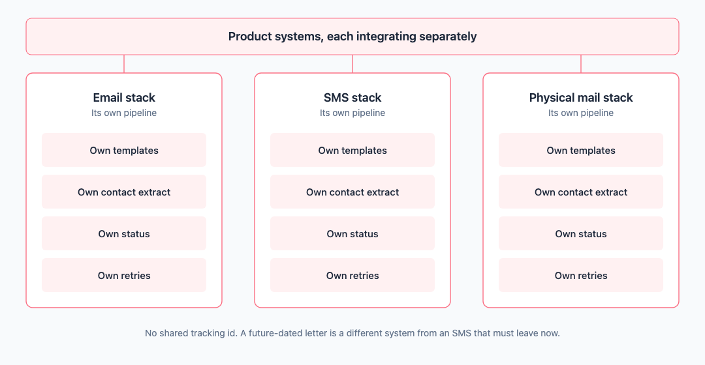
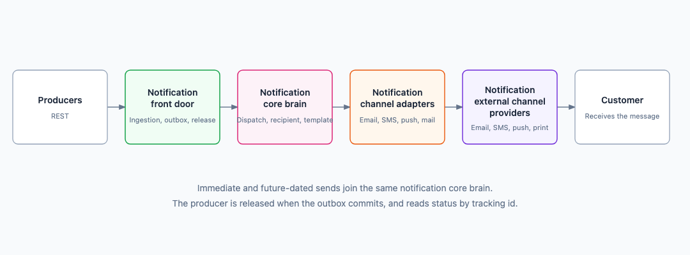

# Customer Communication Platform

## Executive summary

Endorse one notification platform for every product system, and approve the first release: real-time email and SMS, with one tracking id and a status the producer can read.

A product system submits a notification once. The platform stores that intent, resolves the customer, renders the template, and hands the message to the right channel. The same path sends a message now or at a future time. Email, SMS, push and physical mail are adapters, not separate systems.

Full case: [business use case](./01-business-use-case.md). Design: [reference architecture](./02-reference-architecture/index.md).

## The problem

**Each channel is its own stack.** Email, SMS, push and letters each have their own templates, their own copy of the customer's contact details, and their own status. A producer that must send both an email and a letter integrates twice, and cannot answer "what happened to this notification?"

- **Producers integrate once per channel.** A payment, a statement and a service alert each grow their own email, SMS and letter code.
- **Status is local to the channel.** There is no single tracking id from accept through to the provider.
- **A crash can lose or repeat the send.** The decision to send and the handoff to the provider are not one commit. A failure in between drops the message or sends it twice.
- **Future-dated sends are a special case.** A letter that must leave on a given day is a different job from an SMS that must leave now.
- **A new channel is a new system.** Push, or a new provider, is another copy of templates, preferences and retries.

## The solution

The notification front door accepts the intent. Ingestion, the outbox and release sit inside it, and Kafka carries the event. The notification core brain resolves the recipient, renders the template and dispatches one message per channel. An individual adapter submits to a notification external channel provider.

- **Notification front door.** Product systems call one ingest API, over REST, and read status by tracking id. The accept writes the notification and an outbox row in one database transaction.
- **Real-time and scheduled on one path.** Inside the front door, the outbox sends immediate notifications and release polls rows that have become due. Both publish to Kafka. From there the notification core brain is the same.
- **Notification core brain.** Three parts. The notification core dispatcher writes the channel outbox. Notification recipient resolution returns the addresses that may be used. Notification template resolution renders the content. Individual adapters submit to the notification external channel provider.
- **One adapter per channel.** Email, SMS, push and physical mail are individual adapters behind one result event. A new channel is another adapter.

The platform buys the notification external channel providers and places them behind the adapters. It builds the notification front door, the notification core brain, the individual adapters, and the status the producer reads.

## Benefits

| Area | Outcome | How we will know |
|------|---------|------------------|
| Producer teams | One integration for every channel, including a future send time | A new producer sends email and SMS without a second project |
| Customer | The right message, on the channel they can be reached on | Messages follow contact preferences and suppression |
| Operations | One status for accept, dispatch and provider result | Every accepted notification is readable by its tracking id |
| Cost | One pipeline instead of a stack per channel | Fewer channel-specific services to run and change |
| Risk | An accepted notification is not lost, and a retry does not double-send | Outbox age stays inside target. Duplicate provider submits stay at zero |

These targets are illustrative and will be confirmed with the business.

## Delivery approach

Each release stands on its own.

| Release | What goes live |
|---------|----------------|
| 1. Real-time email and SMS | Ingestion, status, the outbox, the notification core brain, and the email and SMS adapters |
| 2. Scheduled sends and push | Release, future-dated notifications, and the push adapter |
| 3. Physical mail and receipts | The physical-mail adapter, and provider receipts that move a message from sent to delivered or failed |

| Risk | How it is managed |
|------|-------------------|
| A retry sends the message twice | The tracking id is idempotent. Publishers claim a row once. Consumers ignore a repeated event |
| The provider is down | The channel outbox retries. Status stays in progress until the provider accepts or the retry ends |
| Contact data is wrong or suppressed | Notification recipient resolution returns only an allowed address. The dispatcher does not invent one |
| The programme is large | Email and SMS ship first. Scheduled sends, push and physical mail follow on the same path |
