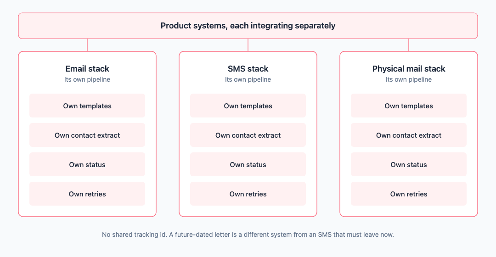
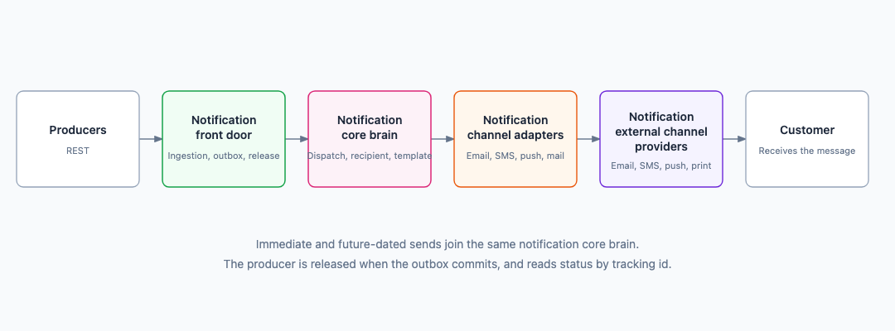
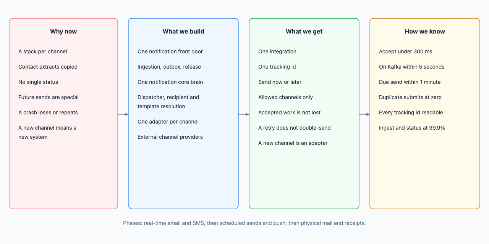

# Customer Communication Platform — Business Use Case

**In one line:** One platform that lets every product system notify a customer on email, SMS, push or physical mail, now or at a future time, with one tracking id from accept to the provider result.

**Context:** Product systems already send customer messages, including the [payments platform](../../modern-payment-platform/docs/00-exec-brief.md). Each channel has grown its own templates, contact extract and status. This platform replaces those stacks with one notification front door, one notification core brain and one adapter per channel.

---

## 1. How notification works today

Email, SMS and physical mail are separate systems. A producer that needs more than one channel integrates more than once, stores more than one status, and cannot treat a future-dated letter the same way it treats an immediate SMS.

Push, where it exists, is a fourth stack. Preferences and suppression are copied, so a customer who opts out of SMS can still be texted by a system that has an old extract.

---

## 2. Why now

| Driver | What is happening | What it means |
|--------|-------------------|---------------|
| **Every product sends messages** | Payments, servicing, onboarding and statements each notify the customer | Each new product repeats the same email, SMS and letter build |
| **Customers expect one conversation** | The same event often needs an email and a message on the phone | Two stacks means two templates, two failures and two statuses |
| **Preferences have to be honoured** | A suppressed channel, or a stale address, is a complaint and a compliance issue | Contact choice has to be resolved at send time, not copied into each producer |
| **Sends must be provable** | Operations and audit ask whether a required notice left, and when | A tracking id has to survive from the producer's call to the provider result |
| **Scheduled notices are normal** | Statements, reminders and letters leave on a date, not at the moment of the request | A future send has to be durable. A polling job in each producer is not |

---

## 3. What we will build

Producers call one Notification front door. The platform commits the intent, publishes it through an outbox, and one notification core brain does the rest.

- **Notification front door.** REST in. Status by tracking id. The notification and its outbox row commit together.
- **Outbox and release, inside the front door.** Immediate rows are published as they are committed. Due rows are published when their send time arrives. Both land on the same Kafka topic.
- **Notification core brain.** Three parts. The notification core dispatcher writes one channel message per channel. Notification recipient resolution returns the address. Notification template resolution renders the content.
- **Notification channel adapters.** An individual adapter for email, SMS, push and physical mail submits to a notification external channel provider and publishes the result.

The notification external channel providers are bought. The front door, the core brain, the adapters and the status model are built.

---

## 4. Who benefits

| Stakeholder | Pain today | With the new platform |
|-------------|------------|-----------------------|
| **Customers** | Duplicate messages, messages on a channel they opted out of, and no way for staff to say what was sent | One send per intent, on an allowed channel, with a record of the result |
| **Product teams** | A project per channel, and a one-off scheduler for anything future-dated | One API. A template id, a customer id, and an optional send time |
| **Operations** | A different console per channel, and no single answer for "did it send?" | One status by tracking id, from accept to provider result |
| **Compliance and audit** | Hard to prove a required notice was sent, and to whom | The request, the template version and the provider result are kept against the tracking id |
| **Technology** | Templates, retries and contact extracts are copied in every producer | One pipeline. A new channel is an adapter |

---

## 5. Business use cases

| # | Use case | Channels | Outcome |
|---|----------|----------|---------|
| 1 | **Tell the customer now**, such as a payment or a one-time code | Email, SMS, push | The message leaves as soon as the provider accepts it |
| 2 | **Send on a date**, such as a statement or a reminder | Email, physical mail | The intent is stored when the producer calls, and leaves when it is due |
| 3 | **Reach the customer on the allowed channel** | Whichever notification recipient resolution returns | A suppressed or missing address is not guessed |
| 4 | **One event, more than one channel** | Email and SMS, or email and a letter | One tracking id, one status, one result per channel |
| 5 | **Answer "what happened to this notice?"** | Any | Status is readable from the tracking id for the life of the record |
| 6 | **Add a channel or a provider** | Push, or a replacement email provider | A new adapter behind the same notification core brain. Producers do not change |

---

## 6. Benefits

Read it left to right. Separate channel stacks, copied contact details and no single status lead to one Notification front door, one notification core brain and one adapter per channel. Each benefit has a measure, and value is released in three phases. [Open the full diagram](pathname:///customer-communication-platform/diagrams/business-value-map.html).

| Area | Benefit | How the platform delivers it | How we measure it |
|------|---------|------------------------------|-------------------|
| **Producer teams** | One integration | REST, a tracking id, and a status read | Time for a new producer to send on two channels |
| **Customer** | Relevant, allowed messages | Notification recipient resolution returns the address at send time | Complaints about duplicates and suppressed channels |
| **Operations** | One place to look | Status on the notification the front door stored | Share of sends that can be answered from the tracking id |
| **Risk** | No lost and no double send | Transactional outbox, a single claim on each row, idempotent consumers | Outbox older than the target. Duplicate provider submits |
| **Compliance** | A record of the notice | Template version, recipient and provider result kept with the tracking id | Audit requests answered from the notification record |
| **Agility** | A new channel is an adapter | Workers submit to a provider and publish one result event | Time to add a channel without a producer change |

---

## 7. Measures of success

Illustrative targets, to be confirmed with the business.

| Measure | Target |
|---------|--------|
| Accept | The ingest call returns after the database commit, in under 300 ms at the 95th percentile |
| Publish | An immediate notification is on Kafka within 5 seconds of accept |
| Scheduled | A due notification is published within 1 minute of its send time |
| Provider | Email and SMS are accepted by the provider within 30 seconds of publish, at the 95th percentile, when the provider is healthy |
| Duplicates | One provider submit per channel message, including retries of the publisher |
| Status | Every accepted tracking id can be read, including failed and scheduled |
| Availability | 99.9% for ingest and status |

---

## 8. Cost of not acting

- Every new product builds email, SMS and letters again.
- Opt-outs live in extracts, so they are late or missing.
- Operations cannot answer, from one record, whether a required notice was sent.
- A failure between "we decided to send" and "the provider accepted" loses the message or sends it twice.
- A future-dated notice stays as a scheduler inside each producer.

---

## 9. Phased value delivery

| Phase | What goes live | Value released |
|-------|----------------|----------------|
| **1. Real-time email and SMS** | Ingestion, status, outbox, notification core brain, email and SMS adapters | One integration for the two channels most producers need, with a tracking id |
| **2. Scheduled sends and push** | Release, future send time, push adapter | Notices that must leave on a date, and messages on the phone, on the same path |
| **3. Physical mail and receipts** | Physical-mail adapter, provider delivery receipts | Letters without a separate stack, and a status that can move from sent to delivered or failed |

---

## 10. Risks and how they are managed

| Risk | Mitigation |
|------|------------|
| Producers send a finished message body instead of a template id | Confirm the contract early. A pre-rendered body skips the template call and is an explicit exception, not the default |
| Recipient resolution is slow or wrong | The dispatcher does not send without an address it returned. A timeout retries, then fails the notification |
| Two publishers claim the same row | The claim is `SKIP LOCKED` in one database statement. The row moves to claimed before the Kafka publish |
| A provider retry looks like a new send | The adapter sends the provider its own idempotency key, the channel message id |
| Physical mail cannot be recalled after handoff | Status for that channel stops at accepted by the print provider, unless the provider returns a later receipt |
| A producer retries the ingest after a timeout | The same tracking id returns the original notification and does not write a second outbox row |

---

## Related pages

- [Executive brief](./00-exec-brief.md): a short version of this page.
- [Reference architecture and solution design](./02-reference-architecture/index.md): the services, the numbered flow and the technology. Its child pages cover the [notification front door](./02-reference-architecture/01-notification-api.md), the [notification core brain](./02-reference-architecture/03-orchestrator.md), [notification channel adapters](./02-reference-architecture/05-channels.md), [notification external channel providers](./02-reference-architecture/06-external-channel-providers.md) and the [priority lane design](./02-reference-architecture/priority-lane-design.md).
