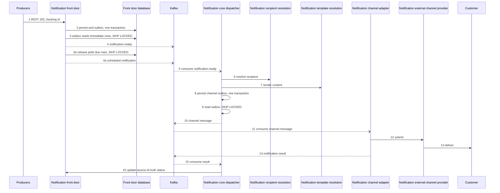

# Customer Communication Platform — Reference Architecture and Solution Design

**Scope:** The services that accept a notification, carry it through an outbox onto Kafka, resolve the recipient, render the template, and submit it to a channel provider. The design is **cloud agnostic**. [Section 10](#10-cloud-mapping) maps the stateful building blocks to AWS, Azure and Google Cloud.

**Context:** Product systems notify a customer by email, SMS, push or physical mail, immediately or at a future time. The [executive brief](../00-exec-brief.md) is the short version, and the benefits are in the [business use case](../01-business-use-case.md). How to design each part is on the [notification front door](./01-notification-api.md), the [notification core brain](./03-orchestrator.md), [notification channel adapters](./05-channels.md), [notification external channel providers](./06-external-channel-providers.md) and the [priority lane design](./priority-lane-design.md).

**Design rule:** The Notification front door is the only writer of the producer-facing notification. The notification core brain is the only service that resolves a recipient and renders a template. A notification channel adapter submits to a provider and does not choose the address or the content.

---

## How to read the flow

Read the picture from top to bottom. Producers call the front door. The front door publishes to Kafka. The notification core brain consumes that event, calls recipient resolution and template resolution, then publishes one channel message. The channel adapter consumes it and calls the external provider. Kafka sits on the right as the backbone. The front door, the brain and the adapters all publish and consume through it. Solid arrows are synchronous calls and database writes. Dotted arrows are Kafka. Steps **3a** and **4a** are the scheduled, future-dated path. From step 5 onward both paths are the same.

[Open the diagram](pathname:///customer-communication-platform/diagrams/end-to-end-sequence.html).

| Step | What happens | Kind |
|------|----------------|------|
| 1 | The producer calls the Notification front door over REST, with a tracking id. The call returns `202` | Synchronous |
| 2 | Ingestion writes the notification and the outbox row in one transaction | Database |
| 3 | The outbox, inside the front door, claims immediate rows with `SKIP LOCKED` | Database |
| 3a | Release claims rows whose send time has arrived, with `SKIP LOCKED` | Database |
| 4 | The outbox puts `notification.ready` on Kafka | Kafka |
| 4a | Release puts the same event on Kafka for a scheduled notification | Kafka |
| 5 | The notification core dispatcher consumes `notification.ready` | Kafka |
| 6 | Notification recipient resolution returns the addresses that may be used | Synchronous, inside the core brain |
| 7 | Notification template resolution renders the content | Synchronous, inside the core brain |
| 8 | The dispatcher writes one channel outbox row per channel, in one transaction | Database |
| 9 | The dispatcher claims those rows with `SKIP LOCKED` | Database |
| 10 | It publishes one channel message | Kafka |
| 11 | The notification channel adapter consumes the message for its channel | Kafka |
| 12 | The adapter submits to the notification external channel provider | Synchronous |
| 13 | The provider delivers to the customer | Provider |
| 14 | The adapter publishes `notification.result` | Kafka |
| 15 | The notification core dispatcher consumes the result and calls the notification front door, which updates the source-of-truth row | Kafka, then synchronous |

---

## Assumptions

The design rests on the assumptions below. Confirm each one with the business and the owning teams. The last column shows what changes if an assumption is wrong.

| # | Area | Assumption | If it does not hold |
|---|------|------------|---------------------|
| 1 | Producers | Existing product systems call REST. They are not rebuilt here. Customers do not call this API | A new producer channel needs its own client. A customer-facing send would need a different front door |
| 2 | One intent | A request is one customer, one template, an optional channel list, an optional send time, and a tracking id | A batch file of many customers is a producer-side loop of this request, or a later bulk ingest |
| 3 | Customer master | Notification recipient resolution, inside the notification core brain, owns addresses, device tokens, preferences and suppression. The front door does not keep a copy | Without that part, the dispatcher has nowhere safe to resolve a recipient, and that part is built first |
| 4 | Templates | Producers send a template id and data. Notification template resolution, inside the core brain, renders the channel content, including the version that was sent | A producer that must send a finished body skips template resolution. That path is an exception with its own audit |
| 5 | Providers | Email, SMS and push go through a notification external channel provider. Physical mail goes through a print provider. Providers are replaceable behind the adapter | Building a send capability in-house replaces the provider call. The adapter boundary stays |
| 6 | Scheduled sends | A future send time is stored on the notification and published by release, inside the front door, when it falls due. The notification core brain does not have a second pipeline | A send window that depends on a business calendar lives in release's due query, not in each producer |
| 7 | Volumes | Peak volume is not yet sized. The front door, the core brain and each adapter scale horizontally. Kafka partitions hold the topics | A much higher peak needs more partitions and a load test before that producer is onboarded |
| 8 | Hosting | The platform runs Kubernetes, PostgreSQL and Kafka in the required region, or the managed services in [section 10](#10-cloud-mapping) | A different runtime still has to offer a transactional database with `SKIP LOCKED` and a log the consumers can replay |
| 9 | Delivery meaning | Sent means the provider accepted the message. A later receipt can move it to delivered or failed. Physical mail stops at accepted unless the print provider returns a receipt | A producer that needs proof of opening needs a provider that supplies that event. The result topic can carry it |

---

## 1. Architecture principles

1. **Accept is a database commit.** The notification and its outbox row are one transaction. Kafka being down does not lose an accepted notification.
2. **One claim per row.** Publishers take work with `FOR UPDATE SKIP LOCKED`. A second instance cannot claim the same row.
3. **The notification core brain decides the message.** It resolves the recipient and renders the template. Producers do not.
4. **One adapter per channel.** The adapter speaks to the provider. It does not choose the template, the address or a fallback channel.
5. **Each part owns its data.** The front door database is the producer-facing source of truth. The notification core dispatcher has its own database. Neither reads the other's tables.
6. **Consumers are idempotent.** A repeated Kafka record for the same notification id and step does not cause a second provider submit.
7. **Scheduled joins the same path.** Steps 3a and 4a only change who publishes `notification.ready`. Step 5 onward does not know which publisher wrote the event.
8. **Status is written by the front door.** After step 15 the notification core dispatcher calls the front door. The front door updates the row the producer reads.

---

## 2. Service architecture

The parts that carry a notification match the flow above. Ingestion, outbox and release sit inside the notification front door. Recipient resolution and template resolution sit inside the notification core brain. Kafka stays the event backbone. It is not a page of its own.

| # | Component | Responsibility |
|---|-----------|----------------|
| 1 | Producers | Product systems. They submit a notification and read its status. They do not render it or call a provider |
| 2 | Notification front door | Ingestion, outbox, and release. Ingestion accepts and returns status. The outbox publishes immediate rows. Release publishes rows whose send time has arrived |
| 3 | Front door database | Source of truth for the producer-facing notification and the ingest outbox |
| 4 | Kafka | Event backbone. Carries ready, channel and result records |
| 5 | Notification core brain | Three parts. The notification core dispatcher consumes ready events, writes channel rows and applies results. Notification recipient resolution returns the addresses the customer can be reached on. Notification template resolution renders approved content for one channel |
| 6 | Notification channel adapters | One adapter each for email, SMS, push and physical mail |
| 7 | Notification external channel providers | Accept the message and deliver it to the customer |

What each part must refuse, and the fields on each call, are on the design pages.

Boundaries that hold across the catalogue:

1. The notification front door authenticates the producer and deduplicates on the tracking id. It does not resolve an address or render a template.
2. Outbox and release, inside the front door, read the ingest outbox, and they read disjoint rows.
3. Only the notification core dispatcher calls notification recipient resolution and notification template resolution.
4. An individual adapter submits one channel message. It does not fan out to another channel.
5. A notification external channel provider is reached only from its adapter.
6. The producer reads status only from the notification front door.

---

## 3. Consistency, time and state

### 3.1 Where a caller waits

| Caller | Waits until | Does not wait for |
|--------|-------------|-------------------|
| A producer ingesting | The notification and the outbox row are committed | Kafka, the notification core brain, or the provider |
| A producer reading status | The current row | A provider call made during the read |
| The outbox, inside the front door | The row is claimed and the Kafka ack is back, then the row is marked published | The notification core dispatcher |
| The dispatcher on steps 6 and 7 | Notification recipient resolution and notification template resolution respond | The provider |
| The notification channel adapter | The provider accepts or rejects the submit | The customer opening the message |

The producer is released at the commit. Status moves to `IN_PROGRESS` when the notification core brain has dispatched, to `SENT` when the provider accepts, and to `FAILED` when resolution, rendering or the provider fails for good. A future send time is `SCHEDULED` until release publishes it.

### 3.2 If a step does not answer

| Step | If it does not answer | What the producer sees |
|------|----------------------|------------------------|
| Ingest, before commit | The call fails. Nothing is stored | The producer retries with the same tracking id |
| Ingest, after commit, before the response | The row exists | The retry returns the original notification |
| The outbox cannot reach Kafka | The row stays claimed, then returns to pending | `RECEIVED`. Nothing is lost |
| Recipient or template resolution | The dispatcher retries, then fails the notification | `FAILED`, with the reason |
| Provider | The adapter retries with backoff, then publishes a failed result | `IN_PROGRESS`, then `FAILED` or `SENT` |
| Status call from the notification core brain | The notification core brain retries. The result event remains the record | Status catches up. The provider is not called again |

A claim that crashes after the Kafka ack and before the row is marked published will publish again. Consumers ignore a duplicate `notification.ready` for a notification they have already taken. The adapter's submit uses the channel message id as the provider idempotency key, so a duplicate channel record does not send a second message.

### 3.3 Status

| Status | Meaning |
|--------|---------|
| `RECEIVED` | Committed. The outbox has not finished |
| `SCHEDULED` | Committed with a future send time. Waiting for release |
| `IN_PROGRESS` | The notification core brain has taken it, or a channel has been handed to an adapter |
| `SENT` | Every requested channel was accepted by its provider |
| `FAILED` | A channel failed and will not be retried, or the recipient or template could not be resolved |

A notification with two channels stays `IN_PROGRESS` until each channel has a result. One failed channel and one sent channel is `FAILED`, and the status body shows both channel results. The producer can see which channel failed.

---

## 4. Topics

| Topic | Producer | Main consumers | Key |
|-------|----------|----------------|-----|
| `notification.ready` | Outbox, and release for a due row, both inside the front door | Notification core dispatcher | Notification id |
| `notification.channel` | Notification core brain outbox | The adapter for that channel | Notification id |
| `notification.result` | Notification channel adapter | Notification core brain | Notification id |

The key is the partition key, so one notification's records stay in order on that topic. Schemas are versioned and change in backward-compatible ways. A topic is a replay window. The notification row, the notification core brain row and the provider reference are the record. A failed status update retries from the result event. It does not submit to the provider again.

`notification.ready` carries a flag so a consumer can see that release published it. The dispatcher treats both flags the same.

---

## 5. Data architecture

| Data | Store | Notes |
|------|-------|-------|
| Notification and ingest outbox | Front door database, PostgreSQL | The row the producer reads. One database, owned by the notification front door |
| Dispatch and channel outbox | Notification core dispatcher database, PostgreSQL | Channel rows, template version, provider references |
| Customer contacts | Notification recipient resolution | Read in step 6, inside the core brain. Not copied into the notification as a master |
| Templates | Notification template resolution | The render response includes the template version, which the dispatcher stores |
| Events | The topics in [section 4](#4-topics) | Replay window. Not the system of record |

The outbox claim, on both databases, is one statement: select pending rows with `FOR UPDATE SKIP LOCKED`, mark them claimed, then publish, then mark them published. The front door outbox selects rows with no future send time. Release selects rows whose send time is due. A row is in only one of those sets.

---

## 6. Deployment and failure domains

| Concern | Design |
|---------|--------|
| Compute | Kubernetes. The front door, the notification core brain and each channel adapter scale on their own |
| Front door database | PostgreSQL, highly available in the region. This is the source of truth for status |
| Notification core brain database | A separate PostgreSQL database. A failure here stops new dispatch. Already accepted notifications remain readable |
| Kafka | The backbone between the outbox and the consumers. A broker loss does not roll back an accepted notification |
| Providers | Outside the platform. An adapter timeout uses the retry in [section 3.2](#32-if-a-step-does-not-answer) |
| Recovery | Restore the front door database and the dispatcher database, then let the outbox and release drain pending rows. Replay is idempotent |

| Failure | What stops | What continues |
|---------|------------|----------------|
| One API instance | Nothing the producer can see, once the load balancer drains it | Other instances |
| Kafka | New publishes | Accept and status. Outbox rows wait |
| Notification recipient resolution | New dispatch | Accept, status, and messages already at the provider |
| One channel provider | That channel | The other channels, and ingest |
| The region | New accepts, until the database is restored | Nothing is accepted in a region that cannot commit |

---

## 7. Security

| Control | Design |
|---------|--------|
| Producer identity | Each producer authenticates. Customers have no credential on this API |
| Authorisation | A producer may submit and read the tracking ids it owns |
| Recipient | Notification recipient resolution applies preferences and suppression. The dispatcher sends only to an address that part returned |
| Content | Templates are approved in notification template resolution. The render stores the version on the dispatcher row |
| Data | TLS in transit. Encryption at rest. The channel message carries the rendered destination only as far as the adapter |
| Provider | Credentials live in a secrets manager. An adapter cannot read another channel's provider secret |
| Audit | The request, the caller, the template version, the channel results and the provider reference are kept with the tracking id |

The Notification front door is an internal API for product systems. It is not a public customer edge, so this design does not add a public CDN or a paid DDoS subscription in front of it.

---

## 8. Observability

- Traces, metrics and logs leave each service through OpenTelemetry. The tracking id is on every span.
- The age of the oldest pending outbox row, on both databases, is a primary signal. A rising age means publish has stalled and accepted notifications are waiting.
- Release reports how far it is behind due time.
- Alerts follow the symptom: outbox age, release lag, a rising `FAILED` rate, provider error rate, and a consumer that stops committing its offset.

| Signal | Alert when |
|--------|------------|
| Ingest | Error rate or latency above target |
| Ingest outbox | Oldest pending row older than 30 seconds |
| Release | A due row unpublished more than 2 minutes past its send time |
| Notification core brain | Customer-details or template errors above target |
| Channel | Provider errors above target for 10 minutes |
| Results | `FAILED` share rising against accepted volume |

---

## 9. Technology stack

Each row is the chosen product for that job.

| Building block | Choice | Constraint |
|----------------|--------|------------|
| Runtime | Kubernetes | A conformant distribution, in the required region |
| Notification store | PostgreSQL | `SKIP LOCKED` for the ingest outbox. One database for the front door |
| Dispatcher store | PostgreSQL | A second database. Same claim pattern for the channel outbox |
| Event backbone | Apache Kafka | The three topics in [section 4](#4-topics) |
| Producer ingress | REST | Returns `202` and the tracking id once the outbox row is committed |
| Recipient resolution | Inside the notification core brain | Addresses, preferences and suppression. Called only by the dispatcher |
| Template resolution | Inside the notification core brain | Versioned renders. Called only by the dispatcher |
| Channel providers | The contracted email, SMS, push and print providers | Behind the adapter. Replaceable |
| Secrets | The enterprise secrets manager | Provider credentials and API client secrets |
| Observability | OpenTelemetry | One trace per tracking id |

---

## 10. Cloud mapping

Managed equivalents for a team that does not want to operate Kafka and PostgreSQL. The services stay the same.

| Building block | AWS | Azure | Google Cloud |
|----------------|-----|-------|--------------|
| Kubernetes | Amazon EKS | Azure Kubernetes Service | Google Kubernetes Engine |
| PostgreSQL | Amazon Aurora PostgreSQL or RDS | Azure Database for PostgreSQL | Cloud SQL or AlloyDB |
| Kafka | Amazon MSK | Event Hubs (Kafka endpoint) or Confluent Cloud | Managed Service for Apache Kafka |
| Secrets | AWS Secrets Manager | Azure Key Vault | Secret Manager |
| Observability | CloudWatch, or an OpenTelemetry backend | Azure Monitor | Cloud Monitoring |

Use the managed service through its open interface: the PostgreSQL wire protocol, the Kafka protocol and OpenTelemetry. The outbox claim depends on `SKIP LOCKED`, which these PostgreSQL services provide.

---

## 11. Architecture decisions

| # | Decision | Alternative rejected | Reason |
|---|----------|----------------------|--------|
| 1 | Commit the notification and the outbox in one transaction | Publish to Kafka inside the ingest request | A failed publish after a successful response would lose the notification, or the producer would time out on Kafka |
| 2 | `SKIP LOCKED` as the claim | A single locked publisher, or a poller in each producer | More than one publisher can run, and a row is claimed once |
| 3 | Release publishes onto the same topic | A separate scheduler and pipeline for future sends | Steps 5 onward would be built twice |
| 4 | The notification core brain resolves and renders | Producers send a finished body and a raw address | Preferences, suppression and the template version would be different in every producer |
| 5 | One adapter per channel | One process that talks to every provider | A provider outage or a new channel would land in the same process as the others |
| 6 | The front door database is the status producers read | Producers read the dispatcher database, or Kafka | One source of truth, and the dispatcher can fail without hiding an already accepted notification |
| 7 | Provider idempotency key is the channel message id | Rely on the provider to deduplicate the body | A retried submit must not deliver a second message |

Record each as an ADR once it is agreed. The design pages follow this list.
