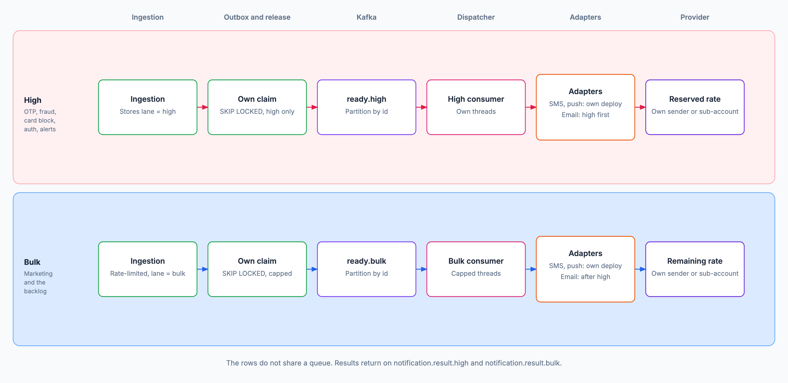

# Priority lane design

A daytime backlog on one topic is FIFO. Draining it quickly still leaves an OTP or a fraud alert behind the marketing mail accepted first. This page splits that path into two lanes, **high** and **bulk**, and keeps the split through to the notification external channel provider.

The [reference architecture](./index.md) describes the single path. This page is the design for the split. The other pages stay the default until this one is adopted.

[Open the diagram](pathname:///customer-communication-platform/diagrams/priority-lanes.html).

## Lanes

| Lane | What it carries | What it is for |
|------|-----------------|----------------|
| `high` | OTP, fraud, card block, auth, alerts | A time-sensitive message that must leave while a campaign is in progress |
| `bulk` | Everything else, including marketing, statements, servicing, consent, and the daytime backlog | Volume that can wait minutes |

The field on the notification and on the outbox row is `lane`. Producers do not send it. Ingestion derives it once from `classification` and stores it. Later steps read `lane`. They do not derive it again.

| Classification | Lane |
|----------------|------|
| `FRAUD`, `OTP`, `CARD_BLOCK`, `AUTH`, `ALERT` | `high` |
| `MARKETING`, `STATEMENT`, `SERVICING`, `CONSENT` | `bulk` |
| Missing, or any other value | `bulk` |

A missing classification is bulk. Unknown traffic does not enter the high lane. A producer is allowed to send a high classification only when that producer and template are on the high allow-list. Anything else is stored as bulk.

## How a notification moves

1. Ingestion writes the notification, the outbox row, and `lane` in one transaction.
2. The outbox claims immediate rows with `SKIP LOCKED`, one claim for `high` and one claim for `bulk`. Release does the same when a send time falls due. A due bulk row stays on the bulk lane.
3. The claim publishes `notification.ready.high` or `notification.ready.bulk`. Partition by notification id inside the lane.
4. The notification core dispatcher consumes the lane it is assigned, calls notification recipient resolution and notification template resolution, and publishes `notification.channel.<channel>.high` or `notification.channel.<channel>.bulk`.
5. The notification channel adapter for that channel and lane submits to the provider.
6. The provider delivers. The result returns on `notification.result.high` or `notification.result.bulk`, and the dispatcher updates the notification front door.

High and bulk are not ordered against each other. A bulk message accepted earlier can leave after a high message accepted later. That reordering is the point of the lane.

## Where the lane stays separate

A lane only works if it survives to the provider. If the two streams share a queue, a thread pool, or a rate limit at any hop, the high message waits behind bulk.

| Hop | High | Bulk |
|-----|------|------|
| Ingestion | Reserved share of front-door capacity. Bulk producers are rate-limited | Capped so a campaign cannot take every connection |
| Outbox and release | Own claim, own publisher, `notification.ready.high` | Own claim, capped, `notification.ready.bulk` |
| Notification core dispatcher | Own consumer. Always running. Own concurrency limit on recipient resolution and template resolution | Own consumer. Capped. Does not borrow the high consumer's threads |
| SMS and push adapters | Own deployment and consumer group | Own deployment and consumer group. Bulk cannot use the high pods' threads or CPU |
| Email adapter | Same deployment as bulk for that channel | That deployment drains high before it takes bulk |
| Notification external channel provider | Reserved rate, or its own sender id or sub-account | The remaining rate, or its own sender id or sub-account |

Email can share a deployment with its bulk traffic only because that process drains high before bulk. SMS and push do not share a deployment. The provider split is required for every channel, including email. A high email submitted through the bulk sender's rate limit waits at the provider.

Example quota, to be set with the provider contract: 200 messages a second reserved for high, 50 a second for bulk. Separate sender ids or sub-accounts are the alternative when the provider will not share one account fairly.

## What this does not change

The producer still reads status from the tracking id on the notification front door. High and bulk use the same status values. The tracking id is still the idempotency key. The channel message id is still the key the adapter sends to the provider.

Lanes change who goes first. They do not add capacity. The provider quota is the ceiling. A high lane with no reserved provider rate is the shared queue again, one hop later.

## Rollout

1. Topics and the provider quotas.
2. Ingestion stores `lane` from `classification`.
3. Outbox and release publish to the lane topic.
4. The notification core dispatcher consumes and publishes per lane.
5. Adapters: separate SMS and push deployments, and email draining high first.
6. Observability: outbox age, consumer lag, and provider rate, each per lane. A high outbox older than its target is the alert. Bulk lag is not that alert.
