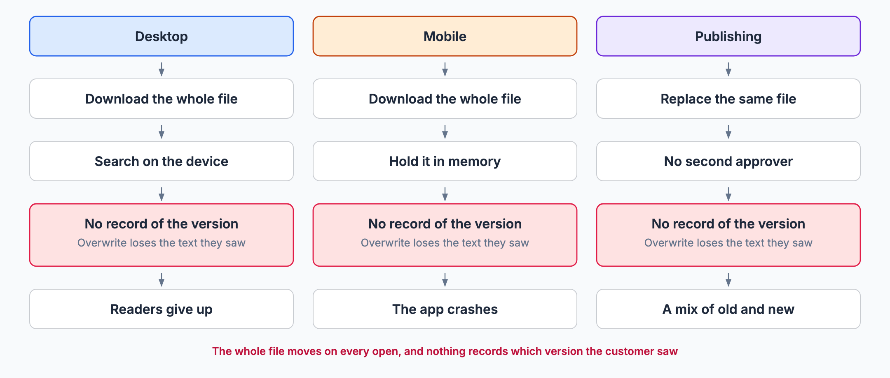
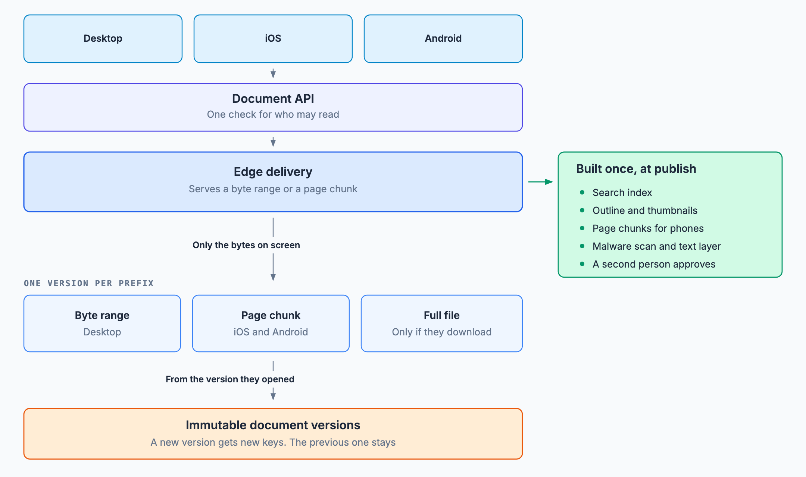

# Large PDF Delivery

## Executive summary

Endorse one way to publish and read very large documents in the desktop and mobile apps, and approve the first release: desktop reading and search, with safe publishing.

Customers open a document of about 1,000 pages in a couple of seconds. The apps fetch only the pages on screen. Search, the table of contents and thumbnails are built when the document is published, so a phone never holds the whole file. Each version is kept, and a second person approves it before it goes live.

Full case: [business use case](./01-business-use-case.md). Design: [reference architecture](./02-reference-architecture/index.md).

## The problem

**The whole file moves before anyone can read it.** A document of about 200 MB downloads onto the device. Search then reads every page locally. Publishing overwrites the file, so there is no clean record of which version a customer saw.

- **Customers expect the first page immediately.** A download that finishes before page 1 feels broken. Many people give up.
- **Phones cannot hold the file.** Lower-end devices run out of memory and crash. The app rating and the support queue both suffer.
- **Search forces the full download.** The viewer finds words by reading every page, which pulls the rest of the file onto the device.
- **Delivery cost grows with every reader.** Each session can move about 200 MB even when the reader looks at 30 pages.
- **The organisation cannot prove the version.** Product terms, a policy wording or a handbook can change. Without an immutable version and an audit event, there is no record of what the customer opened.

:::note
**A linearised PDF** is arranged so the first pages, and the index of where later pages sit, can be fetched without the rest of the file. That speeds the first page. A jump to a later page still needs a range request.

**A page chunk** is a small PDF, about 25 pages, built when the version is published. iOS and Android viewers open a local file. They do not fetch arbitrary byte ranges from a 200 MB document, so the phone downloads one chunk at a time.
:::

## The solution

Publish once. On a read, decide who may open the document, then serve only the bytes for the pages on screen.

- **Document API.** The apps ask one API for the current version, search, bookmarks and a short-lived access cookie. The API is the only place that decides who may read.
- **Edge delivery.** Desktop fetches byte ranges of the linearised file. Mobile fetches pre-built page chunks. One cached copy is shared by every entitled reader. The cookie is not part of the cache key.
- **Built once, at publishing.** Malware scan, removal of active content, a text layer for scanned pages, the outline, thumbnails, the search index and the mobile chunks are produced before anyone reads. Linearisation is the last change to the file.
- **Immutable versions.** Each version gets new storage keys. A second person approves it. Readers already in a session finish on the version they opened. The next open sees the new version.

We use ordinary document tools for scan, OCR and PDF processing, and place them inside the pipeline. We build the API, the access check, the viewers and the publishing flow.

## Benefits

| Area | Outcome | How we will know |
|------|---------|------------------|
| Customer | First page in about two seconds, on desktop or a phone | 95th percentile under 2 seconds on broadband, under 3 seconds on 4G |
| Customer | Find a clause without downloading the document | Search under 500 ms, with a page number and a snippet |
| Cost | A session moves the pages being read, not 200 MB | Under 10% of the file per session |
| Support | Documents open and search reliably | Fewer calls about opening or finding text |
| Risk | No malware and no active content reaches a reader | Zero unsafe files published |
| Compliance | Proof of which version was opened or downloaded | Audit requests answered from records |
| Inclusion | Screen-reader users can read and search | WCAG 2.2 AA in the viewer |
| Agility | A new version is a pipeline run and an approval | Time from upload to live |

These targets are illustrative and will be confirmed with the business. A cost sketch is in the [business use case](./01-business-use-case.md#6-benefits).

## Delivery approach

Each release stands on its own.

| Release | What goes live |
|---------|----------------|
| 1. Desktop | Ingestion, the document store, edge delivery, the Document API, the desktop viewer, server search, reading progress |
| 2. Mobile | Page chunks, iOS and Android viewers, continuous scrolling across chunks |
| 3. Hardening | OCR for scanned pages, an optional offline copy, bookmarks that follow a new version, dashboards and a load test |

| Risk | How it is managed |
|------|-------------------|
| The document turns out to be personalised per customer | Confirm before build. Personalisation stops the shared cache and changes the design |
| Annotation, forms or signing becomes a requirement | That needs a commercial viewer. Confirm the scope before building the free viewers |
| The content network cannot check a token at the edge | Use the token-checking proxy described in the reference architecture |
| A badly built source PDF | The pipeline flags huge images and a missing outline so a publisher can fix the source |

Waiting has a cost. Readers keep abandoning the document or calling for help. Delivery charges grow with every new reader. An unscanned upload remains a risk to the customer's device. Without versions, the organisation still cannot show what a customer was given.

## Decision required

1. Endorse one document platform for large PDFs in the desktop and mobile apps.
2. Approve the first release, desktop reading and search, to proceed.
3. Name an executive sponsor and the business owner for the success measures.
