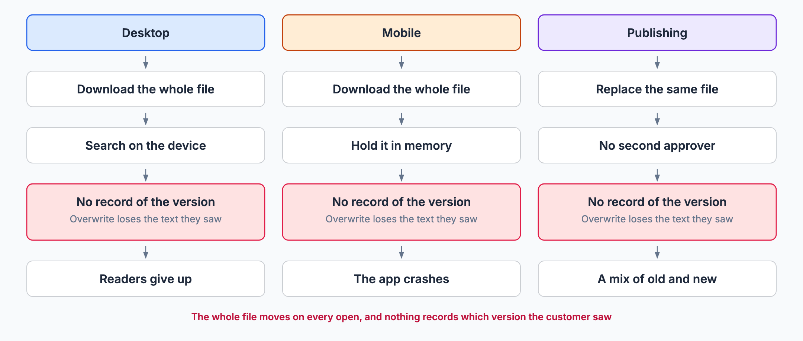
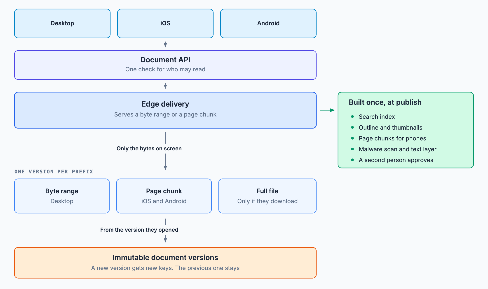
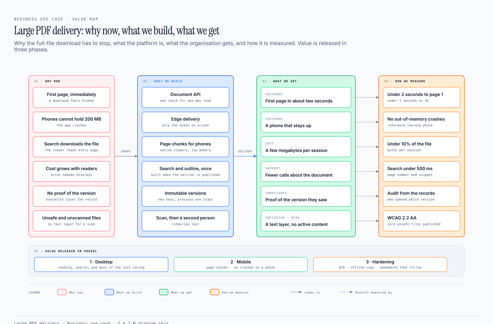

# Large PDF Delivery — Business Use Case

**In one line:** Customers can open, search and read a very large document in the desktop and mobile apps in a couple of seconds, without downloading the whole file, while the business can publish new versions safely and prove who read which version.

**Context:** The organisation publishes a very large PDF (about 1,000 pages, up to roughly 200 MB), such as product terms, a policy wording, a technical manual or a regulatory handbook. Customers need it inside the existing apps. Internal administrators publish a new version from time to time. The document is the same for every entitled customer.

---

## 1. How documents are delivered today

The whole file moves before anyone can read it. Desktop and mobile each download about 200 MB. Search then walks every page on the device. Publishing replaces the file in place, so a reader can see a mix of old and new bytes, and the organisation cannot point at the exact version a customer opened.

A handbook, a policy wording and a product-terms PDF all work the same way today: one file, a full download, and no second person between upload and the customer.

---

## 2. Why now

| Driver | What is happening | What it means |
|--------|-------------------|---------------|
| **Customers expect the first page immediately** | People are used to opening a page, not waiting for a 200 MB download | A spinner until the file finishes feels broken. Sessions are abandoned |
| **Mobile is where they read** | The same document is opened in the iOS and Android apps, including on lower-end phones | A full file exhausts memory. The app crashes before page 1 |
| **Search is part of reading** | Readers look for a clause, a definition or a section title | Search inside the viewer downloads the rest of the file, so the progressive open is lost |
| **Delivery cost follows readers, not pages read** | Every session can move the whole object even when the reader sees 20 to 50 pages | Egress grows with audience size. Most of those bytes are never displayed |
| **The version is the record** | Terms, policies and handbooks change, and a customer may need the exact text they were shown | Overwriting the file destroys that record. There is no audit of open, search or download |
| **The file is untrusted until it is cleaned** | An uploaded PDF can carry malware, JavaScript or a launch action. Scanned pages have no text layer | Customers' devices and screen-reader users both depend on processing that happens before publish |

---

## 3. What we will build

Publish once. On a read, decide who may open the document, then serve only the bytes for the pages on screen.

- **Document API.** Desktop, iOS and Android use one API for the current version, search, bookmarks and a short-lived access cookie. The API decides who may read. The apps do not talk to the document store.
- **Edge delivery.** Desktop fetches byte ranges of a linearised file. Mobile fetches page chunks of about 25 pages. Entitled readers share one cached copy.
- **Built once, at publishing.** Scan, sanitise, a text layer where the source is scanned, outline, thumbnails, search index and chunks are produced before the first reader. Linearisation is the last change to the file.
- **Immutable versions.** Each version has its own storage keys. A second person approves the version. A reader already in a session finishes on that version.

The organisation uses ordinary scan, OCR and PDF tools inside the pipeline. It builds the API, the access check, the viewers and the publishing flow.

---

## 4. Who benefits

| Stakeholder | Pain today | With the new platform |
|-------------|------------|-----------------------|
| **Customers** | Long wait before page 1. Crashes on a phone. Search is slow. The place they reached is lost on another device | First page in about two seconds. Jump to any page. Search with a snippet. Bookmarks follow them |
| **Contact centre** | "I can't open it" and "where does it say…" calls | The document opens, and search returns a page number the agent can quote |
| **Content publishers** | File-size workarounds, and a risky overwrite | Upload, automatic checks, review by a second person, then go live |
| **Risk and compliance** | No proof of which version a customer opened or downloaded | An audit event per open, search and download, against an exact version. Old versions kept as required |
| **Technology and finance** | Full-file egress, and crash investigations | About 6 to 10 MB per session instead of 200 MB. Fewer viewer crashes |
| **Accessibility** | Scanned pages have no text. The viewer is a raw file | A text layer, including OCR where the source is a scan, and a viewer shell that meets WCAG 2.2 AA |

---

## 5. Business use cases

| # | Use case | Customer or user outcome |
|---|----------|--------------------------|
| 1 | **Open and start reading quickly** | The first page appears in about two seconds on desktop and about three on 4G |
| 2 | **Jump to any section or page** | The table of contents and page thumbnails respond without loading the whole document |
| 3 | **Search the whole document** | Results with page numbers and snippets in under half a second |
| 4 | **Pick up where I left off**, on any device | Last-read page and bookmarks sync between desktop and mobile |
| 5 | **Download for offline reading** (optional) | An encrypted copy on the device that expires when access ends |
| 6 | **Publish a new version safely** | Upload, automatic checks, review and approval by a second person, then go live |
| 7 | **Prove what a customer saw** | Every open, search and download is audited against an exact version |

---

## 6. Benefits

Read it left to right. The reasons to act shape one platform: a Document API that decides who may read, edge delivery of only the bytes on screen, and a pipeline that prepares each version once. Each benefit has a measure, and value is released in three phases. [Open the full diagram](pathname:///large-pdf-render/diagrams/business-value-map.html).

| Area | Benefit | How the platform delivers it | How we measure it |
|------|---------|------------------------------|-------------------|
| **Experience** | Fast first page | Only the bytes for the pages on screen are downloaded | Time to first page, 95th percentile |
| **Experience** | Reliable on mobile | Phones load small page chunks instead of the full file | Out-of-memory crash rate |
| **Experience** | Find information quickly | Search runs on the server against an index built at publish | Search response time. Search success rate |
| **Cost** | Far lower delivery cost | About 6 to 10 MB per session instead of 200 MB | Data delivered per session. Monthly delivery cost |
| **Cost** | Fewer support calls | Documents open and search reliably | Calls and complaints about the document |
| **Risk** | Safe content | Every upload is scanned and cleaned of active content before publishing | Zero unsafe files published |
| **Compliance** | Evidence and retention | Immutable versions and a full audit trail | Audit requests answered from records |
| **Inclusion** | Accessible to everyone | A text layer, including OCR for scanned pages, and an accessible viewer | WCAG 2.2 AA conformance |
| **Agility** | Faster updates | Automated processing and a second-person approval | Time from upload to live |

**Cost illustration.** For a 200 MB document and 10,000 sessions a month, delivering the full file is about 2,000 GB. At roughly US$0.10 per GB that is about **US$200 a month**. Reading about 30 pages, at 6 to 10 MB a session, is about 60 to 100 GB, or about **US$10 a month**, before counting the better experience. OCR of a scanned document is paid once per version, not once per reader. Figures are illustrative. Check current regional prices.

---

## 7. Measures of success

Illustrative targets, to be confirmed with the business.

| Measure | Target |
|---------|--------|
| Time to first page | 95th percentile under 2 seconds on desktop broadband, under 3 seconds on 4G |
| Jump to any page | 95th percentile under 1.5 seconds |
| Search response | 95th percentile under 500 ms, with page number and snippet |
| Data downloaded per session | Under 10% of the file size |
| Data downloaded before the first page | Under 2 MB on desktop, one chunk on mobile |
| Mobile stability | No out-of-memory crashes on a reference low-end Android device (3 GB RAM) |
| Availability | 99.9% for the Document API and the delivery path |
| Accessibility | WCAG 2.2 AA in the viewer shell, with a selectable text layer |

---

## 8. Cost of not acting

- Customers keep abandoning the document or calling for help, and app ratings suffer.
- Delivery costs grow with every new reader and every new version, including bytes nobody displays.
- Without immutable versions and an audit trail, the organisation cannot prove what a customer was shown.
- Unscanned uploads remain a security risk for customers' devices.
- Scanned pages stay invisible to search and to screen readers.

---

## 9. Phased value delivery

| Phase | What goes live | Value released |
|-------|----------------|----------------|
| **1. Desktop** | Ingestion pipeline, document store, edge delivery with access control, Document API, desktop viewer, server search, reading progress | Fast reading and search for desktop customers. Most of the delivery-cost saving |
| **2. Mobile** | Page chunks, iOS and Android viewers, continuous scrolling across chunks | Reliable mobile reading without crashes |
| **3. Hardening and extras** | OCR for scanned pages, optional offline copy, version upgrades that keep bookmarks, dashboards and alerts, load testing | Full accessibility for scans, offline reading, operational confidence |

---

## 10. Risks and how they are managed

| Risk | Mitigation |
|------|------------|
| The document turns out to be personalised per customer | Confirm early. Personalisation stops shared caching and changes storage, cost and delivery |
| Annotation, form-filling or signing becomes a requirement | That needs a commercial viewer on every platform. Confirm scope before build |
| Poorly structured source PDFs (huge images, no outline) | The pipeline flags them so publishers can fix the source |
| The chosen content network cannot check access tokens at the edge | Use the token-checking proxy on the [edge delivery](./02-reference-architecture/03-edge-delivery.md#edge-token-validation) page |
| A scanned page is published without a text layer | OCR runs before review. A version with missing text on scanned pages is not offered for approval |
| One publisher approves their own upload | Publish requires a second person. A single-publisher exception is documented, not silent |

---

## Related pages

- [Executive brief](./00-exec-brief.md): a short version of this page for executives.
- [Reference architecture and solution design](./02-reference-architecture/index.md): the services, technology and flows behind these benefits. Its child pages cover [clients](./02-reference-architecture/01-clients.md), the [Document API](./02-reference-architecture/02-document-api.md), [edge delivery](./02-reference-architecture/03-edge-delivery.md), [publishing](./02-reference-architecture/04-publishing.md), [ingestion](./02-reference-architecture/05-ingestion.md) and [document data](./02-reference-architecture/06-document-data.md).
