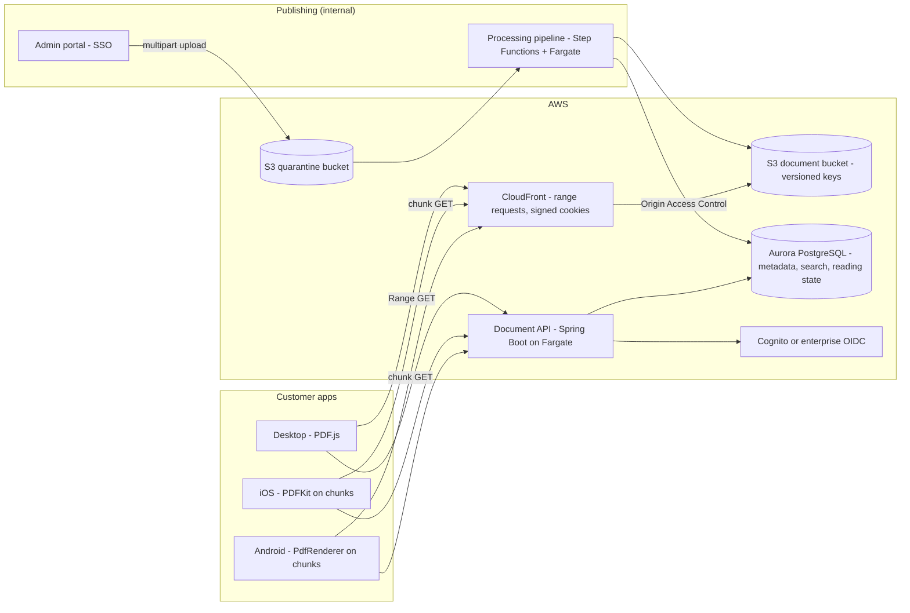
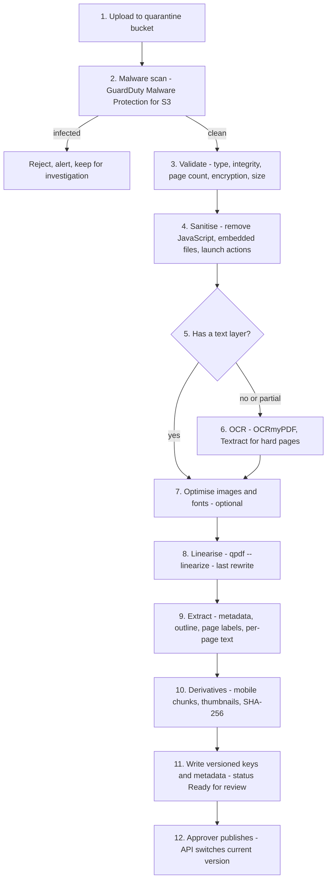
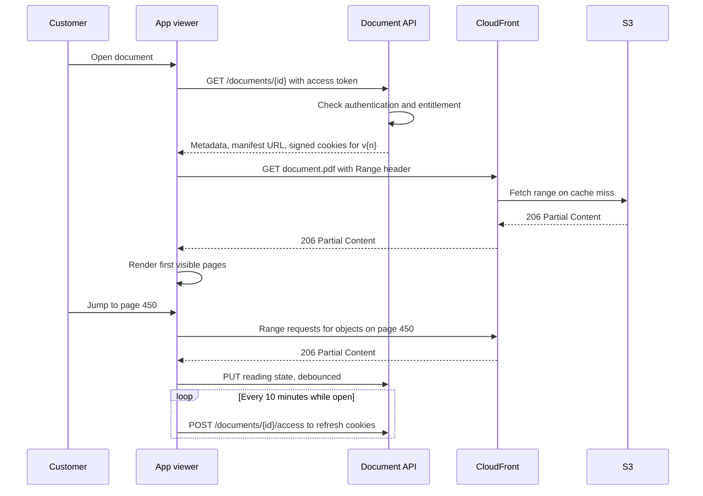

# Large PDF Delivery — Solution Architecture and Technology Recommendations

**Context:** Customers need to open, read, search and download a very large PDF (about 1,000 pages, up to roughly 200 MB) in the desktop and mobile apps. The document is published by internal administrators and updated from time to time.

**Purpose of this doc:** A summary of the target architecture, a review of the first draft design, and a recommended technology stack. AWS is the primary platform. Azure and Google Cloud equivalents are listed in section 13.

---

## 1. Summary

| Area | Recommendation |
|------|---------------|
| Storage | Amazon S3, private, KMS-encrypted, with **immutable versioned keys** (`/documents/{docId}/v{n}/...`) |
| Delivery | Amazon CloudFront with HTTP Range Requests, Origin Access Control and **signed cookies** scoped to one document version |
| Desktop viewer | Mozilla PDF.js in range mode, with streaming and auto-fetch turned off so it only downloads what the reader needs |
| Mobile viewer | Native renderers (PDFKit on iOS, `PdfRenderer` on Android) working on **server-produced page chunks** (for example, 25 pages each). Use a commercial SDK only if annotations, forms or redaction are needed |
| Search | **Server-side** full-text index built at ingestion. Client-side search would force the whole file to download |
| Navigation | Outline (table of contents), page labels and thumbnails extracted at ingestion and served by the API and CDN |
| Processing | Quarantine bucket, malware scan, sanitise, OCR if scanned, extract, **linearise last**, then publish after approval |
| Backend | Java 21 and Spring Boot 3 on ECS Fargate, Aurora PostgreSQL for metadata, search and reading state |

**Key insight:** A customer reads perhaps 20 to 50 pages per session, not 1,000. Everything in this design aims to move **only the bytes for the pages on screen**, and to answer search and navigation from the server so the client never needs the whole file.

---

## 2. Requirements and proposed targets

The targets below are proposals to confirm with the business.

| Requirement | Proposed target |
|-------------|----------------|
| Time to first page visible | p95 under 2 s on desktop broadband, under 3 s on 4G mobile |
| Jump to any page (for example, page 450) | p95 under 1.5 s |
| Data downloaded before first page shows | Under 2 MB on desktop, one chunk on mobile |
| Search response | p95 under 500 ms, results show page number and snippet |
| Mobile memory | No out-of-memory crashes on a reference low-end Android device (3 GB RAM) |
| Availability | 99.9% for the Document API and CDN path |
| Security | Authenticated and entitled customers only, no public object access, every open and download audited |
| Accessibility | WCAG 2.2 AA in the viewer shell, selectable text layer so screen readers work |

**Assumptions:**
1. The document is the same for every entitled customer. It is not personalised per customer, so the CDN can cache it.
2. Customers read and bookmark. They do not annotate, fill forms or sign.
3. A handful of large documents, updated monthly or less often.
4. If data residency applies (for example, Australia), the S3 origin and processing run in the local region (`ap-southeast-2`).

---

## 3. Review of the draft design

The draft is sound in its core idea: private object storage, a CDN, range requests and visible-page rendering. The points below are changes to make before build.

| Draft says | Problem | Change |
|-----------|---------|--------|
| Mobile uses native PDFKit or Android PDF renderer and loads progressively "where supported" | iOS PDFKit and Android `PdfRenderer` open **local files only**. Neither makes HTTP range requests, so a 200 MB file must fully download before page 1 shows | Produce page chunks at ingestion and render them natively, or use a streaming-capable SDK (section 8) |
| Viewer supports search | PDF.js and native viewers search by reading the text of every page, which **downloads the entire document** and defeats progressive loading | Build a server-side search index at ingestion (section 9) |
| Signed URLs or signed cookies | A time-limited URL can expire during a two-hour reading session. PDF.js cannot swap the URL mid-document, so later page loads fail with 403 | Use signed cookies scoped to the document version path, refreshed silently while the viewer is open |
| CDN caches documents, and documents get new versions | Overwriting the same object key needs CDN invalidation, and a reader can receive **byte ranges from two different versions** in one session, which corrupts rendering | Never overwrite. Each version gets a new immutable key, and the API points to the current version |
| Step 7 linearise, then step 8 OCR | OCR rewrites the file and **undoes linearisation**. So does any other rewrite (sanitising, image optimisation) | Make linearisation the last step that changes the file |
| Validate and parse, then scan for malware | Parsing an untrusted PDF before scanning exposes the parser to malicious files | Upload to a quarantine bucket and scan first. Only check file type by its magic bytes before the scan |
| Amazon Textract for OCR | Textract returns text and coordinates. It does **not** produce a searchable PDF | Use OCRmyPDF (Tesseract) to embed a text layer. Keep Textract for hard cases such as tables and poor scans |
| Viewer must be configured for range loading | Correct, but by default PDF.js also streams and pre-fetches the **whole file** in the background | Set `disableStream` and `disableAutoFetch`, and expose range headers through CORS (section 7) |
| Linearise for fast web view | Linearisation speeds up the **first page** only. Random jumps rely on range requests and the cross-reference table | Keep linearisation, but do not count on it for deep navigation. Serve the outline and thumbnails from the server |

---

## 4. Recommended architecture



| Component | Responsibility | Design notes |
|-----------|---------------|--------------|
| Admin portal | Upload, review, approve and publish document versions | Behind workforce SSO. Large files go straight to S3 with presigned multipart upload. Publishing needs a second approver (maker-checker) |
| Processing pipeline | Scan, sanitise, OCR, extract, produce derivatives, linearise | Step Functions orchestrates. Heavy steps run on Fargate because OCR of 1,000 pages can exceed Lambda's 15-minute limit |
| S3 quarantine bucket | Holds uploads until they pass scanning | No customer path to this bucket. Short lifecycle expiry |
| S3 document bucket | Original, linearised PDF, chunks, thumbnails, text artefacts | Block Public Access, SSE-KMS, versioning on, Object Lock if retention is regulated |
| Document API | Entitlements, metadata, access cookies, search, reading state, download audit | Stateless. The only component that decides who can read what |
| Aurora PostgreSQL | Document and version metadata, per-page text index, bookmarks and last-read page | One database keeps the design simple. Move search to OpenSearch only if needed (section 9) |
| CloudFront | Global, cached, range-capable delivery | Checks the signed cookie at the edge **before** serving from cache. The S3 origin is reachable only through CloudFront |
| Desktop app | PDF.js viewer with visible-page rendering | Server search, outline and thumbnails, not client-side scans |
| Mobile apps | Native rendering of chunks, optional encrypted offline copy | Keeps memory low and the feel native |

**Principle:** The API decides **who** may read. The CDN decides **how fast** they get the bytes. Clients never talk to S3 directly.

---

## 5. Processing pipeline



| Step | Recommended tool | Notes |
|------|-----------------|-------|
| Malware scan | Amazon GuardDuty Malware Protection for S3 | Managed, tags the object with the result, which triggers the next step |
| Validate and extract | Apache PDFBox (Java, Apache 2.0) | Same language as the API. Run in an isolated, network-restricted container because PDF parsers are a common attack surface |
| Sanitise | PDFBox | Strips active content customers should never receive |
| OCR | OCRmyPDF with Tesseract (open source). Amazon Textract for poor scans or tables | OCRmyPDF embeds an invisible text layer, so search, selection and screen readers work |
| Linearise and chunk | qpdf (Apache 2.0) | `qpdf --linearize` for the full file. `qpdf in.pdf --pages . 1-25 -- chunk-001.pdf` for chunks |
| Thumbnails | PDFium (BSD) or Poppler `pdftoppm` (GPL, run as a separate command) | Small WebP images, one per page. Avoid MuPDF unless its AGPL or commercial licence is acceptable |

**Output for one version** (all immutable):

```
/documents/{docId}/v{n}/document.pdf          linearised full file (desktop and download)
/documents/{docId}/v{n}/chunks/001.pdf ...    25-page chunks (mobile)
/documents/{docId}/v{n}/thumbs/0001.webp ...  page thumbnails
/documents/{docId}/v{n}/manifest.json         page count, chunk map, outline, page labels, SHA-256
```

Chunk size is a tuning choice. Aim for 2 to 5 MB per chunk. Fonts are repeated in each chunk, so total storage grows by perhaps 10 to 30 percent, which is cheap.

---

## 6. Progressive delivery with range requests



Configuration that must be right, or progressive loading silently becomes a full download:

| Item | Setting |
|------|---------|
| S3 and CloudFront | Range GETs are supported by default. Return `Accept-Ranges: bytes` and `206 Partial Content` |
| Compression | **Do not** compress PDFs at the CDN. Compressed responses cannot be served as byte ranges |
| CORS (desktop web) | Allow the app origin with credentials, and expose `Accept-Ranges`, `Content-Range`, `Content-Length` and `Content-Encoding` |
| Cache policy | Long CDN lifetime (`s-maxage` of a year) because keys are immutable. Short or no browser caching if the content is confidential |
| Cache key | Path only. Signed cookie values must not be part of the cache key, so all customers share one cached copy |
| Content headers | `Content-Type: application/pdf`. `Content-Disposition: attachment` only on the download link |

---

## 7. Desktop viewer: PDF.js

Use the PDF.js viewer components (`pdf_viewer`), which already render only visible pages and keep a small page cache.

| Option | Value | Why |
|--------|-------|-----|
| `disableRange` | `false` | Fetch by byte range |
| `disableStream` | `true` | Otherwise PDF.js also streams the full file |
| `disableAutoFetch` | `true` | Otherwise PDF.js keeps downloading the rest in the background |
| `rangeChunkSize` | 64 KB default. Test 128 to 256 KB | Fewer round trips on high-latency links |
| `withCredentials` | `true` | Sends the CloudFront signed cookies |
| `isEvalSupported` | `false` | Hardening. CVE-2024-4367 allowed script execution in PDF.js before 4.2.67 |
| `enableScripting` | `false` | PDF JavaScript is never needed here |

Navigation uses the server manifest: the outline panel, page labels and thumbnails come from `manifest.json` and `thumbs/`, so opening the sidebar does not trigger downloads of hundreds of pages.

---

## 8. Mobile viewer

The native renderers are efficient once a file is local, but they cannot stream. Three options:

| Option | How it works | Pros | Cons |
|--------|-------------|------|------|
| **A. Native on chunks (recommended)** | App downloads the 25-page chunk containing the requested page, plus the next one, and renders it with PDFKit or `PdfRenderer` | Native look and feel, low memory, no licence cost, chunks cache well at the CDN | Chunk boundaries need handling (the app shows a continuous scroll across chunks). Extra pipeline step |
| B. PDF.js in a WebView | Reuse the desktop viewer inside the app | One viewer codebase, true range loading | Slower on low-end devices, less native feel, WebView cookie handling |
| C. Commercial SDK with streaming | For example Apryse or Nutrient (formerly PSPDFKit), which open linearised remote PDFs progressively | Rich features: annotations, forms, redaction, consistent rendering on every platform | Licence cost (get quotes, often five figures a year). Vendor lock-in |

**Recommendation:** Option A. Move to option C only if annotations, forms or redaction come into scope.

Mobile memory rules:
- Render only the visible page plus one page either side, at screen resolution.
- Render in tiles when the reader zooms in, instead of one huge bitmap.
- Release page bitmaps as they leave the screen. Keep at most two or three chunks on disk for the session.
- Use server thumbnails for the page strip. Never render 1,000 thumbnails on the device.

Android note: `PdfRenderer` only gained text search and selection APIs in Android 15. That is fine here, because search is server-side and the API can return highlight rectangles (section 9). Keep an eye on the Jetpack `androidx.pdf` library as it matures.

**Offline (optional):** Download the full `document.pdf` in the background. Store it encrypted: iOS Data Protection class "Complete", Android AES-GCM with a key held in Android Keystore. Record an expiry date so the app removes the copy when the entitlement or version expires.

---

## 9. Search, navigation and bookmarks

| Feature | Design |
|---------|--------|
| Search | At ingestion, store each page's text in PostgreSQL with a `tsvector` index. `GET /documents/{id}/versions/{v}/search?q=` returns page number, page label and a snippet. The viewer jumps to the page and highlights matches using that page's text, or rectangles from a per-page word-box file |
| Outline | Extracted once and returned in the manifest. Works without loading the PDF |
| Thumbnails | Pre-rendered WebP images on the CDN, loaded lazily as the reader scrolls |
| Bookmarks and last-read page | Stored per customer, document and version. Saved with a debounce (for example, every 5 seconds or on page change), so syncing across desktop and mobile is cheap |

**When to move search to Amazon OpenSearch Service:** when customers search across many documents, need ranking, synonyms or several languages, or PostgreSQL search no longer meets the 500 ms target. For a few large documents, PostgreSQL is enough and avoids running another cluster.

---

## 10. Security

| Control | Design |
|---------|--------|
| Customer authentication | Amazon Cognito or the enterprise OIDC provider. The app sends an access token to the API |
| Authorisation | The API checks entitlement to the document **and** version on every metadata, access and search call |
| Edge access | CloudFront signed cookies with a custom policy scoped to `/documents/{docId}/v{n}/*`, valid for 15 to 30 minutes and refreshed while the viewer is open. Signing keys in AWS Secrets Manager, rotated through CloudFront key groups |
| Origin protection | S3 Block Public Access, bucket policy allowing only the CloudFront distribution through Origin Access Control |
| Encryption | TLS 1.2 or higher in transit. SSE-KMS at rest with a customer-managed key |
| Content safety | Malware scan and sanitising before publish. Viewer scripting turned off |
| Abuse protection | AWS WAF on CloudFront and the API with rate limits per customer, to slow scraping |
| Audit | Application audit events for open, search and download (who, which version, when, from which channel). CloudTrail data events on the document bucket. CloudFront logs to S3, queried with Athena |
| Watermarking | If needed, use a viewer overlay showing the customer's name (a deterrent that keeps CDN caching). Generate per-customer stamped files only for downloads, on demand, because they cannot be shared in the CDN cache |

---

## 11. Versioning and updates

1. A new version goes through the same pipeline and lands under `v{n+1}`. Nothing under `v{n}` changes, so no CDN invalidation is needed.
2. On approval, the API marks `v{n+1}` as current. New sessions open it.
3. Customers already reading `v{n}` finish their session on it. On next open they see "This document has been updated".
4. Bookmarks store the page number **and** the outline section. On upgrade, the app re-anchors each bookmark to the same section in the new version and tells the customer if a section was removed.
5. Old versions stay available, read only, for as long as the retention policy requires, because customers may need the exact version they accepted. S3 lifecycle rules move them to cheaper storage classes.

---

## 12. Document API (contract sketch)

| Method and path | Purpose |
|-----------------|---------|
| `GET /documents` | Documents the customer is entitled to |
| `GET /documents/{id}` | Current version, page count, size, manifest URL, SHA-256. Sets signed cookies |
| `POST /documents/{id}/access` | Refresh signed cookies for the open version |
| `GET /documents/{id}/versions/{v}/search?q=` | Page-level hits with snippets |
| `GET /me/documents/{id}/reading-state` and `PUT` | Last-read page and bookmarks |
| `POST /documents/{id}/versions/{v}/download` | Short-lived download link, writes an audit event |
| `POST /admin/documents/{id}/versions` | Start an upload (returns presigned multipart URLs) |
| `POST /admin/documents/{id}/versions/{v}/publish` | Approver publishes a processed version |

Errors use one shape (for example, RFC 9457 problem details). Version numbers are always explicit in URLs, so a client never mixes versions.

---

## 13. Technology recommendations

| Layer | AWS (recommended) | Azure | Google Cloud |
|-------|-------------------|-------|--------------|
| Object storage | S3 | Blob Storage | Cloud Storage |
| CDN and edge auth | CloudFront, signed cookies, Origin Access Control | Front Door (see note) | Cloud CDN, signed cookies |
| Customer identity | Cognito or enterprise OIDC | Entra External ID | Identity Platform |
| Backend API | Spring Boot 3 on ECS Fargate (.NET 8 if the organisation standard) | Same on Container Apps | Same on Cloud Run |
| Orchestration | Step Functions, EventBridge | Durable Functions, Event Grid | Workflows, Eventarc |
| Metadata, search, reading state | Aurora PostgreSQL | Azure Database for PostgreSQL | Cloud SQL or AlloyDB |
| Search at scale | OpenSearch Service | Azure AI Search | Vertex AI Search or Elastic |
| Malware scanning | GuardDuty Malware Protection for S3 | Defender for Storage | Third-party scanner |
| OCR | OCRmyPDF, plus Textract for hard cases | OCRmyPDF, plus Document Intelligence | OCRmyPDF, plus Document AI |
| Keys and secrets | KMS, Secrets Manager | Key Vault | Cloud KMS, Secret Manager |
| Edge protection | AWS WAF | Front Door WAF | Cloud Armor |
| Monitoring | CloudWatch, X-Ray through OpenTelemetry, CloudWatch RUM | Azure Monitor, Application Insights | Cloud Monitoring, Cloud Trace |
| Audit | CloudTrail, application audit log | Activity Log, application audit log | Cloud Audit Logs, application audit log |
| Desktop viewer | PDF.js | PDF.js | PDF.js |
| Mobile viewer | PDFKit, `PdfRenderer` on chunks | Same | Same |
| PDF tooling | PDFBox, qpdf, PDFium | Same | Same |

**Azure note:** Front Door does not validate signed URLs or cookies at the edge. Serving a cached private document safely needs extra design, such as a token-checking proxy in front of the origin. Validate this before choosing Azure.

**Build or buy for the viewer:** PDF.js and the native renderers cover reading, search (with the server index), zoom and navigation at no licence cost. Buy a commercial SDK only for annotations, form filling, redaction or e-signature.

---

## 14. Observability

| Signal | What to measure | Alert when |
|--------|----------------|-----------|
| Time to first page | Real-user timing from open tap to first page painted (CloudWatch RUM on web, Firebase Performance or the organisation's mobile tool) | p95 above target for 15 minutes |
| Bytes per session | Total bytes downloaded divided by pages viewed | Jumps suddenly, which usually means range loading broke and full downloads are happening |
| CDN health | Cache hit ratio, share of 206 responses, 403 rate, origin latency | 403 rate rises (cookie refresh failing) or hit ratio drops |
| API | Request rate, errors and latency per endpoint | Error rate above 1% or latency above target |
| Pipeline | Processing duration, failures per step, scan results | Any failed publish or malware hit |
| Mobile stability | Out-of-memory crashes and viewer crashes per device class | Any rise after a release |

---

## 15. Cost indication

Illustrative only. Check current regional pricing.

- 200 MB document, 10,000 reading sessions a month.
- Full download every session: about 2,000 GB of CDN egress.
- Range or chunk loading, reading about 30 pages per session: about 6 to 10 MB per session, so about 60 to 100 GB.
- At roughly US$0.10 per GB, that is about **US$200 a month versus US$10 a month**, before counting the better experience.
- OCR with Textract costs roughly US$1.50 per 1,000 pages, and only for scanned documents and only once per version.

---

## 16. Key decisions

| # | Decision | Main alternative rejected | Reason |
|---|----------|--------------------------|--------|
| 1 | Immutable versioned object keys | Overwrite and invalidate the CDN | No invalidation, no mixed-version byte ranges, clean audit of what each customer saw |
| 2 | CloudFront signed cookies | Signed URLs | Long reading sessions outlive URL expiry. Cookies refresh without restarting the viewer |
| 3 | Server-side search | Viewer search | Viewer search downloads the full document |
| 4 | Native mobile rendering on chunks | PDF.js in WebView, commercial SDK | Native feel and memory control without licence cost |
| 5 | PostgreSQL for search first | OpenSearch from day one | One database to run. Upgrade path is clear |
| 6 | Linearise as the final rewrite | Linearise early | Later rewrites undo linearisation |

Record each as an ADR under `docs/decisions/` once agreed.

---

## 17. Risks and open questions

| Item | Impact | Next step |
|------|--------|----------|
| Is the document personalised per customer? | If yes, CDN caching mostly stops working and the design changes | Confirm with the business |
| Confidentiality level | Decides watermarking, download permission and offline support | Classify the document |
| Annotation, form or signing needs | Would push mobile towards a commercial SDK | Confirm scope |
| Badly structured source PDFs (huge images, no outline) | Slow pages, poor navigation | Pipeline flags them and an admin fixes the source |
| Azure as the target cloud | No edge validation of signed tokens | Spike before committing |
| Accessibility of scanned pages | Screen readers need a text layer | OCR is mandatory for scanned pages |

---

## 18. Delivery plan

| Phase | Scope | Exit criteria |
|-------|-------|--------------|
| 1. Foundation and desktop | Pipeline (scan, sanitise, extract, linearise, thumbnails), S3 and CloudFront with signed cookies, Document API, PDF.js desktop viewer, server search, reading state | Desktop meets the first-page and jump targets on the real 1,000-page document. Bytes per session under 10% of file size |
| 2. Mobile | Chunk derivatives, iOS and Android chunk viewers, continuous scroll across chunks, memory tuning | No out-of-memory crashes on the reference low-end device. Mobile first-page target met on 4G |
| 3. Hardening and extras | OCR path, encrypted offline download, version upgrade with bookmark re-anchoring, dashboards and alerts, load test at peak | Load test passes at twice expected peak. Runbook and rollback for a bad published version |
