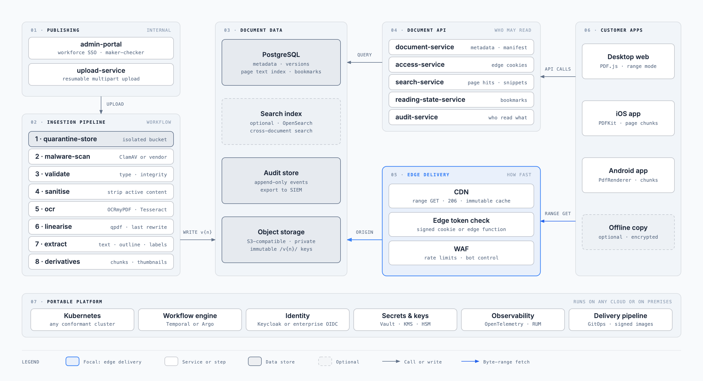
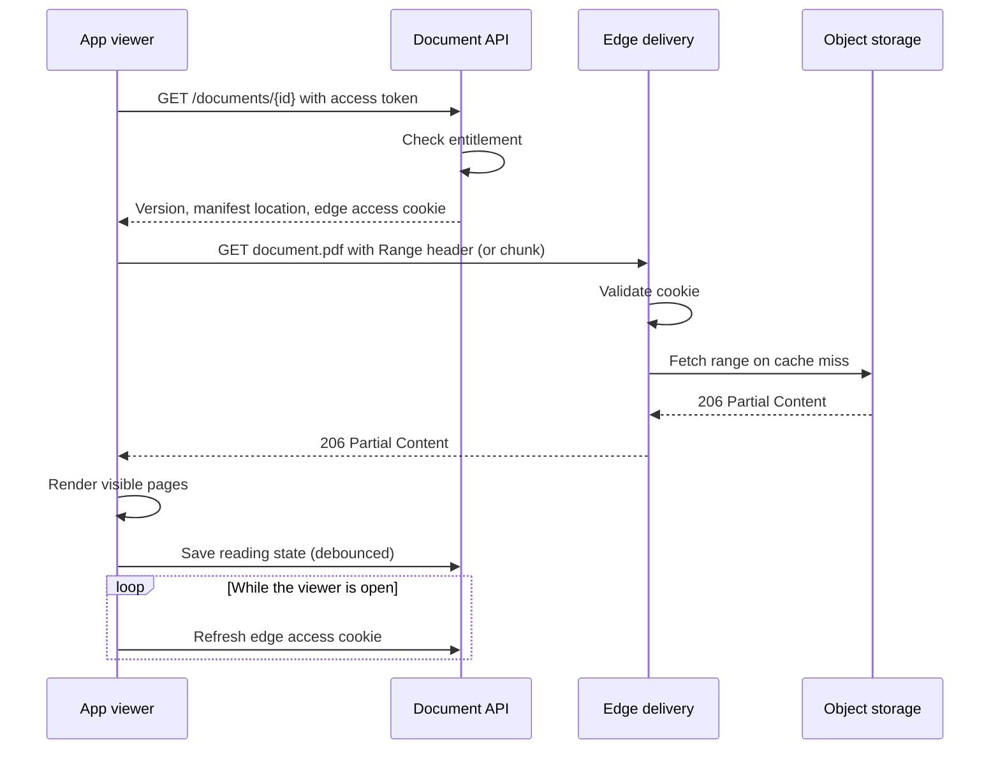
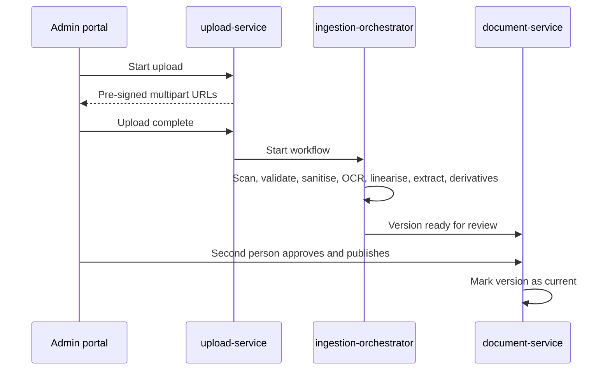

# Large PDF Delivery — Reference Architecture and Solution Design

**Scope:** The cloud-agnostic reference architecture, the services that implement it and the portable technology they run on. Every building block uses open-source or portable technology. [Section 12](#12-cloud-mapping) maps each block to AWS, Azure and Google Cloud managed services. A detailed AWS implementation is in the [AWS deep dive](./03-solution-architecture.md), and the benefits are in the [business use case](./01-business-use-case.md).

---

## 1. Architecture principles

1. **The API decides who may read. The edge decides how fast.** Clients never talk to the document store directly.
2. **Move only the bytes on screen.** Desktop uses HTTP range requests. Mobile uses small, pre-built page chunks.
3. **Process once, at ingestion.** Text, outline, thumbnails, chunks and the search index are produced when a version is published, not on customers' devices.
4. **Immutable versions.** Each version gets new storage keys. Nothing is overwritten, so caches never need clearing and a reader never mixes versions.
5. **Scan before parse.** Untrusted files are scanned in quarantine before any PDF parser touches them.
6. **Linearise last.** Any later rewrite of the file would undo it.
7. **Portable building blocks.** Kubernetes, PostgreSQL, S3-compatible storage and a standard CDN, so the design runs on any cloud or on premises.

---

## 2. Reference architecture



Publishing and the ingestion pipeline write immutable versions into the **document data** layer. On the read path, customer apps call the **Document API** for access, metadata, search and reading state, and fetch byte ranges or page chunks through **edge delivery**, which checks an access token before serving from cache. [Open the full diagram](pathname:///large-pdf-render/diagrams/reference-architecture.html).

---

## 3. Service catalogue

### 3.1 Publishing

| Service | Responsibility | Owns data | Interfaces |
|---------|---------------|-----------|------------|
| `admin-portal` | Upload, review, approve and publish versions. Maker-checker approval | None (UI) | Calls `upload-service` and `document-service` admin APIs |
| `upload-service` | Issues pre-signed, resumable multipart uploads straight to the quarantine store. Starts the ingestion workflow when the upload completes | Upload sessions | REST. Publishes `document.uploaded` |

### 3.2 Ingestion

| Service | Responsibility | Portable technology |
|---------|---------------|---------------------|
| `ingestion-orchestrator` | Runs the pipeline as a durable workflow with retries, timeouts and a status per step | Temporal or Argo Workflows |
| `scan-worker` | Malware scan in quarantine. Rejects and alerts on infected files | ClamAV or a commercial scanning engine |
| `pdf-processing-worker` | Validates, sanitises (removes JavaScript, embedded files and launch actions), optimises, linearises, extracts metadata, outline, page labels and per-page text, and builds chunks and thumbnails | Apache PDFBox, qpdf, PDFium |
| `ocr-worker` | Adds an invisible text layer to scanned pages | OCRmyPDF with Tesseract |
| `index-writer` | Writes page text to the search index and version metadata to PostgreSQL. Sets status to "ready for review" | PostgreSQL full-text search, optional OpenSearch |

Workers run in isolated, network-restricted containers because PDF parsers are a common attack surface. They scale on queue depth (for example, with KEDA).

### 3.3 Read path

| Service | Responsibility | Owns data | Interfaces |
|---------|---------------|-----------|------------|
| `document-service` | Lists entitled documents, returns the current version, page count, size, manifest location and checksum | Documents and versions | REST |
| `access-service` | Checks entitlement and issues short-lived edge access cookies scoped to one document version, refreshed while the viewer is open | Signing keys (in the secrets store) | REST |
| `search-service` | Page-level search with snippets and highlight positions | Page text index | REST |
| `reading-state-service` | Last-read page and bookmarks per customer, document and version | Reading state | REST |
| `audit-service` | Records open, search and download events with customer, version, time and channel | Audit events | Consumes events. Exports to the SIEM |

### 3.4 Edge delivery

| Component | Responsibility | Portable options |
|-----------|---------------|------------------|
| CDN | Caches immutable files and serves byte ranges (`206 Partial Content`) and chunks | Any CDN that supports range requests and long cache lifetimes |
| Edge token check | Validates the access cookie before serving from cache | See section 4 |
| Web application firewall | Rate limits per customer, bot control, scraping protection | CDN-integrated WAF or ModSecurity with the OWASP Core Rule Set |

### 3.5 Clients

| Client | Viewer | Notes |
|--------|--------|-------|
| Desktop web | PDF.js in range mode, with streaming and auto-fetch turned off | Uses server search, outline and thumbnails |
| iOS | PDFKit on page chunks | Renders only visible pages |
| Android | `PdfRenderer` on page chunks | Same chunk model |
| Offline (optional) | Full file stored encrypted on the device | Expires with the entitlement |

---

## 4. Edge token validation (the portability question)

The one capability that differs most between CDNs is checking an access token **at the edge, before serving a cached file**. Design for one of three options:

| Option | How it works | When to use |
|--------|-------------|-------------|
| **A. CDN-native signed cookies** | The CDN validates a signed cookie with a policy scoped to `/documents/{docId}/v{n}/*` | Preferred where the CDN supports it |
| **B. Edge function** | A small function at the edge validates a signed JWT cookie, then lets the cached request through | When the CDN has edge compute but no native signed cookies |
| **C. Token-checking proxy** | A thin proxy (Envoy or NGINX) in front of the origin validates the cookie. The CDN forwards the cookie but keeps it out of the cache key | Fallback for any CDN. Adds a hop on cache misses |

In every option the cookie value is **never** part of the cache key, so all entitled customers share one cached copy.

---

## 5. Key flows

### 5.1 Open and read



### 5.2 Publish a new version



---

## 6. Data design

**Object storage layout** (immutable, one prefix per version):

```
/documents/{docId}/v{n}/document.pdf          linearised full file (desktop and download)
/documents/{docId}/v{n}/chunks/001.pdf ...    page chunks (mobile)
/documents/{docId}/v{n}/thumbs/0001.webp ...  page thumbnails
/documents/{docId}/v{n}/manifest.json         page count, chunk map, outline, page labels, checksum
```

**PostgreSQL** (main tables):

| Table | Holds |
|-------|-------|
| `document` | Document ID, title, entitlement rules, current version |
| `document_version` | Version number, status, page count, size, checksum, approver, published time |
| `page_text` | Version, page number, page label, text, full-text search vector |
| `reading_state` | Customer, document, version, last page, bookmarks |
| `audit_event` | Customer, version, action, channel, time (also streamed to the audit store) |

**Events:** `document.uploaded`, `document.version.ready`, `document.version.published`, `document.opened`, `document.downloaded`.

---

## 7. API summary

| Method and path | Purpose |
|-----------------|---------|
| `GET /documents` | Documents the customer is entitled to |
| `GET /documents/{id}` | Current version and manifest. Sets edge access cookies |
| `POST /documents/{id}/access` | Refresh edge access cookies |
| `GET /documents/{id}/versions/{v}/search?q=` | Page-level hits with snippets |
| `GET` and `PUT /me/documents/{id}/reading-state` | Last-read page and bookmarks |
| `POST /documents/{id}/versions/{v}/download` | Short-lived download link, with an audit event |
| `POST /admin/documents/{id}/versions` | Start an upload |
| `POST /admin/documents/{id}/versions/{v}/publish` | Approver publishes a version |

Errors use RFC 9457 problem details. Version numbers are explicit in every URL.

---

## 8. Deployment and resilience

| Concern | Design |
|---------|--------|
| Compute | Kubernetes across three availability zones. API services are stateless and scale on load. Workers scale on queue depth |
| Storage | Object storage with versioning and cross-region replication if required. Retention lock where regulation requires it |
| Database | PostgreSQL high-availability cluster with a cross-region replica |
| Delivery | The CDN absorbs read traffic. The origin is reachable only through the CDN or the token-checking proxy |
| Releases | GitOps with canary releases. A bad document version is rolled back by pointing "current" at the previous version |
| Data residency | Storage and processing stay in the required region (for example, Australia) |

---

## 9. Security

| Control | Design |
|---------|--------|
| Customer authentication | OpenID Connect through Keycloak or the enterprise identity provider |
| Authorisation | Entitlement checked on every metadata, access, search and download call |
| Edge access | Short-lived access cookie scoped to one document version, refreshed while reading |
| Origin protection | Private storage, no public access, reachable only from the edge tier |
| Content safety | Malware scan and sanitising before publish. Viewer scripting turned off |
| Encryption | TLS 1.2 or higher in transit. Encryption at rest with keys in a KMS or HSM |
| Abuse protection | WAF rate limits per customer to slow scraping. Optional viewer watermark |
| Audit | Every open, search and download recorded and exported to the SIEM |

---

## 10. Observability

- Real-user monitoring of time to first page and page-jump time (OpenTelemetry browser and mobile SDKs).
- **Bytes per session** as a key signal: a sudden rise means range loading broke and full downloads are happening.
- CDN cache hit ratio, share of `206` responses and `403` rate (a rising `403` rate means cookie refresh is failing).
- Pipeline duration and failures per step, and any malware detection.

---

## 11. Portable technology stack

| Building block | Portable choice |
|----------------|-----------------|
| Container platform | Kubernetes |
| Workflow engine | Temporal or Argo Workflows |
| Object storage | Any S3-compatible store |
| Database and search | PostgreSQL full-text search, OpenSearch when scale demands |
| Malware scanning | ClamAV or a commercial engine |
| PDF processing | Apache PDFBox, qpdf, PDFium, OCRmyPDF with Tesseract |
| Identity | Keycloak or the enterprise identity provider |
| Secrets and keys | HashiCorp Vault or OpenBao, plus a KMS or HSM |
| Edge proxy (option C) | Envoy or NGINX |
| WAF | ModSecurity with the OWASP Core Rule Set, or the CDN's WAF |
| Observability | OpenTelemetry, Prometheus, Grafana |
| Desktop viewer | PDF.js |
| Mobile viewers | PDFKit (iOS), `PdfRenderer` (Android) |

---

## 12. Cloud mapping

| Building block | AWS | Azure | Google Cloud |
|----------------|-----|-------|--------------|
| Kubernetes | Amazon EKS | Azure Kubernetes Service | Google Kubernetes Engine |
| Object storage | Amazon S3 | Azure Blob Storage | Cloud Storage |
| CDN | Amazon CloudFront | Azure Front Door | Cloud CDN |
| Edge token check | Native signed cookies (option A) | No native signed tokens at the edge, so use option B or C | Native signed cookies (option A) |
| Workflow | Step Functions | Durable Functions | Workflows |
| PostgreSQL | Amazon Aurora PostgreSQL or RDS | Azure Database for PostgreSQL | Cloud SQL or AlloyDB |
| Search at scale | Amazon OpenSearch Service | Azure AI Search | Vertex AI Search or Elastic Cloud |
| Malware scanning | GuardDuty Malware Protection for S3 | Microsoft Defender for Storage | Commercial scanner or ClamAV |
| OCR for hard cases | Amazon Textract | Azure AI Document Intelligence | Document AI |
| Identity | Amazon Cognito | Microsoft Entra External ID | Identity Platform |
| Secrets and keys | AWS Secrets Manager, AWS KMS | Azure Key Vault | Secret Manager, Cloud KMS |
| WAF | AWS WAF | Azure Front Door WAF | Cloud Armor |
| Monitoring | CloudWatch, CloudWatch RUM | Azure Monitor, Application Insights | Cloud Monitoring |

Confirm the edge token option with the chosen CDN in a short spike before committing to it.

---

## 13. Architecture decisions

| # | Decision | Alternative rejected | Reason |
|---|----------|----------------------|--------|
| 1 | Immutable versioned storage keys | Overwrite and clear the cache | No cache invalidation, no mixed-version reads, clear audit |
| 2 | Signed access cookies at the edge | Signed URLs | Long reading sessions outlive URL expiry. Cookies refresh silently |
| 3 | Server-side search | Viewer search | Viewer search downloads the whole document |
| 4 | Page chunks for mobile | Full download or WebView | Native feel and low memory without licence cost |
| 5 | PostgreSQL search first | Search cluster from day one | One database to run, with a clear upgrade path |
| 6 | Portable building blocks with a cloud mapping | Single-cloud native stack | Run on any cloud. The only cloud-specific concern, edge token validation, is isolated in section 4 |
