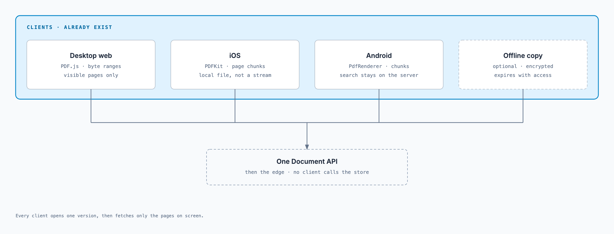

# Clients

Clients are the apps that open a document. Desktop web, iOS and Android already exist. This programme does not rebuild them. It gives them one reading contract, and they stop downloading the whole file.

Back to the [reference architecture](./index.md). The door they call is the [Document API](./02-document-api.md). Bytes come from [edge delivery](./03-edge-delivery.md).



[Open the diagram](pathname:///large-pdf-render/diagrams/component-clients.html).

## Steps

The client follows one version for the session. It does not choose bytes from a newer version halfway through.

1. Open the document. Store the version, the manifest location and the edge cookie.
2. Paint the first page from a range (desktop) or from the chunk that contains page 1 (mobile).
3. Jump, search and thumbnails use the manifest and the search API. They do not scan the file.
4. Save the last page and bookmarks, debounced, about every 5 seconds or on page change.
5. Refresh the edge cookie while the viewer is open, before it expires.
6. On the next open, if the version changed, re-anchor bookmarks and tell the reader the document was updated.

## How to design a client

Design the client against the version, not against a file URL. The customer says "open the terms". The client asks which version is current, then fetches only what is on screen.

| Client | What it opens | Design rule |
|--------|---------------|-------------|
| Desktop web | The linearised PDF, by byte range | PDF.js renders visible pages only. Streaming and background download of the rest of the file stay off |
| iOS | The 25-page chunk that contains the page, plus the next chunk | PDFKit opens a local file. It does not make HTTP range requests, so the app downloads a chunk and then renders |
| Android | The same chunks as iOS | `PdfRenderer` also opens a local file. Search stays on the server |
| Offline copy | The full `document.pdf`, only when the customer asks | Encrypted on the device. Removed when the entitlement or the version expires |

Amounts of data are bytes. A 200 MB document is not a unit the client tries to hold. The client holds the visible page, one page either side, and at most two or three chunks.

Desktop settings that have to be right, or the viewer silently downloads the file:

| Option | Value | Why |
|--------|-------|-----|
| `disableRange` | `false` | Fetch by byte range |
| `disableStream` | `true` | Otherwise PDF.js also streams the full file |
| `disableAutoFetch` | `true` | Otherwise PDF.js keeps downloading the rest in the background |
| `rangeChunkSize` | 64 KB. Test 128 to 256 KB | Fewer round trips on a high-latency link |
| `withCredentials` | `true` | Sends the edge cookie |
| `isEvalSupported` | `false` | Hardening. Script execution in PDF.js was a real defect before 4.2.67 |
| `enableScripting` | `false` | PDF JavaScript is never needed |

Use a PDF.js release at or after 4.2.67. Navigation uses the manifest: the outline, page labels and thumbnails come from the server, so opening the sidebar does not fetch hundreds of pages.

Mobile memory rules:

- Render the visible page plus one page either side, at screen resolution.
- When the reader zooms, render tiles. Do not allocate one bitmap for the whole page at the zoomed size.
- Release bitmaps as they leave the screen. Keep at most two or three chunks on disk for the session.
- Use server thumbnails for the page strip. Do not render 1,000 thumbnails on the device.
- Show a continuous scroll across a chunk boundary. The reader should not see a hard stop every 25 pages.

`PdfRenderer` gained text search and selection in Android 15. Search here is server-side. The hit can include rectangles so the app can highlight without that API. The Jetpack `androidx.pdf` library is watched, not required.

A commercial viewer SDK is the alternative when the product needs annotations, form filling, redaction or signing. Reading, zoom and server search do not need it.

## API

The client calls the Document API. The open call returns when the cookie is issued. It does not stay open until the file has arrived.

### Open a document

`GET /v1/documents/{documentId}`

| Header | Required | Meaning |
|--------|----------|---------|
| `Authorization` | Yes | Customer token |
| `X-Channel` | Yes | `DESKTOP`, `IOS` or `ANDROID` |
| `X-Open-Id` | Yes | One id per intended open. A retry of the same open reuses it so the audit records one event |

**Response** `200`

```json
{
  "documentId": "terms-2026",
  "version": 4,
  "title": "Product terms",
  "pageCount": 1000,
  "byteSize": 209715200,
  "checksumSha256": "2c26b46b68ffc68a...",
  "manifestPath": "/documents/terms-2026/v4/manifest.json",
  "edgeCookieExpiresInSeconds": 900,
  "previousVersion": 3,
  "bookmarkMoves": [
    { "sectionId": "fees", "page": 90, "status": "MOVED" },
    { "sectionId": "old-clause", "status": "REMOVED" }
  ]
}
```

The edge cookie arrives as `Set-Cookie`. It is `HttpOnly`, `Secure`, and its path is `/documents/terms-2026/v4/`. The client does not copy the cookie into a query string.

`bookmarkMoves` is present when the customer had bookmarks on `previousVersion`. `MOVED` is the same outline section in the new version. `REMOVED` means the section is gone and the client tells the reader.

| HTTP | What the client does |
|------|----------------------|
| `200` | Store the version. Fetch the manifest and the first range or chunk |
| `401` | Send the reader to sign in |
| `403` | The customer is not entitled. Do not call the edge |
| `404` | Unknown document |
| `503` | Safe to retry the same `X-Open-Id` |

### Refresh the cookie

`POST /v1/documents/{documentId}/access`

**Request**

```json
{ "version": 4 }
```

**Response** `200`, with a new `Set-Cookie` for the same version. Call this on a timer shorter than `edgeCookieExpiresInSeconds` (a 15-minute cookie is refreshed about every 10 minutes) while the viewer is open. A `403` means entitlement has ended. Close the document.

### Search

`GET /v1/documents/{documentId}/versions/4/search?q=cooling-off`

The version in the path is the version the session opened. A search does not silently move the reader onto a newer version.

**Response** `200`

```json
{
  "query": "cooling-off",
  "hits": [
    {
      "page": 450,
      "pageLabel": "12.4",
      "snippet": "The cooling-off period is 14 days",
      "rects": [{ "x": 72, "y": 640, "w": 180, "h": 14 }]
    }
  ]
}
```

`rects` is present when a word-box file was built for that page. Otherwise the client jumps to the page and highlights from the page text once that page is loaded. The client does not download the other 999 pages to find the match.

### Reading state

`GET /v1/me/documents/{documentId}/reading-state`

`PUT /v1/me/documents/{documentId}/reading-state`

**Request**

```json
{
  "version": 4,
  "lastPage": 450,
  "bookmarks": [
    { "page": 90, "sectionId": "fees", "label": "Fees" }
  ]
}
```

| Field | Required | Notes |
|-------|----------|-------|
| `version` | Yes | The open version. A newer current version does not change this row until the next open |
| `lastPage` | Yes | 1-based page in that version |
| `bookmarks` | No | Page, outline `sectionId`, and the label the reader saw |
| `sectionId` | On a bookmark | Stable across a version when the outline section survives. The page number alone is not stable |

**Response** `200` with the stored state. `409` means the body refers to a version the customer has not opened. Do not overwrite another version's bookmarks.

### Download

`POST /v1/documents/{documentId}/versions/4/download`

| Header | Required | Meaning |
|--------|----------|---------|
| `Idempotency-Key` | Yes | One key per intended download. A retry returns the same link and one audit event |

**Response** `200`

```json
{
  "url": "https://download.example/documents/terms-2026/v4/document.pdf",
  "expiresInSeconds": 300
}
```

The link is for the full file of that version. It is the offline path and the "save a copy" path. It is not how the viewer turns pages.

Errors use one problem shape: `type`, `title`, `status`, `detail`, and `documentId` when one exists.

## Events

Clients are not log consumers. They learn that a version changed on the next open, from `previousVersion` and `bookmarkMoves`.

| What the client sees | When |
|----------------------|------|
| `previousVersion` and `bookmarkMoves` | The next `GET` after a publish |
| Cookie expiry | The edge returns `403` on a range. Refresh, or close if entitlement has ended |
| Reading state | `GET` on open, so the other device's last page is available |

A missed reading-state save is recovered on the next successful `PUT`. The save is not the book of record for the PDF.

## Files

A customer does not upload the source PDF from the reading app. An administrator does, through [publishing](./04-publishing.md).

| File | Direction | What the client does with it |
|------|-----------|------------------------------|
| `manifest.json` | Edge to the client | Page count, chunk map, outline, page labels, checksum. Fetched once per open |
| `document.pdf` | Edge to the desktop client | Byte ranges only, while reading. The full object only on an explicit download |
| `chunks/001.pdf` and the following | Edge to the mobile client | The chunk for the visible page, and the next one |
| `thumbs/0001.webp` and the following | Edge to the client | Lazy, as the thumbnail strip scrolls |
| Offline `document.pdf` | Device storage | Encrypted. iOS Data Protection class Complete. Android AES-GCM with the key in the Android Keystore. Deleted at the expiry the API returned |

The client fetches these paths. It does not build a linearised file or a chunk. [Ingestion](./05-ingestion.md) owns the files that actually land in the store.
