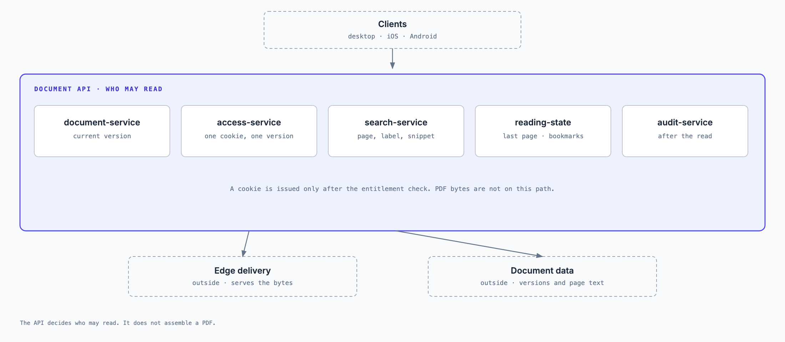

# Document API

The Document API is the only door that decides who may read. A public request passes the WAF in the [reference architecture](./index.md#request-protection) before it reaches this door. The API then checks the token and the entitlement, and issues an edge cookie for one version. It does not move PDF bytes or run OCR. A finished pipeline does not make the version current. A second person does that.

Back to the [reference architecture](./index.md). Callers are the [clients](./01-clients.md). Bytes are served by [edge delivery](./03-edge-delivery.md).

[Open the diagram](pathname:///large-pdf-render/diagrams/component-document-api.html).

## Steps

Five services, one door. None of them fetches a byte range for the caller.

**Open**

1. Authenticate. Reject a token that does not match the customer.
2. Load the document and the current version. Unknown document is `404`.
3. Check entitlement for that document. A miss is `403` and no cookie.
4. Ask `access-service` for a cookie scoped to `/documents/{docId}/v{n}/*`.
5. Return the metadata, the manifest path and `Set-Cookie`. Record `document.opened` once per `X-Open-Id`.

**Search and reading state**

1. The same token and entitlement check, against the version in the URL.
2. Search reads the page index for that version only.
3. Reading state is stored per customer, document and version. It does not change the current pointer.

## How to design it

| Service | Build it to | It must not |
|---------|-------------|-------------|
| `document-service` | Return the current version, page count, size, checksum and manifest path. Be the only writer of the current pointer, and only on publish | Issue a cookie, parse a PDF, or serve bytes |
| `access-service` | Sign a cookie for one version, with a 15 to 30 minute life, after `document-service` has allowed the customer | Decide entitlement on its own, or put the cookie value into a cache key |
| `search-service` | Answer from the page index with page, label, snippet and optional rectangles | Open the PDF, or search a version the customer is not allowed to read |
| `reading-state-service` | Store last page and bookmarks for the version the client names | Move a bookmark onto a new version by itself. The client re-anchors on the next open |
| `audit-service` | Append open, search and download, and export to the SIEM | Block a read because the export is late |

Signing keys live in the secrets store and rotate through the edge key set. The API stores the key id on the cookie so an old cookie still verifies until it expires.

The entitlement decision is explainable: the open audit carries the rule id that allowed the customer. The service stores that on the event. It does not read the audit store to make the next decision.

## API

The resource shapes the customer sees are on the [clients](./01-clients.md) page. This is how the API enforces them.

| Check | Where | Result |
|-------|-------|--------|
| Token | API | `401` |
| Entitlement, including a download of an old version the customer may still see | API | `403` |
| Unknown document or version | API | `404` |
| Search query empty, or longer than the limit | API | `400` |
| Reading state for a version that does not exist | API | `409` |
| Cookie signer unavailable | API | `503`. No manifest is returned without a cookie |
| Search index unavailable | Search | `503`. The open call is unaffected |

The API copies these response fields and does not invent others: `documentId`, `version`, `title`, `pageCount`, `byteSize`, `checksumSha256`, `manifestPath`, `edgeCookieExpiresInSeconds`, `previousVersion`, `bookmarkMoves`.

Internal call, `document-service` to `access-service`:

| Field | Source |
|-------|--------|
| `documentId` | Path |
| `version` | The current row, or the version the client named |
| `customerId` | Token. Never the body |
| `ttlSeconds` | Configured, 900 to 1800 |

`access-service` returns the cookie attributes. `document-service` sets them on the HTTP response.

Search is a different resource. The query is a query parameter, not a body, so it stays on a `GET`.

| Field | Meaning |
|-------|---------|
| `q` | The reader's text, length-limited |
| `version` | Path. The index for that version only |
| Hit `page` | 1-based page in that version |
| Hit `pageLabel` | The printed label, which may differ from the page index |
| Hit `snippet` | A short extract with the match |
| Hit `rects` | Optional word boxes, in PDF user space, when the page has a box file |

Download checks entitlement again, writes `document.downloaded`, and returns a short-lived URL for that exact version. The URL is minted for the edge. It still requires the cookie, or it is a one-time URL that the edge will honour once. It is not a permanent public object link.

Errors use RFC 9457 problem details: `type`, `title`, `status`, `detail`, and `documentId` when one exists.

## Events

| Topic | Who writes it | Body |
|-------|---------------|------|
| `document.opened` | `document-service`, after the cookie is issued | `documentId`, `version`, `customerId`, `channel`, `openId` |
| `document.searched` | `search-service`, after the query | `documentId`, `version`, `customerId`, a hash of the query. The raw query is kept only if the retention rule allows it |
| `document.downloaded` | `document-service` | `documentId`, `version`, `customerId`, `channel` |
| `document.version.published` | `document-service`, after the pointer commit | `documentId`, `version`, `approverId`. Consumed by audit |

A retried open with the same `openId` does not append a second opened event. The log is not the book of record. The version row and the audit archive are.

## Files

The API does not store the PDF and does not write the manifest. [Ingestion](./05-ingestion.md) writes both. [Document data](./06-document-data.md) is the layout.

| File | Direction | What the API does with it |
|------|-----------|---------------------------|
| Audit export | API platform to the SIEM | A batch or a stream of the events above. A late export does not revoke a cookie |
| Entitlement extract | Identity or the system of record, into the API's cache | Who may read which document. The API does not own the master |

The manifest path in the open response is a location. The bytes of `manifest.json` are fetched from the edge, under the same cookie.
