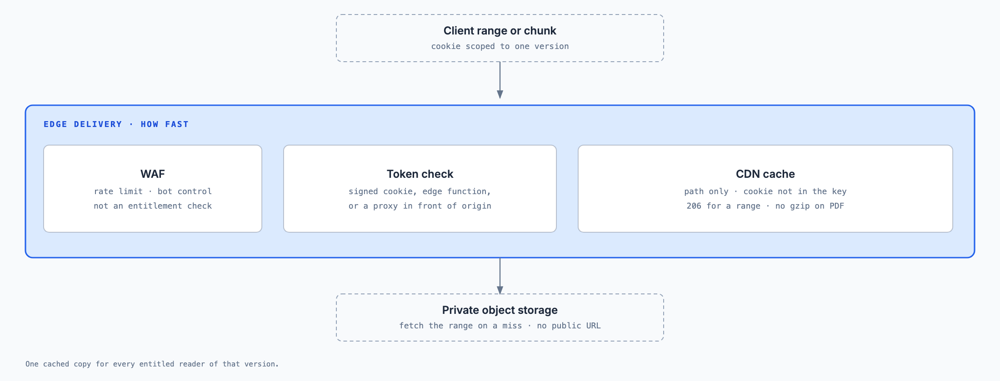

# Edge delivery

The edge is where bytes move. It checks the cookie, then serves a cached range or a cached chunk. It does not decide who is entitled, and it does not see the PDF as a document. A cache miss fetches that range from private storage. The origin is not a public URL.

Back to the [reference architecture](./index.md). The cookie is issued by the [Document API](./02-document-api.md). The files are written by [ingestion](./05-ingestion.md).



[Open the diagram](pathname:///large-pdf-render/diagrams/component-edge.html).

## Steps

One object, many readers, one cache entry.

1. Receive `GET` with a `Range` header, or `GET` of one chunk or thumbnail.
2. Reject a missing or invalid cookie with `403`, before reading the cache.
3. Look up the object by path only. The cookie value is not part of the key.
4. On a hit, return `206` for a range, or `200` for a whole chunk or thumbnail.
5. On a miss, fetch that range from the origin over the private path, store it, and return it.
6. Do not compress the response. A compressed PDF cannot be served as a byte range.

## How to design it

| Piece | Build it to | It must not |
|-------|-------------|-------------|
| CDN | Cache immutable prefixes for a long time. Honour `Range`. Return `Accept-Ranges: bytes` | Treat the cookie as part of the cache key, or gzip a PDF |
| Token check | Validate the cookie's signature, expiry and path before the cache is read | Call back to the Document API on every range. That would put the API on the byte path |
| Origin access | Allow the CDN, or the token-checking proxy, and nobody else | Publish a public object URL "just for the miss" |
| WAF | Rate-limit and block abusive HTTP in front of the CDN and the API | Score entitlement, or scan the PDF |

Cache lifetime on the CDN is about a year (`s-maxage`), because the key never changes. Browser caching stays short, or off, when the content is confidential. `Content-Type` is `application/pdf` for the file and the chunks. `Content-Disposition: attachment` is set only on the explicit download.

CORS, for the desktop app: allow the app origin with credentials, and expose `Accept-Ranges`, `Content-Range`, `Content-Length` and `Content-Encoding`.

## Edge token validation

Checking a cookie at the edge, before a cached file is served, is the part that differs between networks. Design for one of these. Confirm it with a short spike before committing to a CDN.

| Option | How it works | When to use |
|--------|--------------|-------------|
| **A. CDN-native signed cookies** | The network validates a signed cookie whose policy is `/documents/{docId}/v{n}/*` | Preferred where the CDN supports it. CloudFront and Cloud CDN do |
| **B. Edge function** | A small function at the edge validates a signed JWT cookie, then lets the cached request through | The CDN has edge compute and no native signed cookies |
| **C. Token-checking proxy** | Envoy or NGINX in front of the origin validates the cookie. The CDN forwards the cookie and keeps it out of the cache key | Any CDN, including Azure Front Door. Adds a hop on cache misses |

In every option the cookie value stays out of the cache key, so entitled customers share one copy. A cookie for version 4 does not authorise version 5. When the reader opens version 5 they receive a new cookie from the API.

## API

This is HTTP, not a JSON resource. The JSON calls are on the [clients](./01-clients.md) page.

`GET /documents/terms-2026/v4/document.pdf`

```http
Range: bytes=0-65535
Cookie: <edge cookie for v4>
```

**Response** `206`

```http
Accept-Ranges: bytes
Content-Range: bytes 0-65535/209715200
Content-Type: application/pdf
Content-Length: 65536
Cache-Control: public, max-age=31536000, immutable
```

The body is those bytes and nothing else. There is no envelope.

| Request | Response | Notes |
|---------|----------|-------|
| Range of `document.pdf` | `206` | Desktop reading |
| `chunks/001.pdf` | `200` of that chunk | Mobile. The chunk is small enough to cache whole |
| `thumbs/0450.webp` | `200` | Lazy thumbnail |
| `manifest.json` | `200` | Once per open. Same cookie |
| Missing or expired cookie | `403` | The client refreshes, or closes |
| Range past the end | `416` | The client has a bad offset. It does not retry the whole file |
| Origin down on a miss | `504` | Cached hits in other locations still succeed |

A chunk request may also send `Range`. The client should prefer the whole chunk. Chunks are built at 2 to 5 MB so that one `GET` is the unit.

Configuration that has to be right, or progressive loading silently becomes a full download:

| Item | Setting |
|------|---------|
| Range | `Accept-Ranges: bytes` and `206 Partial Content` |
| Compression | Do not compress PDFs at the CDN |
| Cache key | Path only |
| Cookie path | `/documents/{docId}/v{n}/*` |
| Origin | Private. The CDN identity is the only reader |

## Events

The edge does not publish document events. Access logs are an operational record.

| Log | Who reads it | What it is for |
|-----|--------------|----------------|
| Edge access log | Operations, and the bytes-per-session metric | Status, bytes, cache hit, range or full |
| Origin access log | Operations | Misses. A rising miss rate on an immutable prefix means the cache key has started varying |

`document.opened` is written by the API when the cookie is issued, not when the first range returns. A range log is not a second "opened" event.

## Files

| File | Served as | Cache |
|------|-----------|-------|
| `document.pdf` | Ranges | The ranges that readers actually touch. Not a reason to prefetch the object |
| `chunks/*.pdf` | Whole object | One entry per chunk |
| `thumbs/*.webp` | Whole object | One entry per thumbnail |
| `manifest.json` | Whole object | One entry per version |
| Word-box JSON, when present | Whole object | Optional. The search API may return `rects` without the client fetching this |

Quarantine objects are not on this edge. There is no route from a customer cookie to the quarantine bucket.
