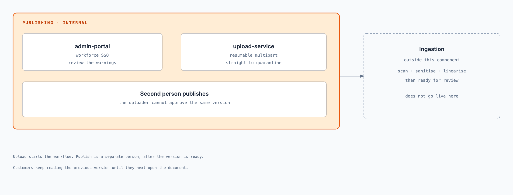

# Publishing

Publishing is how a new version gets into quarantine and, after the pipeline and a second person, becomes current. The admin portal and `upload-service` do not parse the PDF, scan it for malware, or serve it to customers. They accept the file and start the workflow.

Back to the [reference architecture](./index.md). The workflow is [ingestion](./05-ingestion.md). The pointer moves in the [Document API](./02-document-api.md).



[Open the diagram](pathname:///large-pdf-render/diagrams/component-publishing.html).

## Steps

Two people. The uploader and the approver are different accounts.

**Upload**

1. The administrator signs in through workforce SSO and chooses the document.
2. `upload-service` opens a session and returns pre-signed URLs for a multipart upload into the quarantine bucket.
3. The browser or the admin tool sends the parts straight to storage. The API does not proxy 200 MB.
4. On complete, the service checks the part list and the declared size, stores the session, and emits `document.uploaded`.
5. The portal shows the workflow status. It does not offer Publish until the status is `READY_FOR_REVIEW`.

**Approve**

1. A second person opens the review: page count, checksum, warnings (huge images, missing outline, scanned pages that needed OCR).
2. They call publish. The service rejects the call when `approverId` equals `uploaderId`.
3. `document-service` sets this version current. New sessions open it. Existing sessions keep their cookie.

## How to design it

| Service | Build it to | It must not |
|---------|-------------|-------------|
| `admin-portal` | Upload, show pipeline status and warnings, and collect a second approval | Talk to object storage with a long-lived key, or hide a failed scan |
| `upload-service` | Issue a short-lived multipart upload, accept complete, start one workflow | Parse the PDF, or copy the object into the document prefix itself. Ingestion does that after the scan |

The quarantine bucket has no customer path and a short lifecycle. An abandoned upload expires. An infected file is kept for investigation and is not copied out.

Pre-signed URLs expire in minutes and are bound to the upload id, the part numbers and the expected size. A URL from one session does not write another document's prefix.

## API

Customer calls are on the [clients](./01-clients.md) page. These routes are the admin door. They require a workforce token and an admin role.

### Start an upload

`POST /v1/admin/documents/{documentId}/versions`

**Request**

```json
{
  "fileName": "product-terms.pdf",
  "byteSize": 209715200,
  "contentType": "application/pdf"
}
```

| Field | Required | Notes |
|-------|----------|-------|
| `fileName` | Yes | Display only. The storage key is assigned by the service |
| `byteSize` | Yes | Rejected when it is above the configured ceiling |
| `contentType` | Yes | Must be `application/pdf`. The magic bytes are checked again after upload, before parse |

**Response** `201`

```json
{
  "uploadId": "upl_01HZX",
  "version": 5,
  "partSize": 16777216,
  "parts": [
    { "partNumber": 1, "url": "https://quarantine.example/..." }
  ],
  "expiresInSeconds": 3600
}
```

`version` is reserved. It is not current, and customers cannot open it. Parts can be retried. Completing twice with the same `uploadId` starts one workflow.

### Complete the upload

`POST /v1/admin/documents/{documentId}/versions/5/complete`

**Request**

```json
{
  "uploadId": "upl_01HZX",
  "parts": [{ "partNumber": 1, "etag": "abc" }]
}
```

**Response** `202`

```json
{ "version": 5, "status": "UPLOADED" }
```

The call returns when the workflow has started. It does not stay open for OCR.

### Publish

`POST /v1/admin/documents/{documentId}/versions/5/publish`

| Header | Required | Meaning |
|--------|----------|---------|
| `Authorization` | Yes | Workforce token of the approver |
| `Idempotency-Key` | Yes | One key per intended publish |

**Request**

```json
{ "uploadId": "upl_01HZX" }
```

The approver id is taken from the token. The body cannot name a different approver.

| HTTP | Meaning |
|------|---------|
| `200` | The version is `PUBLISHED` and current. Body includes `version` and `publishedAt` |
| `403` | The caller uploaded this version, or lacks the approver role |
| `409` | The version is not `READY_FOR_REVIEW`, or it was rejected |
| `200` on retry | The same key returns the original publish result |

A person can also reject. `POST .../reject` with a reason moves the version to `REJECTED` and leaves the current pointer where it was.

| HTTP | Status in the body | What the portal does |
|------|--------------------|----------------------|
| `202` | `UPLOADED` | Show pipeline progress |
| `200` | `PUBLISHED` | Tell the publisher the new version is live |
| `409` | `REJECTED` or not ready | Show the pipeline error or the scan result. Do not offer a retry of publish |
| `403` | — | A different person has to approve |

Errors use the same problem shape as the customer API.

## Events

| Topic | When | Body |
|-------|------|------|
| `document.uploaded` | Complete has been stored | `uploadId`, `documentId`, `version`, `uploaderId`, `byteSize` |
| `document.version.ready` | Consumed from ingestion, to refresh the portal | `version`, warnings |
| `document.version.published` | The pointer commit succeeds | `documentId`, `version`, `approverId` |

The portal reads status from `document-service`. A missed event is recovered with `GET /v1/admin/documents/{documentId}/versions/5`. The event is not the book of record.

## Files

| File | Direction | What publishing puts in it |
|------|-----------|----------------------------|
| Multipart object in quarantine | Admin tool to the quarantine bucket | The raw PDF, in parts. Not linearised, not scanned yet |
| Complete manifest of parts | Admin tool to `upload-service` | Part number and entity tag, so the object can be assembled |

The published prefix, the chunks and the manifest are not written here. [Ingestion](./05-ingestion.md) copies a clean file into `/documents/{docId}/v{n}/` after the scan.
