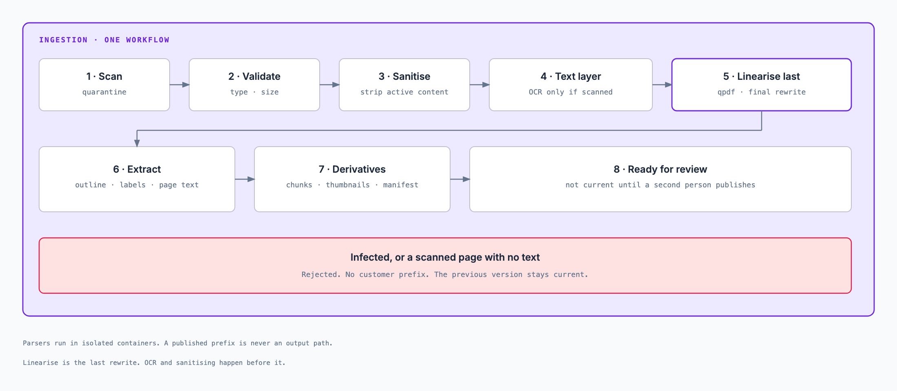

# Ingestion

Ingestion turns an upload into a version that is safe to read. It scans, strips active content, adds a text layer when the source is a scan, linearises, and writes the chunks, thumbnails, manifest and page index. It then marks the version ready for review. It does not publish, and it does not serve bytes to customers.

Back to the [reference architecture](./index.md). The file arrives from [publishing](./04-publishing.md). The bytes land in [document data](./06-document-data.md).



[Open the diagram](pathname:///large-pdf-render/diagrams/component-ingestion.html).

## Steps

The orchestrator runs these in order. A later step does not start on a failed earlier one. Linearise is the last rewrite of `document.pdf`.

1. Take `document.uploaded`. The object is still in quarantine.
2. Scan for malware. An infected file is `REJECTED`, alerted, and kept in quarantine.
3. Check type, integrity, page count, encryption and size. A file that is not a PDF, or that is password-protected so it cannot be processed, is `REJECTED`.
4. Strip JavaScript, embedded files and launch actions.
5. If any page has no text layer, run OCR and embed an invisible text layer. A scanned page that still has no text does not proceed to review.
6. Optionally recompress images and subset fonts. This still happens before linearise.
7. Linearise the full file. This is the last tool that rewrites `document.pdf`.
8. Extract metadata, outline, page labels and per-page text. Build chunks, thumbnails, the checksum and the manifest.
9. Write the prefix and the page index. Set status to `READY_FOR_REVIEW`.

Workers that parse PDFs run in isolated containers with no general network egress. They scale on queue depth.

## How to design it

| Worker | Build it to | It must not |
|--------|-------------|-------------|
| `ingestion-orchestrator` | Own the step history, the timers and the retries. One run per `uploadId` | Mark the version current |
| `scan-worker` | Scan the quarantine object and return clean or infected | Copy a clean file to the public prefix by itself. The workflow does that later |
| `pdf-processing-worker` | Validate, sanitise, extract, linearise, chunk, thumbnail | Fetch arbitrary URLs out of the PDF. External actions are stripped, not followed |
| `ocr-worker` | Embed a text layer with OCRmyPDF and Tesseract. Call a commercial engine only for pages that come back unreadable | Return loose text without writing it back into the PDF. Search, selection and screen readers need the layer in the file |
| `index-writer` | Write `page_text` and the version row in one commit, then emit `document.version.ready` | Publish |

Chunk size is a tuning choice. Aim for 2 to 5 MB and about 25 pages. Fonts repeat in each chunk, so stored bytes grow by perhaps 10 to 30 percent, which is cheap next to a full download per reader.

A source with huge images or no outline is still processed, and the warnings are stored on the version so the reviewer sees them. The publisher can withdraw and fix the source.

## Tools

| Step | Tool | Notes |
|------|------|-------|
| Malware scan | ClamAV, or a commercial engine behind the same worker interface | An infected result stops the workflow |
| Validate and extract | Apache PDFBox | Same language family as a Java API, if that is the organisation standard. Any maintained library behind the worker is acceptable |
| Sanitise | PDFBox | Strips active content customers should never receive |
| OCR | OCRmyPDF with Tesseract | Embeds an invisible text layer. A cloud OCR API is only for a page Tesseract cannot read, such as a poor scan or a dense table |
| Linearise and chunk | qpdf | `qpdf --linearize` for the full file. `qpdf in.pdf --pages . 1-25 -- chunk-001.pdf` for a chunk |
| Thumbnails | PDFium, or Poppler `pdftoppm` as a separate process | Small WebP images, one per page |

Poppler is GPL and runs as a separate command, not as a linked library, when its licence is the reason to keep it out of the API process. MuPDF is avoided unless its licence is accepted.

## Variant flows

### A PDF that already has text

1. Scan, validate, sanitise.
2. Skip OCR. The text-layer check passed.
3. Linearise, extract, write derivatives, index.
4. Ready for review. A second person publishes.

### A scan

1. Scan and sanitise.
2. OCRmyPDF embeds the text layer. Hard pages may go to the commercial engine.
3. Linearise after OCR. OCR before linearise would be undone.
4. The page index is the OCR text. Ready for review only when every scanned page has text.

### An infected file

1. The scanner returns infected.
2. The workflow sets `REJECTED`, alerts, and leaves the object in quarantine.
3. No parser opens it. No prefix is written under `/documents/`.

## Events

| Topic | When |
|-------|------|
| `document.uploaded` | Consumed. Starts the run |
| `document.version.ready` | Published after the index commit, with the warning list |
| Pipeline failure | Not a customer event. The version row stores the failed step and the error. The portal reads it |

A retried step uses the same `uploadId` and the same output prefix. It overwrites only objects inside a version that is not yet `PUBLISHED`. A published prefix is never an output path.

## Files

All of these are immutable once the version is `PUBLISHED`:

```text
/documents/{docId}/v{n}/document.pdf
/documents/{docId}/v{n}/chunks/001.pdf
/documents/{docId}/v{n}/thumbs/0001.webp
/documents/{docId}/v{n}/manifest.json
/documents/{docId}/v{n}/pages/0450-boxes.json
```

| File | What the worker writes |
|------|------------------------|
| `document.pdf` | The linearised, sanitised file. Desktop ranges and the explicit download |
| `chunks/001.pdf` | Pages 1–25, then the next chunk. Page numbers are 1-based and match the manifest |
| `thumbs/0001.webp` | One image per page |
| `manifest.json` | Page count, chunk map, outline, page labels, checksum. Shape on the [document data](./06-document-data.md) page |
| `pages/0450-boxes.json` | Optional word boxes for highlight rectangles. Omitted when the page has no reliable boxes |

The quarantine object is a different file. It is not copied into this prefix until the scan has passed and the processing steps have produced the linearised result. The linearised file is the one customers can read. The upload is not.

## Glossary

| Term | Meaning |
|------|---------|
| Chunk | A small PDF of consecutive pages, built so a phone can open a local file |
| Linearise | Arrange the PDF so the first pages and the cross-reference can be fetched without the rest. Also called Fast Web View. It speeds the first page, not a jump to page 450 |
| Manifest | The JSON description of one version: where the chunks are, the outline, the labels, the checksum |
| Page label | The printed label, such as `12.4` or `iv`, which may differ from the 1-based page index |
| Quarantine | The private bucket that holds uploads until the scan passes |
| Text layer | Invisible text on a scanned page so search, selection and screen readers work |
