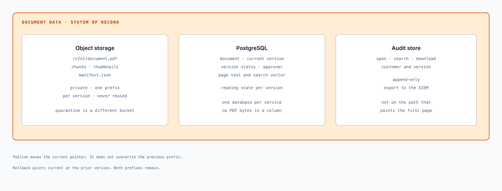

# Document data

Document data is the system of record for bytes and for which version is current. Object storage holds the PDF, the chunks, the thumbnails and the manifest. PostgreSQL holds the document, the version, the page text and the reading state. Nothing in the customer path reads a shared database. The edge reads objects. The API reads rows.

Back to the [reference architecture](./index.md). [Ingestion](./05-ingestion.md) writes a version. The [Document API](./02-document-api.md) is the only writer of the current pointer.



[Open the diagram](pathname:///large-pdf-render/diagrams/component-document-data.html).

## Steps

A version becomes readable only after both the prefix and the rows exist.

1. Ingestion writes the prefix for `v{n}`. Customers cannot name that prefix until a cookie exists, and a cookie is not issued before publish.
2. `index-writer` commits `document_version` as `READY_FOR_REVIEW` and the `page_text` rows in the same database transaction, then emits `document.version.ready`.
3. On publish, `document-service` sets `document.current_version` to `n` and the previous current row to `SUPERSEDED`, in one transaction, then emits `document.version.published`.
4. A reader with a cookie for the previous version keeps reading that prefix. The objects are still there.
5. Retention moves old prefixes to a colder storage class. It does not delete a version inside the retention period, and it does not delete the audit of who opened it.

## How to design it

| Store | Build it to | It must not |
|-------|-------------|-------------|
| Document prefix | One prefix per version. Keys never reused. Block public access. Encrypt with a customer-managed key | Accept a write from the CDN, or from a customer credential |
| Quarantine bucket | Hold the raw upload until the scan finishes. Short lifecycle for abandoned uploads. Keep infected objects for investigation | Sit behind the customer CDN |
| `document` and `document_version` | Be the source of truth for title, entitlement binding, current version, page count, checksum, approver and status | Store PDF bytes in a column |
| `page_text` | One row per page, with the text and a full-text vector | Be updated after publish. A correction is a new version |
| `reading_state` | One row per customer, document and version | Be required for the first page to paint |
| Audit store | Append open, search and download. Export to the SIEM. Retention lock where the rule requires it | Be queried on the open path |
| Search engine | Stay empty until PostgreSQL misses the target or search must cross documents | Replace `page_text` as the only copy. The table remains the source |

The core customer system, if there is one, remains the system of record for who the customer is. This platform stores the entitlement binding it was given, and it caches it. It does not become the identity system.

A half-written prefix is not referenced by a `READY_FOR_REVIEW` row. If the workflow fails after some objects exist, those objects belong to a version that never publishes and can be deleted by the lifecycle rule for abandoned versions.

## API

Other services reach this data through their own APIs, not through SQL across a boundary. The row shapes below are the contract those APIs persist.

### Document and version

| Column | Meaning |
|--------|---------|
| `document_id` | Stable id, for example `terms-2026` |
| `title` | What the client shows |
| `entitlement_rule` | The rule id the open path evaluates |
| `current_version` | The version new sessions open. Null until the first publish |
| `version` | Integer, increasing. Never reused |
| `status` | The states in the [reference architecture](./index.md#44-version-states) |
| `page_count`, `byte_size`, `checksum_sha256` | Taken from the processed file |
| `uploader_id`, `approver_id`, `published_at` | The maker-checker record |
| `warnings` | Huge images, missing outline, pages that needed OCR |

### Page text

| Column | Meaning |
|--------|---------|
| `version`, `page` | Together unique. `page` is 1-based |
| `page_label` | Printed label |
| `text` | The text layer for that page |
| `search_vector` | The full-text index PostgreSQL queries |

### Reading state

| Column | Meaning |
|--------|---------|
| `customer_id`, `document_id`, `version` | Together unique |
| `last_page` | Last page reported by a client |
| `bookmarks` | JSON list of `page`, `sectionId`, `label` |
| `updated_at` | Last successful `PUT` |

### Manifest

`manifest.json` is the file a client fetches to navigate. It is written once and then immutable.

```json
{
  "documentId": "terms-2026",
  "version": 4,
  "pageCount": 1000,
  "byteSize": 209715200,
  "checksumSha256": "2c26b46b68ffc68a...",
  "linearised": true,
  "chunkPages": 25,
  "chunks": [
    { "id": "001", "firstPage": 1, "lastPage": 25, "byteSize": 2400000 }
  ],
  "outline": [
    { "title": "Fees", "page": 90, "sectionId": "fees" }
  ],
  "pageLabels": [
    { "fromPage": 1, "toPage": 4, "style": "roman" }
  ]
}
```

`sectionId` is what a bookmark keeps so a later version can re-anchor. The page number is where that section sat in this version.

## Events

These stores do not publish the document topics themselves, except where a service in another page commits a row and an outbox event together.

| Stream | Who | What it is for |
|--------|-----|----------------|
| `document.version.ready` | `index-writer`, after the row commit | The portal may review |
| `document.version.published` | `document-service`, after the pointer commit | Audit, and any notification the organisation sends |
| Audit export | `audit-service` | The SIEM. Replay comes from the log and from this archive |

A consumer may lag behind `PUBLISHED`. The version is still current.

## Files

```text
/documents/{docId}/v{n}/document.pdf
/documents/{docId}/v{n}/chunks/001.pdf
/documents/{docId}/v{n}/thumbs/0001.webp
/documents/{docId}/v{n}/manifest.json
/documents/{docId}/v{n}/pages/0450-boxes.json
```

| File | Retention |
|------|-----------|
| Published prefix | As long as the version must be reproducible. Lifecycle may change storage class. It does not remove the prefix inside that period |
| Quarantine, clean and consumed | Short expiry after the prefix is written |
| Quarantine, infected | Kept for the investigation window, then the security retention rule |
| Abandoned upload | Expires with the multipart session |
| Audit archive | The regulatory retention for "what the customer was shown", with a retention lock where that rule requires it |

Rollback of a bad published version does not delete `v{n}`. It points `current_version` back at `v{n-1}`. Readers who already opened `v{n}` finish on it. The next open gets `v{n-1}`.
