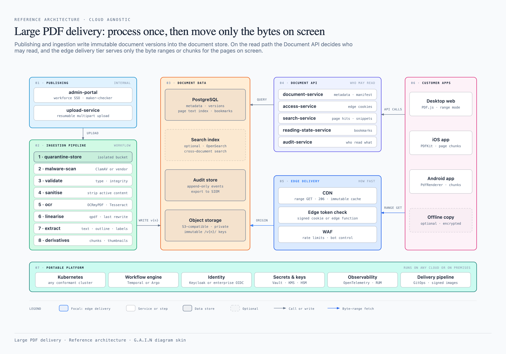
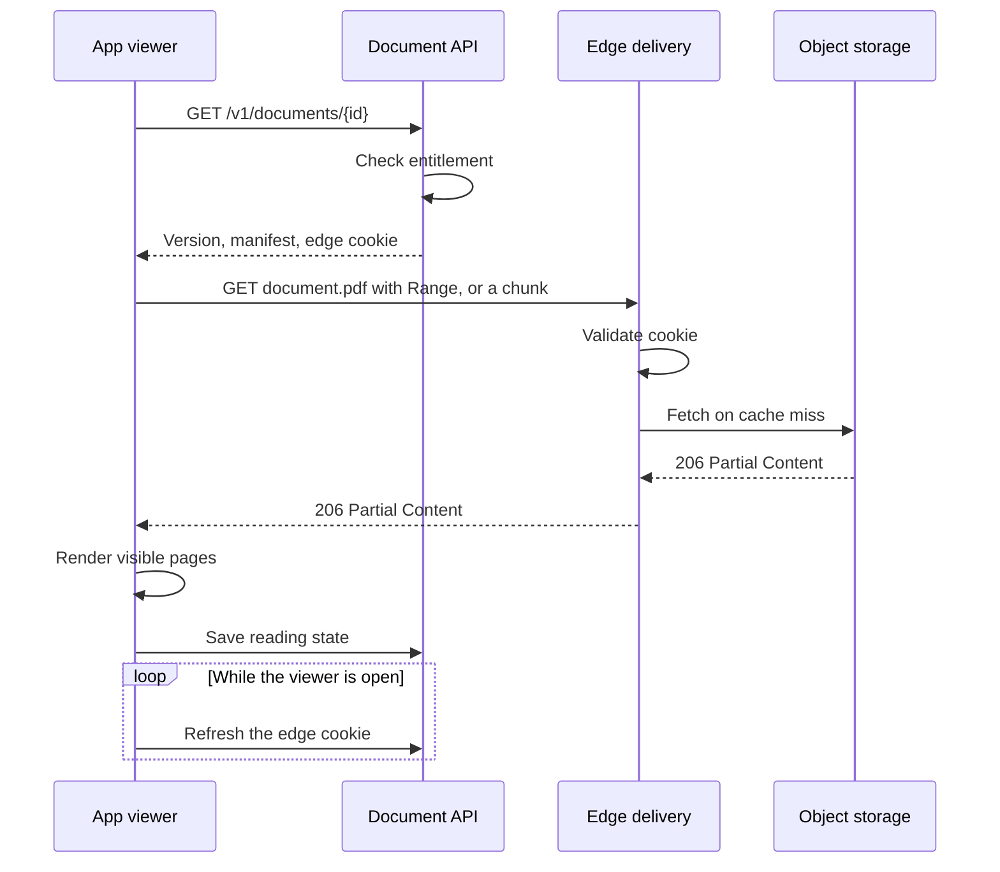
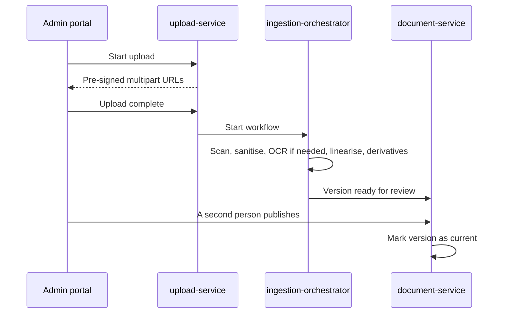

# Large PDF Delivery — Reference Architecture and Solution Design

**Scope:** The services that publish and read a very large PDF, the rules that keep a version consistent, and the portable technology they run on. The design is **cloud agnostic**. [Section 12](#12-cloud-mapping) maps each building block to AWS, Azure and Google Cloud for teams that prefer managed services.

**Context:** Customers open one shared document of about 1,000 pages, up to roughly 200 MB, in the existing desktop and mobile apps. Administrators publish a new version from time to time. The [executive brief](../00-exec-brief.md) is the short version, and the benefits are in the [business use case](../01-business-use-case.md). How to design each part, including the request and response, is on [clients](./01-clients.md), the [Document API](./02-document-api.md), [edge delivery](./03-edge-delivery.md), [publishing](./04-publishing.md), [ingestion](./05-ingestion.md) and [document data](./06-document-data.md).

**Design rule:** Only `access-service` issues an edge cookie, and only after an entitlement check. Ingestion writes a new immutable version. It does not publish it. A second person publishes. The edge serves bytes for that version and does not apply a business rule.

---

## Assumptions

The design rests on the assumptions below. Confirm each one with the business and the owning teams. The last column shows what changes if an assumption is wrong.

| # | Area | Assumption | If it does not hold |
|---|------|------------|---------------------|
| 1 | Content | The document is the same for every entitled customer. It is not personalised, so all customers share one cached copy at the edge | Personalised documents cannot share the cache. Each copy is produced per customer, which changes storage, cost and delivery |
| 2 | Document size and count | A handful of large documents, each about 1,000 pages and up to roughly 200 MB | Many documents, or search across them, can raise search latency. Explore OpenSearch then. It is not required on day one, and the pipeline needs more capacity |
| 3 | Update frequency | New versions are published monthly or less often. Processing a version, including OCR, can take minutes before review | Frequent or urgent updates need a faster pipeline, for example OCR split across page ranges |
| 4 | Reading pattern | A customer reads perhaps 20 to 50 pages per session, not the whole document | If most customers read the whole file, range requests save less and the optional offline copy becomes the main path |
| 5 | Customer actions | Customers read, search, bookmark and download. They do not annotate, fill forms or sign | Annotation, forms or signing need a commercial viewer on every platform |
| 6 | Source quality | Source PDFs can be sanitised and linearised, and most have an outline. Scanned pages are expected and are handled by OCR | Badly structured files are flagged. Publishers fix the source before approval |
| 7 | Identity and entitlement | Customers sign in through the enterprise identity provider using OpenID Connect. The rules for who may read each document are available to `document-service` and `access-service` | A missing entitlement source is built first. Every read depends on it |
| 8 | Clients | Customers use existing authenticated apps: a desktop web app that can host PDF.js, and iOS and Android apps that can use PDFKit and `PdfRenderer` | A public website or another client type needs its own access and caching rules |
| 9 | CDN capability | The CDN supports HTTP range requests, long cache lifetimes, and a cache key that leaves out the access cookie. Which edge-token option it supports is confirmed in a spike on the [edge delivery](./03-edge-delivery.md#edge-token-validation) page | Without range support, desktop uses page chunks, as mobile does. Without edge validation, use the token-checking proxy |
| 10 | Traffic | Read traffic is moderate. The cost illustration uses 10,000 sessions a month. The CDN absorbs most of it, so origin services stay small | Much higher traffic mainly raises CDN cost. The origin design stays the same, with more replicas |
| 11 | Availability | 99.9% is enough. One region across three availability zones, with a cross-region database replica, meets the target | A higher target needs active-active delivery and storage across regions |
| 12 | Data residency and retention | Storage and processing stay in one required region. Old versions are kept for as long as regulation requires | Other residency rules change where storage, processing and replicas run. A retention lock is turned on only where required |
| 13 | Publishing roles | At least two administrators are available, so a second person approves every version | A single publisher cannot meet the maker-checker control without a documented exception |

---

## 1. Architecture principles

1. **The API decides who may read. The edge decides how fast.** Clients never talk to the document store.
2. **Move only the bytes on screen.** Desktop uses HTTP range requests. Mobile uses small, pre-built page chunks.
3. **Process once, at ingestion.** Text, outline, thumbnails, chunks and the search index are produced when a version is published, not on the device.
4. **Immutable versions.** Each version gets new storage keys. Nothing is overwritten, so caches never need clearing and a reader never mixes two versions in one session.
5. **Scan before parse.** Untrusted files are scanned in quarantine before any PDF parser touches them.
6. **Linearise last.** Any later rewrite of the file undoes linearisation.
7. **Always able to read the current version.** A failed notification, a slow audit export or a pipeline failure does not unpublish the version customers are already reading.
8. **Portable.** Kubernetes, PostgreSQL, S3-compatible storage and a standard CDN, as in [section 11](#11-technology-stack), so the read path is not tied to one cloud.

---

## 2. Service architecture

This is the build view. Read it from publishing and the pipeline into document data, then across the Document API to the apps. The apps call the API for access, metadata, search and reading state. They fetch bytes from the edge.

Everything the customer waits on is above the document store: the entitlement check, the cookie, and search. Fetching a byte range is a separate call, and it does not come back through the API. Ingestion is off the read path. A version in progress is invisible to customers until a second person publishes it.

The design pages own the fields on each call.

[Open the service diagram](pathname:///large-pdf-render/diagrams/reference-architecture.html).

---

## 3. Service catalogue

Six boundaries hold across the catalogue:

1. The Document API authenticates and checks entitlement. It does not assemble PDF bytes, so a client cannot skip the check by calling the store.
2. Only `access-service` issues an edge cookie, and the cookie is scoped to one document version.
3. The edge serves bytes for a valid cookie. It does not decide entitlement, and the cookie value is not part of the cache key.
4. Ingestion writes a new version. It does not mark that version current.
5. A publisher cannot approve their own upload. `document-service` is the only writer of the current-version pointer.
6. Audit reads events. It is not on the path that paints the first page.

What each service must refuse, and the fields on each call, are on the design page for that part.

### 3.1 Clients

Desktop web, iOS, Android, and an optional offline copy. The apps already exist. This programme gives them one reading contract. The caller contract is on the [clients](./01-clients.md) page.

| Client | Responsibility | Talks to |
|--------|----------------|----------|
| Desktop web | PDF.js in range mode. Renders visible pages. Uses server search, outline and thumbnails | Document API and the edge |
| iOS | PDFKit on page chunks. Renders visible pages | Document API and the edge |
| Android | `PdfRenderer` on page chunks | Document API and the edge |
| Offline copy | Optional encrypted full file on the device, removed when access ends | Document API for the download link |

### 3.2 Document API

The only door that decides who may read. How the door is built is on the [Document API](./02-document-api.md) page.

| Service | Responsibility | Owns data | Interfaces |
|---------|---------------|-----------|------------|
| `document-service` | Lists entitled documents. Returns the current version, page count, size, manifest location and checksum | Documents and versions | REST |
| `access-service` | Checks entitlement and issues a short-lived edge cookie scoped to one version, refreshed while the viewer is open | Signing keys, in the secrets store | REST |
| `search-service` | Page-level search with snippets and highlight positions | Page text index | REST |
| `reading-state-service` | Last-read page and bookmarks per customer, document and version | Reading state | REST |
| `audit-service` | Records open, search and download with customer, version, time and channel | Audit events | Consumes events. Exports to the SIEM |

### 3.3 Edge delivery

Caches immutable files and serves byte ranges and chunks after the cookie check. The HTTP contract is on the [edge delivery](./03-edge-delivery.md) page.

| Component | Responsibility | Notes |
|-----------|---------------|-------|
| CDN | `206 Partial Content` for ranges. Long cache lifetime because keys are immutable | Any CDN with range requests |
| Edge token check | Validates the cookie before a cached object is served | Three options on the edge page |
| Web application firewall | Rate limits per customer, bot control, scraping protection | CDN WAF, or ModSecurity with the OWASP core rule set |

### 3.4 Publishing

| Service | Responsibility | Owns data | Interfaces |
|---------|---------------|-----------|------------|
| `admin-portal` | Upload, review, approve and publish. Maker-checker | None (UI) | Workforce SSO. Calls upload and document admin APIs |
| `upload-service` | Pre-signed, resumable multipart upload straight to quarantine. Starts ingestion when the upload completes | Upload sessions | REST. Publishes `document.uploaded` |

The admin contract is on the [publishing](./04-publishing.md) page.

### 3.5 Ingestion

Workers run in isolated, network-restricted containers. PDF parsers are a common attack surface. The step order and the tools are on the [ingestion](./05-ingestion.md) page.

| Service | Responsibility | Portable technology |
|---------|---------------|---------------------|
| `ingestion-orchestrator` | Durable workflow with retries, timeouts and a status per step | Temporal |
| `scan-worker` | Malware scan in quarantine. Rejects and alerts on an infected file | ClamAV, or a commercial engine |
| `pdf-processing-worker` | Validates, strips active content, extracts text, outline and page labels, linearises, builds chunks and thumbnails | Apache PDFBox, qpdf, PDFium |
| `ocr-worker` | Invisible text layer on scanned pages | OCRmyPDF with Tesseract |
| `index-writer` | Writes page text and sets status to ready for review | PostgreSQL full-text search |

### 3.6 Document data

Object storage, PostgreSQL, an optional search engine, and the audit store. No service shares another's database. The layout and the manifest are on the [document data](./06-document-data.md) page.

| Store | Holds |
|-------|-------|
| Object storage | Linearised PDF, chunks, thumbnails, manifest. One prefix per version. Private |
| PostgreSQL | Document, version, page text, reading state |
| Search index | Empty on day one. Explore OpenSearch if PostgreSQL full-text search cannot answer the query, or latency increases |
| Audit store | Append-only open, search and download events. Exported to the SIEM |

---

## 4. Consistency, time and state

### 4.1 Where a caller waits

| Caller | Waits until | Does not wait for |
|--------|-------------|-------------------|
| A customer opening a document | Entitlement check, current version, and a durable edge cookie. The response is `200` with the manifest location | The PDF bytes. Those come from the edge after this call |
| A customer searching | The page hits for that query | Any download of the file |
| An administrator, when the upload completes | The object is in quarantine and the workflow has started | Scan, OCR, linearise, or approval |
| An approver publishing | The current-version pointer is durable | CDN cache fill. The keys are new, so nothing is invalidated |
| Audit, dashboards, the SIEM | Nothing on the read path | They read events |

The viewer that needs page 450 issues a range or chunk request to the edge. The open call is not held open for those bytes.

### 4.2 If a step does not answer

A customer is refused before a cookie is issued. A file is scanned before it is parsed, and linearised after every rewrite. A customer read never starts ingestion.

| Step | If it does not answer |
|------|------------------------|
| Customer token | `401`. No cookie |
| Entitlement | `403`. No cookie and no manifest |
| Search | `503` on the search call. Pages already on screen stay. The viewer does not fall back to downloading the file to search it locally |
| Reading-state save | The viewer retries. A missed save does not block reading |
| Upload into quarantine | The admin retries the same upload session. Ingestion does not start |
| Malware scan | Do not parse. The version stays in quarantine |
| Validate, sanitise, OCR, linearise | Do not offer the version for review. A scanned page without a text layer is not ready |
| Publish | Do not move the current pointer. The previous version stays current |
| Edge, on a cache miss, when the origin is down | The viewer gets an error for that range. There is no public fallback URL |

A timeout is a decision. The open path does not retry entitlement in a loop. Ingestion retries a failed tool step inside the workflow until the attempt limit, then marks the version failed for a person.

### 4.3 Idempotency

| Boundary | Key | A duplicate |
|----------|-----|-------------|
| Upload session | Upload id | Completing twice starts one workflow |
| Publish | Document id and version | A second publish leaves the same version current |
| Reading state | Customer, document | `PUT` replaces the row. A retry does not create a second bookmark set |
| Download link | Customer, document, version, idempotency key | One audit event and the same link until it expires |
| Open audit | Customer, document, version, client open id | A retried open is one `document.opened` |

### 4.4 Version states

`document-service` is the only writer of `PUBLISHED`. Ingestion advances the version as far as `READY_FOR_REVIEW`. Notification is not a state.

`UPLOADED → SCANNED → PROCESSED → READY_FOR_REVIEW → PUBLISHED`

| State | Meaning |
|-------|---------|
| `UPLOADED` | The bytes are in quarantine and the workflow has started |
| `SCANNED` | The malware scan is clean. A parser may open the file |
| `PROCESSED` | The file is sanitised, has a text layer, is linearised, and the derivatives are written |
| `READY_FOR_REVIEW` | Metadata and the page index are written. Customers cannot open it |
| `PUBLISHED` | This version is current for new sessions |
| `REJECTED` | The scan, the validation, or a person declined it. Terminal for this version |
| `SUPERSEDED` | It was current, and a newer version replaced it. Still readable by version id for the retention period |

A reader who already holds a cookie for version `n` finishes that session on `n`. The next open returns `n+1` and the message that the document was updated. A reject before `PUBLISHED` leaves the previous current version in place. A failed step after `SCANNED` does not publish a half-written prefix: the prefix is abandoned and the workflow records the failure.

### 4.5 How the services talk

| Mechanism | Used for | Choice |
|-----------|----------|--------|
| Request and response | Open, search, reading state, admin upload and publish | REST |
| Durable workflow | Ingestion steps, timers, retries | Temporal |
| Domain event | Facts other services may react to | An append-only log with a schema. Kafka when the organisation already runs one |
| Transactional outbox | The state write and the publish of the event | Outbox table in the service database |
| Byte delivery | Ranges and chunks | HTTPS `GET` with `Range`, through the CDN |

:::note
The protocol for a call to an internal service or a bought scanner is subject to what that product offers. REST is the working choice between the platform's own services. A product that speaks something else is wrapped. PDF bytes stay on the edge path and are not tunnelled through the API.
:::

---

## 5. Canonical flows

These two flows are the normative patterns. Search, a page jump, a download and a scanned-page publish are the same patterns with a different call. Those variants are on the [clients](./01-clients.md), [publishing](./04-publishing.md) and [ingestion](./05-ingestion.md) pages.

### 5.1 Open and read

A failed entitlement check returns before any cookie and before any byte request. The viewer shows an error and does not call the edge.

### 5.2 Publish a new version

The person who uploaded cannot call publish for that version. Customers already reading the previous version are not interrupted.

---

## 6. Topics

| Topic | Producer | Main consumers | Key |
|-------|----------|----------------|-----|
| `document.uploaded` | `upload-service` | Ingestion orchestrator | Upload id |
| `document.version.ready` | Ingestion, after the index commit | `document-service`, the admin portal | Version id |
| `document.version.published` | `document-service`, after the pointer commit | Audit, notifications if the organisation sends them | Document id |
| `document.opened` | `document-service` | `audit-service` | Document id |
| `document.downloaded` | `document-service` | `audit-service` | Document id |
| `document.searched` | `search-service` | `audit-service` | Document id |

The key is the partition key, so one document's versions stay in order. Schemas are versioned and change in backward-compatible ways. A topic is a replay window. The books and records are the version rows, the object store and the audit archive in [section 7](#7-data-architecture).

A failed audit export does not change the version. The consumer retries from the log.

---

## 7. Data architecture

| Data | Store | Notes |
|------|-------|-------|
| Service data | PostgreSQL, one database per service | Documents, versions, page text, reading state, upload sessions |
| Workflow state | Temporal, backed by PostgreSQL | The history of each ingestion run |
| Objects | S3-compatible store, versioned prefixes | The only copy of the PDF bytes |
| Events | The log in [section 6](#6-topics) | Replay window. Not the system of record |
| Audit archive | Object storage with a retention lock where required | Open, search and download events |
| Search at scale | OpenSearch, only if explored | Not deployed on day one. Explore it if PostgreSQL full-text search cannot answer the query, or search latency increases past the 500 ms target |

The object store is the system of record for bytes. PostgreSQL is the system of record for which version is current, who approved it, and the page text. A manifest in the prefix describes the chunks and the outline so a client can navigate without opening the PDF. A published prefix is never rewritten. The [document data](./06-document-data.md) page has the keys and the tables.

---

## 8. Deployment and failure domains

| Concern | Design |
|---------|--------|
| Compute | Kubernetes in one region, three availability zones. API services are stateless and scale on load. Workers scale on queue depth |
| Storage | Object storage with versioning. A retention lock where regulation requires it. Cross-region replication when the retention copy must leave the region |
| Database | PostgreSQL high-availability inside the region. An asynchronous replica in another region |
| Delivery | The CDN absorbs reads. The origin is reachable only from the CDN or the token-checking proxy |
| Releases | GitOps. Canary. A bad document version is rolled back by pointing current at the previous version |
| Recovery | Published bytes and the version pointer are recoverable from the replica. Recovery time is the time to promote that replica and is tested |
| Residency | Storage and processing stay in the required region |

A fault should stop as little reading as possible:

| Failure | What stops | What continues |
|---------|------------|----------------|
| One availability zone | Nothing the customer can see, once the zone is drained | The other zones |
| One CDN location | Readers directed at that location | Other locations. Cached ranges are still served |
| Search | Search results | Opening and paging the current version |
| Ingestion | New versions | The published version |
| The region | New reads, until the replica is promoted | The retention copy, for recovery. This design is not active-active |

---

## 9. Security architecture

The products that implement these controls are in [section 11](#11-technology-stack).

| Control | Design |
|---------|--------|
| Identity | OpenID Connect. Customer identity comes from the enterprise identity provider. Administrators use workforce SSO |
| Authorisation | Entitlement on every metadata, access, search and download call. Publish requires a second person |
| Edge access | Short-lived cookie scoped to `/documents/{docId}/v{n}/*`, refreshed while the viewer is open. The cookie value is never part of the cache key |
| Origin protection | Private storage. No public object URL. Reachable only from the edge tier |
| Content safety | Malware scan and sanitising before publish. Viewer scripting turned off |
| Encryption | TLS 1.2 or higher in transit. Encryption at rest with keys in a KMS or HSM |
| Abuse protection | A WAF in front of the API and the CDN. A rate limit per customer slows scraping. An optional viewer watermark shows the customer's name and keeps the shared cache |
| Audit | Every open, search and download. Exported to the SIEM |
| Supply chain | Signed container images, a software bill of materials, and admission control. Workers that parse PDFs have no general network egress |

### Request protection

A public request is inspected before it reaches `document-service`. The public edge is the CDN and the gateway in front of the Document API.

| Threat | What stops it | Where |
|--------|----------------|-------|
| A flood of packets or connections | DDoS protection | The API address and the CDN |
| A malformed or abusive HTTP call | Web application firewall | The HTTPS edge |
| One client above its call rate | A rate rule at the edge, then the API's own limit | Dropped before a cookie is issued |
| A caller who is not entitled | Token and the entitlement check | The Document API. No cookie |
| A stolen or expired cookie | Edge token check, short lifetime | The CDN, before the cached object is served |
| A malicious upload | Quarantine and malware scan before any parser | Ingestion. No customer path to that bucket |

The WAF runs the OWASP core rule set, a limit on body size, a block on methods the API does not use, and a rate rule per token. It does not decide entitlement and it does not scan PDF bytes. An SFTP-style drop is not used. Administrators upload with pre-signed URLs to the quarantine bucket, which is not behind the public CDN cache.

DDoS protection in the table above is the protection included with the CDN. CloudFront includes AWS Shield Standard, Azure includes infrastructure DDoS protection, and Google's edge includes always-on network DDoS protection. Those are part of the CDN. This design does not add AWS Shield Advanced, Azure DDoS Network Protection or Cloud Armor Enterprise. Those are paid subscriptions with a response team, for an edge that must stay up through a targeted attack. Here the public traffic is moderate cached reads, and the origin is private, so the CDN's included protection and the WAF cover the flood. A paid DDoS subscription would be a later decision if that threat changes.

Per-customer watermarking, if required, is a viewer overlay. A file stamped per customer cannot be shared in the CDN cache and is generated only for an explicit download.

---

## 10. Observability

- Traces, metrics and logs leave each service through OpenTelemetry. Browser and mobile real-user monitoring record time to first page and time to jump.
- Every trace carries the document id and the version, so one read can be followed across the API, the cookie issuer and the edge.
- **Bytes per session** is a primary signal. A sudden rise means range loading broke and full downloads have started.
- Alerts follow the symptom: first-page time above target, search above 500 ms, a rising `403` rate on the edge (cookie refresh is failing), cache hit ratio dropping, any failed publish, any malware hit, and a rise in viewer crashes after a release.

| Signal | Alert when |
|--------|------------|
| Time to first page | 95th percentile above target for 15 minutes |
| Bytes per session | Jumps against pages viewed |
| CDN | `403` rate rises, or the share of `206` responses falls |
| API | Error rate above 1% or latency above target on open or search |
| Pipeline | Any failed publish, or a malware hit |
| Mobile | Out-of-memory crashes rise after a release |

---

## 11. Technology stack

Each row is the chosen product. Earlier sections describe the control. They do not name a second product for the same job.

| Building block | Choice | Constraint |
|----------------|--------|------------|
| Container platform | Kubernetes | A conformant distribution, in the required region |
| Workflow engine | TBD | |
| Object storage | An S3-compatible store | Private. One prefix per version |
| Database and search | PostgreSQL full-text search | OpenSearch is not required on day one. Explore it if full-text search cannot answer the query, or latency increases |
| Malware scanning | ClamAV, or a commercial engine behind `scan-worker` | The scanner can be replaced without rewriting the workflow |
| PDF processing | Apache PDFBox, qpdf, PDFium | OCRmyPDF with Tesseract for the text layer. A commercial OCR engine only for pages Tesseract fails |
| Identity | The enterprise identity provider, or Keycloak where the organisation has none | OIDC. The document services do not store passwords |
| Secrets and keys | HashiCorp Vault or OpenBao, plus a KMS or HSM | Cookie-signing keys live here |
| Edge proxy, when option C is required | Envoy or NGINX | In front of the origin. The CDN still caches |
| WAF | The CDN WAF, or ModSecurity with the OWASP core rule set | In front of the public API and the CDN |
| Observability | OpenTelemetry, Prometheus, Grafana | Real-user monitoring on web and mobile |
| Desktop viewer | PDF.js | Range mode. Scripting off |
| Mobile viewers | PDFKit on iOS, `PdfRenderer` on Android | On page chunks |
| Delivery | GitOps, images signed with Sigstore | Canary |

---

## 12. Cloud mapping

Managed equivalents for a team that does not want to operate the stack above. The document services stay the same.

| Building block | AWS | Azure | Google Cloud |
|----------------|-----|-------|--------------|
| Kubernetes | Amazon EKS | Azure Kubernetes Service | Google Kubernetes Engine |
| Object storage | Amazon S3 | Azure Blob Storage | Cloud Storage |
| CDN | Amazon CloudFront | Azure Front Door | Cloud CDN |
| Edge token check | CloudFront signed cookies (option A) | No native signed cookies at the edge. Use option B or C | Cloud CDN signed cookies (option A) |
| Workflow engine | Temporal Cloud | Temporal Cloud | Temporal Cloud |
| PostgreSQL | Amazon Aurora PostgreSQL or RDS | Azure Database for PostgreSQL | Cloud SQL or AlloyDB |
| Search, only if explored | Amazon OpenSearch Service | Azure AI Search | Vertex AI Search, or Elastic Cloud |
| Malware scanning | GuardDuty Malware Protection for S3, behind `scan-worker` | Microsoft Defender for Storage | A commercial scanner or ClamAV |
| OCR for hard pages | Amazon Textract, behind `ocr-worker` | Azure AI Document Intelligence | Document AI |
| Identity | Amazon Cognito, or the enterprise provider | Microsoft Entra External ID | Identity Platform |
| Secrets and keys | AWS Secrets Manager and AWS KMS | Azure Key Vault | Secret Manager and Cloud KMS |
| WAF | AWS WAF on CloudFront | Azure Web Application Firewall on Front Door | Cloud Armor |
| Monitoring | CloudWatch and CloudWatch RUM | Azure Monitor and Application Insights | Cloud Monitoring |
| Private origin | Origin Access Control | Private origin locked to Front Door | Signed requests from the load balancer |

Azure Front Door does not validate signed cookies at the edge. Serving a cached private document on Azure uses the token-checking proxy on the [edge delivery](./03-edge-delivery.md#edge-token-validation) page. Confirm that option before choosing the CDN.

OpenSearch is not required on day one. Search runs on PostgreSQL full-text search. If that search cannot answer the query, or latency increases past the 500 ms target, explore OpenSearch. Amazon OpenSearch Service is the AWS service for that exploration. Azure AI Search, or Vertex AI Search or Elastic Cloud, is the same step on the other clouds. Until then the search row is not deployed.

There is no Shield Advanced row. DDoS protection is the protection included with the CDN, as described under [request protection](#request-protection).

Use the managed service through its open interface: the S3 API, the PostgreSQL wire protocol and OpenTelemetry. A cloud workflow engine such as Step Functions, Durable Functions or Google Workflows is a different programming model from Temporal, so it is a separate decision and not a drop-in mapping. A short function timeout is the wrong place for a 1,000-page OCR. The worker is still a container.

---

## 13. Architecture decisions

| # | Decision | Alternative rejected | Reason |
|---|----------|----------------------|--------|
| 1 | Immutable versioned storage keys | Overwrite the object and clear the cache | No cache invalidation, no mixed-version byte ranges, and a clear record of what each customer saw |
| 2 | Signed cookies at the edge, refreshed while the viewer is open | A signed URL per request | A long reading session outlives a URL. PDF.js cannot swap the URL mid-document, so later pages fail |
| 3 | Server-side search | Search inside the viewer | Viewer search reads every page and downloads the document |
| 4 | Native mobile rendering on page chunks | A full download, a WebView, or a commercial SDK as the default | The phone stays within memory, the viewer feels native, and there is no licence cost. A commercial SDK is only for annotations, forms or signing |
| 5 | PostgreSQL full-text search on day one | A search cluster from day one | One database to run. Explore OpenSearch only if full-text search cannot answer the query, or latency increases |
| 6 | Portable building blocks, with a cloud mapping | An AWS-only stack as the architecture | The same services run on any cloud. The one cloud-specific concern, edge token validation, is isolated on the edge page |
| 7 | Linearise as the last rewrite | Linearise earlier in the pipeline | OCR, sanitising and image optimisation rewrite the file and undo linearisation |
| 8 | Scan in quarantine before any parser runs | Validate and parse, then scan | PDF parsers are a common place for a malicious file to land |
| 9 | Temporal owns the ingestion lifecycle | A cloud state machine as the default | Retries, timers and the step history would be rebuilt per cloud. Containers still do the heavy work |
| 10 | The customer is released at metadata and a cookie | Hold the API call until the file has downloaded | The API would move 200 MB, and a phone would still have to hold it. Status of the bytes is the edge's `206` |
| 11 | A second person publishes | The uploader publishes when processing finishes | The person who prepared the file should not be the person who makes it current |
| 12 | Public HTTP enters through the CDN WAF | A WAF only inside the cluster | The cluster would absorb the flood, and the API would see traffic that should have been dropped at the edge |

Record each as an ADR once it is agreed. The design pages follow this list. They do not keep a second one.
