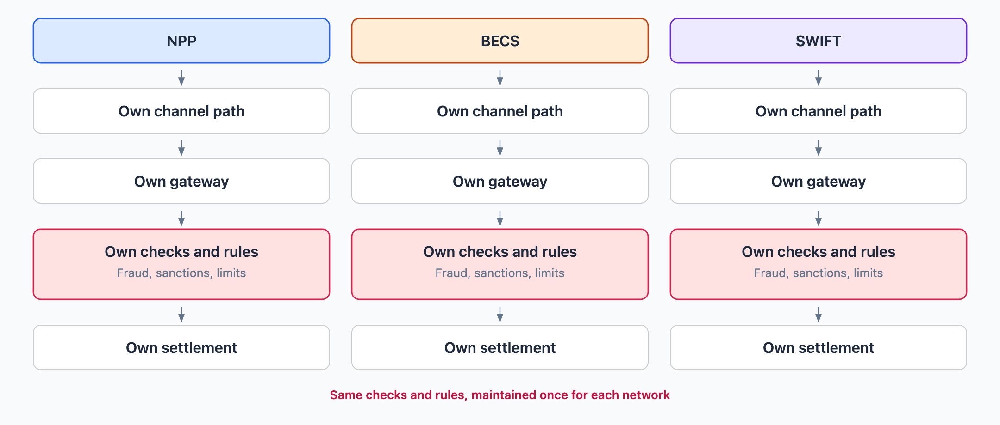
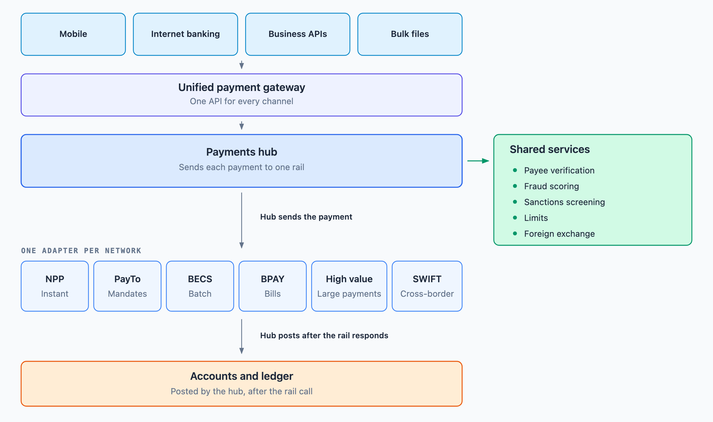

# Modern Payment Platform

## Executive summary

Endorse one payments platform as the direction for all payment networks, and approve the first release: instant payments on NPP, with real-time fraud and sanctions checks.

One hub serves every channel and every network. Shared services apply the same checks to every payment. Each network connects through its own adapter. Customers pay and get paid instantly, safely and at any hour, in Australia or overseas.

Full case: [business use case](./01-business-use-case.md). Design: [reference architecture](./02-reference-architecture/index.md).

## The problem

**Each payment network is its own path, from the channel down to settlement.** Fraud, sanctions, limits and the other shared checks are wired in separately on every path. The same rules are duplicated, and every change is maintained once for each network.

- **Customers expect instant.** Osko and PayID are normal. A next-business-day payment feels broken.
- **BECS closes around 2030.** Payroll and direct debits move to NPP. Building for NPP now avoids a second migration later.
- **PayTo replaces direct debit.** Customers approve, pause and cancel recurring payments in the app. A revenue opportunity with merchants and billers.
- **Scams are a board issue.** The Scams Prevention Framework requires real-time prevention, with evidence that it works.
- **Payments must stay up.** APRA CPS 230 requires payments to run 24/7, within defined tolerance levels, with no maintenance windows.

:::note
**NPP** (New Payments Platform) is Australia's real-time payments network. Money moves account to account in seconds, 24 hours a day. Osko and PayID run on it.

**BECS** (Bulk Electronic Clearing System), also called Direct Entry, is the older batch network behind payroll and direct debits. Payments are exchanged in files and settle a few times a day, not instantly. The industry plans to retire it around 2030 and move that traffic to NPP.
:::

## The solution

Every channel and every payment network connects to one hub.

- **Unified payment gateway.** Mobile, internet banking, business APIs and bulk files use the same Payments API.
- **Shared services.** Payee verification, fraud and scam scoring, sanctions screening, limits, and pricing and foreign exchange are built once and called from the hub on every payment. A rule is written and maintained in one place, and a new network inherits the same controls. The checks complete in under a second.
- **One adapter per network.** The hub sends the payment to NPP, PayTo, BECS, BPAY, high value or SWIFT. After the rail responds, the hub posts to the accounts and ledger. A new network is added as one adapter.
- **Always on.** Multiple sites, no maintenance windows, able to run on any major cloud or on premises.

We buy sanctions screening, the fraud platform and the network gateways, and place them behind the shared services. We build the orchestration, the routing and the customer experience.

## Benefits

| Area | Outcome | How we will know |
|------|---------|------------------|
| Customer | Pay anyone in seconds, any time, and see the payee's name first | A few seconds, end to end |
| Revenue | PayTo for merchants, payment APIs for business, transparent foreign exchange | Revenue from PayTo, APIs and foreign exchange |
| Cost | One platform, with most payments needing no manual touch | Above 98% straight through. Lower cost per payment |
| Risk | Fraud, scam and mule checks on every payment | Losses fall year on year |
| Resilience | Stays up, and a network outage is queued or rerouted | 99.99% availability, no planned downtime |
| Agility | A new payment product is configuration plus an adapter | Weeks to launch, not quarters |

These targets are illustrative and will be confirmed with the business.

## Delivery approach

Each release stands on its own.

| Release | What goes live |
|---------|----------------|
| 1. Instant payments | The hub, shared services for fraud and sanctions, NPP with Osko and PayID |
| 2. Control and safety | PayTo, Confirmation of Payee, business APIs, bulk payments over NPP |
| 3. Global | SWIFT with tracking and foreign exchange, high-value payments |
| 4. Complete | BECS and BPAY, and retirement of the older payment systems |

| Risk | How it is managed |
|------|-------------------|
| The programme is large | Value is released in four stages. Each stage stands on its own |
| Checks could slow a payment | Each check is tested at peak volumes, and a check that does not answer has a defined outcome |
| Dependence on vendors | Vendor products sit behind the shared services and can be replaced. Contracts are managed under CPS 230 |

Waiting has a cost. BECS closing means a second migration. Scam losses grow. Customers move their main account to a bank with better payments. Each network-specific system keeps its own upgrades, staff and vendor contracts.
