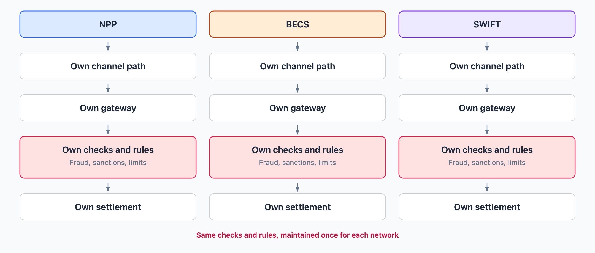
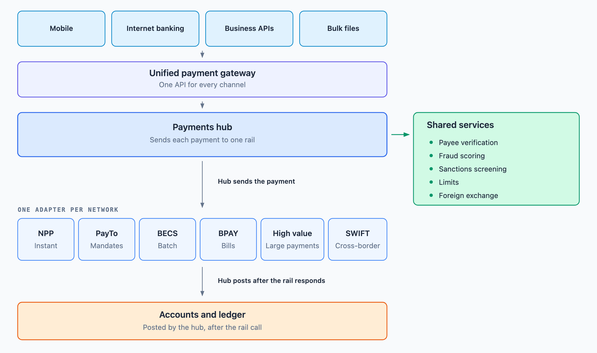
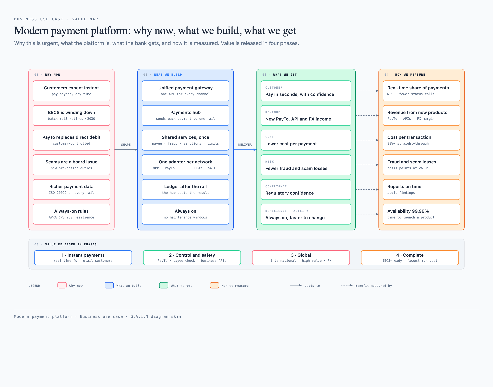

# Modern Payment Platform — Business Use Case

**In one line:** One modern payments platform that lets every customer pay and get paid instantly, safely and at any hour, in Australia or overseas, while cutting the cost and risk of running a separate system for each payment network.

**Context:** An Australian bank that holds a banking licence (an authorised deposit-taking institution, or ADI) and connects directly to the Australian payment networks and to SWIFT for international payments. It is building a new payments platform from scratch rather than extending older systems.

---

## 1. How payments work today

Each payment network is its own path, from the channel down to settlement. Fraud, sanctions, limits and the other shared checks are wired in separately on every path. The same rules are duplicated, and every change is maintained once for each network.

NPP, BECS and SWIFT are shown. PayTo, BPAY and high-value payments work the same way: a separate path, a separate copy of the checks, and a separate set of rules.

---

## 2. Why now

| Driver | What is happening | What it means for the bank |
|--------|-------------------|----------------------------|
| **Customers expect instant** | Real-time payments through NPP (Osko and PayID) are now normal for consumers and businesses | Any delay or "next business day" feels broken. Instant is the baseline, not a premium |
| **BECS is being wound down** | The industry plans to retire BECS Direct Entry, the batch system behind payroll and direct debits, around 2030 and move that traffic to NPP | Payroll, direct debits and bulk payments must move to real-time rails. A platform built NPP-first avoids a second migration later |
| **PayTo is replacing direct debits** | PayTo lets customers approve, pause and cancel recurring payments in their banking app | A new revenue and retention opportunity with merchants and billers, and a better customer experience than paper direct debit forms |
| **Scams are a board-level issue** | The Scams Prevention Framework (2025) places obligations on banks to prevent, detect and respond to scams. Confirmation of Payee is rolling out across the industry | The bank needs real-time scam and fraud controls inside every payment, with evidence that they work |
| **ISO 20022 everywhere** | NPP, high-value payments and SWIFT now carry ISO 20022 messages, which include richer, structured data | Better data for fraud models, reconciliation and business customers, but only if the platform keeps that data end to end |
| **Operational resilience rules** | APRA's CPS 230 (in force since July 2025) requires banks to keep critical operations, such as payments, within defined tolerance levels | Payments must run 24/7 with no maintenance windows and a tested recovery plan |

---

## 3. What we will build

Every channel and every payment network connects to one hub.

- **Unified payment gateway.** Mobile, internet banking, business APIs and bulk files use the same Payments API.
- **Shared services.** Payee verification, fraud and scam scoring, sanctions screening, limits, and pricing and foreign exchange are built once and called from the hub. A rule is written in one place, and a new network inherits the same controls.
- **One adapter per network.** The hub sends the payment to NPP, PayTo, BECS, BPAY, high value or SWIFT. After the rail responds, the hub posts to the accounts and ledger.
- **Always on.** Multiple sites, no maintenance windows, able to run on any major cloud or on premises.

The bank buys sanctions screening, the fraud platform and the network gateways, and places them behind the shared services. It builds the orchestration, the routing and the customer experience.

---

## 4. Who benefits

| Stakeholder | Pain today | With the new platform |
|-------------|------------|-----------------------|
| **Retail customers** | Some payments are not instant. Unsure if they are paying the right person. International transfers are slow and opaque | Pay anyone in seconds, any time. See the payee's name before paying. Track international payments like a parcel |
| **Business and corporate customers** | Payroll and supplier runs depend on batch windows. Reconciliation is manual. Different channels for different payment types | One API and file channel for all payment types, real-time status, rich remittance data that reconciles automatically |
| **Merchants and billers** | Direct debit failures, dishonours and paper forms | PayTo mandates with real-time authorisation and fewer failed collections |
| **Payment operations** | Several systems and consoles, manual repairs, late visibility of problems | One operations console for every rail, automated exception queues, live dashboards |
| **Risk, fraud and compliance** | Controls differ by channel and rail. Reporting is manual | The same fraud, scam and sanctions checks on every payment, automated AUSTRAC reporting and a full audit trail |
| **Treasury** | Limited intraday view of settlement liquidity | Real-time view of the settlement account at the Reserve Bank and overseas account balances |
| **Technology** | Each network is its own path. Checks and rules are copied, so a change is made once per network | One gateway, one hub, shared checks written once, and one adapter per network |

---

## 5. Business use cases

| # | Use case | Payment network | Customer outcome |
|---|----------|-----------------|------------------|
| 1 | **Pay anyone instantly**, using a PayID (phone, email or ABN) or BSB and account | NPP and Osko | Money arrives in seconds, 24/7 |
| 2 | **Know who you're paying** before you confirm | PayID lookup, Confirmation of Payee | Fewer mistaken payments and fewer scams |
| 3 | **Subscriptions and recurring payments** that customers control in their app | PayTo | Approve, pause or cancel in one tap. Merchants get paid reliably |
| 4 | **Payroll and supplier runs** | NPP first, BECS only where needed | Staff and suppliers are paid in real time, even on weekends |
| 5 | **Bill payments** | BPAY | Familiar biller payments in the same experience |
| 6 | **International transfers** with upfront fees, exchange rate and tracking | SWIFT, including gpi tracking and Swift Go for smaller amounts | Customers know the cost and can see where their money is |
| 7 | **High-value and treasury payments** | High-value RTGS through the Reserve Bank | Certain, final settlement for large payments |
| 8 | **Real-time payment data for business** | All rails, ISO 20022 | Automatic reconciliation and instant notifications into accounting systems |

---

## 6. Benefits

Read it left to right. The reasons to act shape one platform: a unified payment gateway, a hub that sends each payment to one rail, and shared services written once. The hub posts to the ledger after the rail responds. Each benefit has a measure, and value is released in four phases. [Open the full diagram](pathname:///modern-payment-platform/diagrams/business-value-map.html).

| Area | Benefit | How the platform delivers it | How we measure it |
|------|---------|------------------------------|-------------------|
| **Customer** | Instant, always-on payments | Real-time rails with a 24/7 platform and 24/7 account updates | Share of domestic payments that are real time. Payment success rate |
| **Customer** | Confidence and transparency | Payee name check before paying, live status, international tracking | Fewer "where is my payment?" calls. Customer satisfaction (NPS) |
| **Revenue** | New products and fees | PayTo for merchants and billers, payment APIs for business, FX on international payments | Revenue from PayTo, APIs and FX margin |
| **Revenue** | Customer retention | Payments are the most frequent banking interaction. A better experience keeps primary customers | Primary-bank customers. Attrition rate |
| **Cost** | Lower cost per payment | One hub instead of a system per rail. Straight-through processing with few manual touches | Cost per transaction. Manual repair rate |
| **Cost** | Lower operations effort | Automated reconciliation and exception handling | Reconciliation breaks. Operations hours per 10,000 payments |
| **Risk** | Fewer fraud and scam losses | Real-time fraud and scam scoring, payee checks and incoming mule detection on every payment | Fraud and scam losses (basis points of value). Scam reimbursement costs |
| **Compliance** | Regulatory confidence | Built-in sanctions screening, automated AUSTRAC reports, complete audit trail | Reporting on time. Audit findings |
| **Resilience** | Payments stay up | Runs across multiple sites with no maintenance windows. A payment network outage can be absorbed by queueing or rerouting | Availability (target 99.99%). Time to recover |
| **Agility** | Faster change | Payment-network differences sit in adapters. Rules are configuration, not code | Time to launch a new payment product or network |

---

## 7. Measures of success

Illustrative targets, to be confirmed with the business.

| Measure | Target |
|---------|--------|
| Payments processed with no manual touch | Above 98% |
| Domestic payment value moved in real time | Majority of eligible payments within 24 months |
| Time for an instant payment to reach the payee's bank | A few seconds, end to end |
| Platform availability | 99.99% or better, with no planned downtime |
| Fraud and scam losses | Measurable reduction year on year |
| Cost per transaction | Lower than today's blended cost across rails |
| Time to add a new payment product | Weeks, not quarters |

---

## 8. Cost of not acting

- **Two migrations instead of one.** Building on BECS means migrating again when BECS closes.
- **Growing scam liability.** Without real-time controls, the bank carries more of the cost of scams under the new framework.
- **Lost customers.** Customers move their primary account, and their salary, to banks with better payments.
- **Rising run cost.** Every rail-specific path keeps its own checks, rules, upgrades, security fixes, staff and vendor contracts.
- **Resilience risk.** Batch-era systems with maintenance windows struggle to meet CPS 230 tolerance levels for a 24/7 service.

---

## 9. Phased value delivery

| Phase | What goes live | Value released |
|-------|---------------|----------------|
| **1. Instant payments** | Unified payment gateway, payments hub, shared services for fraud and sanctions, NPP with Osko and PayID, core banking integration. The hub sends the payment and posts to the ledger after the rail responds | Real-time payments for retail customers. Foundation for everything else |
| **2. Control and safety** | PayTo, Confirmation of Payee, business payment APIs, bulk payments sent over NPP first | New merchant revenue. Fewer scams. Real-time payroll for business customers |
| **3. Global** | SWIFT with gpi tracking and FX, high-value RTGS payments | Transparent international payments and FX revenue. One platform for treasury |
| **4. Complete** | BECS and BPAY adapters, retirement of any older payment systems, data products for business customers | Lowest run cost, ready for the BECS wind-down, insight-led products |

---

## 10. Risks and how they are managed

| Risk | Mitigation |
|------|------------|
| Delivery is large and complex | Release value in phases. Each phase stands on its own |
| Fraud and sanctions checks slow instant payments | Each check is tested at peak volumes, and a check that does not answer has a defined outcome |
| Dependence on vendors for screening and scheme connectivity | Vendor products sit behind the shared services, so they can be replaced. Contracts managed under CPS 230 |
| Skills for a 24/7 event-driven platform | Platform team with clear ownership, runbooks and production readiness reviews |
| Customer change (for example, moving direct debits to PayTo) | Phased migration with clear customer communications and support |

---

## Related pages

- [Executive brief](./00-exec-brief.md): a 10-minute version of this page for executives.
- [Reference architecture and solution design](./02-reference-architecture/index.md): the services, technology and flows behind these benefits. Its child pages cover [clients](./02-reference-architecture/01-clients.md), the [unified payment gateway](./02-reference-architecture/02-unified-payment-gateway.md), the [payments hub](./02-reference-architecture/03-payments-hub.md), [rails](./02-reference-architecture/04-rails.md), [accounts and ledger](./02-reference-architecture/05-accounts-and-ledger.md) and [shared services](./02-reference-architecture/06-shared-services.md).
