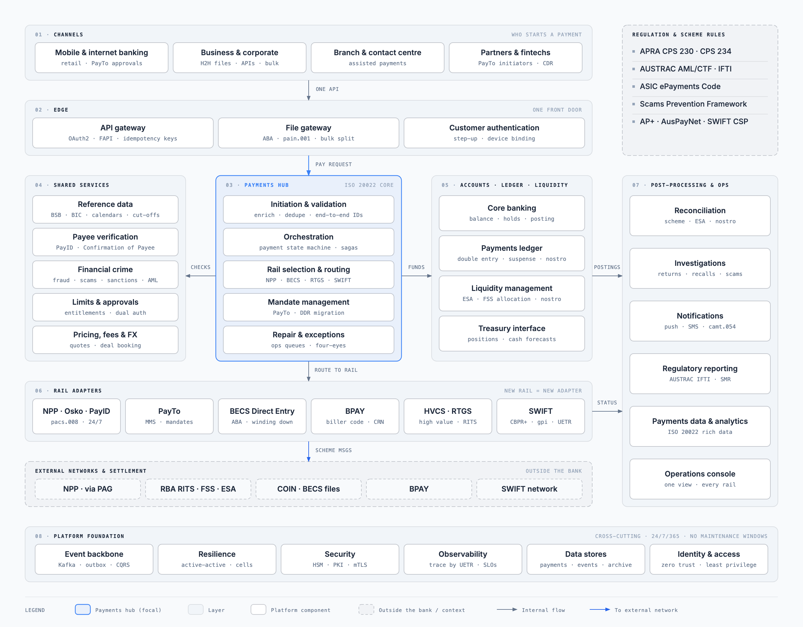
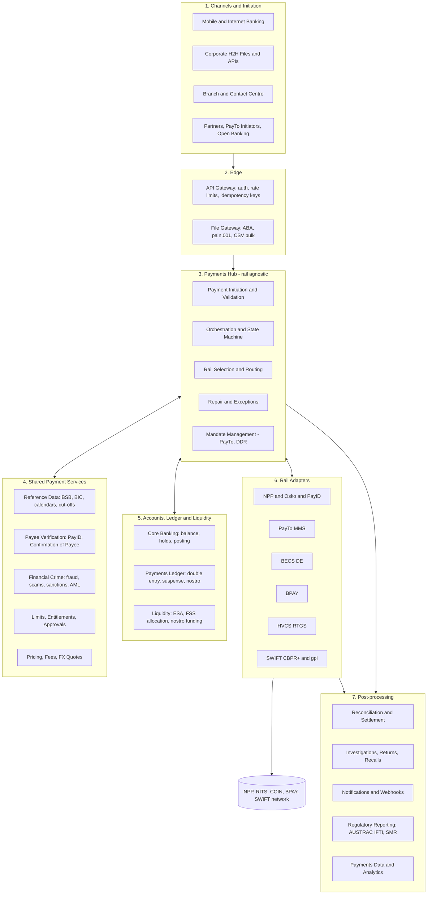

# Modern Payment Platform — Component Deep Dive (Australia)

**Context:** An Australian bank that holds a banking licence from APRA (an authorised deposit-taking institution, or ADI) and an Exchange Settlement Account (ESA) with the Reserve Bank of Australia (RBA). It is building a **greenfield** payments platform and connects directly to the local rails and to SWIFT.

**Purpose of this doc:** A deep, complete view of the components. We will later condense it into two 10-minute decks, one for business and one for tech.

---

## 1. The rails the platform must support

| Rail | What it is | Speed and settlement | Message format | How the bank connects |
|------|-----------|----------------------|----------------|------------------------|
| **NPP** (New Payments Platform) | Real-time account-to-account payments, 24/7/365. Operated by Australian Payments Plus (AP+) | Seconds. Settled line by line in RBA's **Fast Settlement Service (FSS)** inside RITS | ISO 20022 (`pacs.008`, `pacs.002`, `pacs.004`, `camt.056`, `camt.029`) | Payments Access Gateway (PAG) at the participant, plus PKI certificates |
| **Osko** | NPP overlay service for fast consumer and business payments | Same as NPP | Same as NPP | Via NPP |
| **PayID** | NPP addressing service (phone, email, ABN mapped to BSB and account) | Lookup in real time | NPP addressing APIs | Via NPP |
| **PayTo** | NPP mandated payments: payer authorises a mandate in their banking app, initiators pull funds | Real time | ISO 20022 mandate messages (`pain.009`–`pain.012`) plus NPP payments | NPP Mandate Management Service (MMS) |
| **BECS / Direct Entry** | Bulk batch credits and debits (payroll, direct debits). Administered by AusPayNet. **Being wound down, with migration to NPP planned by around 2030** | Deferred net settlement in RITS, several times a day | ABA (Cemtex) fixed-width files | File exchange over COIN (Community of Interest Network) |
| **BPAY** | Bill payments using a biller code and a customer reference number (CRN). Operated by AP+ | Batch, net settlement | BPAY file formats | BPAY connectivity |
| **HVCS / RITS** | High-value payments settled one by one in real time (RTGS) across ESAs at the RBA | Real time during RITS hours | ISO 20022 over SWIFT (Y-copy) | SWIFT, RITS |
| **SWIFT (cross-border)** | International payments through correspondent banks | Minutes to days, using nostro and vostro accounts | ISO 20022 **CBPR+** (`pacs.008`, `pacs.009`, `camt.053`). MT coexistence for payment instructions ended in November 2025 | SWIFT Alliance (Access or Lite2) or a service bureau. gpi tracker (UETR). Swift Go for low-value payments |

**Key insight for the presentation:** Every one of these rails either already uses ISO 20022 or is migrating to it, apart from the legacy BECS and BPAY file formats. So a **single canonical model based on ISO 20022** is the natural centre of the design.

---

## 2. The big picture: a layered architecture

Read it top to bottom to follow a payment. A channel calls one Payments API through the edge. The **payments hub** (highlighted) validates the payment, calls **shared services** on its left for checks and **accounts, ledger and liquidity** on its right for funds, then routes the payment to a **rail adapter**. The adapter speaks that scheme's language to the external network. Status and postings flow right into **post-processing**, and the **platform foundation** underpins everything.

Interactive version with notes: [open the full diagram](pathname:///modern-payment-platform/diagrams/layered-architecture.html).

Mermaid source (editable fallback)

---

## 3. Layer 1 — Channels and initiation

Who starts a payment and how.

| Component | Responsibility | Design notes |
|-----------|---------------|--------------|
| Retail digital (app and web) | Single payments, PayID pay, scheduled and recurring payments, PayTo mandate approval, international transfers | The UX should hide the rail. The customer says "pay Sam $50" and the platform picks the rail |
| Business and corporate | Host-to-host files (ABA, ISO 20022 `pain.001`), payment APIs, bulk payroll, approval workflows | Corporates need status callbacks (`pain.002`, `camt.054`) and rich remittance data |
| Branch and contact centre | Assisted payments, investigations, recalls | Same APIs as digital channels. No side doors |
| Partners and fintechs | PayTo payment initiators, embedded finance, Consumer Data Right (CDR) action initiation in future | Partner onboarding, API keys, consent |
| Internal | Treasury payments, fee collections, interest, loan drawdowns | Treated as just another channel |

**Principle:** Every channel calls **one Payments API**, and none of them integrates with a rail directly.

---

## 4. Layer 2 — Edge

| Component | Responsibility |
|-----------|---------------|
| **API Gateway** | OAuth2 and FAPI-grade security, mTLS for partners, throttling, **idempotency keys** (a retried request must never pay twice), API versioning |
| **File Gateway** | Receive bulk files, scan them, check format, split them into individual payments, return acknowledgements |
| **Customer authentication** | Step-up and strong customer authentication for high-risk payments, device binding |

---

## 5. Layer 3 — Payments Hub (the heart)

The hub is **rail-agnostic**. It works only with the canonical ISO 20022 model and leaves scheme-specific detail to the adapters.

### 5.1 Payment initiation and validation
- Syntax and business validation (BSB format, account checks, amount limits, currency).
- Enrichment: debtor details, purpose codes, structured remittance, LEI for corporates.
- Assigns identifiers: the internal payment ID, the **end-to-end ID**, and the **UETR** for SWIFT.
- Duplicate detection, in addition to the idempotency check at the edge.

### 5.2 Orchestration and the payment state machine
A payment is a long-running process with many steps. Model it as an explicit **state machine**, for example:

`RECEIVED → VALIDATED → SCREENED → FUNDS_RESERVED → ROUTED → SENT_TO_RAIL → ACCEPTED / REJECTED → SETTLED → POSTED → NOTIFIED`

- Each step publishes an event, which gives full auditability and lets other components react.
- Use the **saga pattern** for compensations. For example, if the rail rejects the payment, release the hold and notify the customer.
- Timeouts per rail. NPP needs a response within seconds, while BECS works on cut-off times.
- **Exactly-once effect** through idempotent steps and an outbox pattern.

### 5.3 Rail selection and routing (smart routing)
Decides **which rail** to use, based on:
- Whether the payee is reachable on NPP (if the payee's bank isn't an NPP participant, fall back to BECS).
- Amount (high value goes to HVCS/RTGS), urgency, and cost.
- Currency and destination (non-AUD or offshore goes to SWIFT, Swift Go, or partner networks).
- Customer preference, contractual rules, and rail health. If NPP is degraded, decide whether to queue or fall back.

This is a **key differentiator** to call out to the business: it optimises cost and speed, and it keeps the platform resilient when one rail has an outage.

### 5.4 Mandate management
- PayTo mandates: create, amend, suspend, cancel. Holds the mandate store, synchronised with the NPP MMS.
- Legacy Direct Debit Requests (DDRs) for BECS, and **migrating DDRs to PayTo** as BECS winds down.

### 5.5 Repair and exceptions
- Queues for operations staff: payments that failed validation, sanctions hits, scheme rejects.
- Four-eyes approval on manual repair.

---

## 6. Layer 4 — Shared payment services

### 6.1 Reference data
- **BSB directory** (from AusPayNet), NPP participant reachability, **BIC directory** (SWIFT), IBAN rules by country.
- Business calendars: Australian public holidays by state, foreign holidays, RITS hours, BECS settlement windows, SWIFT cut-offs per currency.
- Correspondent bank routing tables (Standard Settlement Instructions, or SSIs).

### 6.2 Payee verification
- **PayID resolution**, which shows the payee name before the customer confirms.
- **Confirmation of Payee (CoP)**: the Australian industry rollout matches name to BSB and account for non-PayID payments. This is a major scam-reduction control.

### 6.3 Financial crime (often the hardest part)
| Capability | When it runs | Notes |
|-----------|---------|-------|
| **Real-time fraud and scam scoring** | Before the payment is sent (pre-authorisation, in milliseconds) | Behavioural analytics, device signals, mule-account detection, first-time payee checks. Can hold, challenge, or block |
| **Sanctions screening** | Before the payment is sent, on both outbound and inbound | DFAT Consolidated List, plus UN, OFAC and EU lists for USD and EUR. Screens names and full message content. Must fit within NPP's latency budget |
| **AML transaction monitoring** | After the event, in near real time | Detects patterns such as structuring and layering, and feeds AUSTRAC Suspicious Matter Reports (SMRs) |
| **Scam interventions** | Before sending | Friction, warnings, cooling-off periods. Driven by the **Scams Prevention Framework** obligations |
| **Inbound mule detection** | When funds arrive | Monitors receiving accounts. Part of shared industry intelligence |

### 6.4 Limits, entitlements and approvals
- Customer and channel daily limits, plus per-payee and per-rail limits.
- Corporate approval rules (for example, two approvers above $X) and role-based entitlements.

### 6.5 Pricing, fees and FX
- Fee calculation per rail, product and segment.
- **FX**: rate quote, then booking (deal ID), then settlement. The quote should be locked for a short window. FX margin is a key revenue line in the business deck.
- Transparency of SWIFT charge options (OUR, SHA, BEN) and gpi fee and FX disclosure.

---

## 7. Layer 5 — Accounts, ledger and liquidity

| Component | Responsibility |
|-----------|---------------|
| **Core banking integration** | Real-time balance check, **funds reservation (hold)**, final posting, reversals. Must be available 24/7, because NPP never stops |
| **Payments ledger** | Double-entry sub-ledger for in-flight payments, suspense and clearing accounts, nostro mirrors, fee income. It is the source of truth for reconciliation |
| **Liquidity management** | Monitors the **ESA balance** in real time and decides how much ESA liquidity to allocate to **FSS** (for NPP) versus RTGS. Also handles intraday liquidity forecasting, **nostro funding** per currency for SWIFT, and alerts and throttling when liquidity runs low |
| **Treasury interface** | Position keeping and funding of nostros, cash flow forecasts |

**Design decision to discuss:** Should holds and postings happen in the core banking system, or in a modern payments ledger that posts to the core asynchronously? A greenfield platform often uses a **real-time ledger** so that it isn't limited by batch-era core banking systems.

---

## 8. Layer 6 — Rail adapters (gateways)

Each adapter **translates between the canonical model and the scheme**, enforces scheme rules, and manages the connection.

| Adapter | Key responsibilities |
|---------|---------------------|
| **NPP adapter** | Connects to the PAG, sends and receives `pacs.008` and `pacs.002`, handles PayID lookups, and runs the 24/7 inbound flow. **Inbound payments** must be validated, screened and credited within seconds, otherwise they are rejected. Also handles returns (`pacs.004`), recall requests (`camt.056`, `camt.029`), and PKI and certificate management |
| **PayTo adapter** | Mandate lifecycle messages with the MMS, mandate-based payment initiation, notifying payers of changes |
| **BECS adapter** | Builds ABA files for each settlement window, exchanges them over COIN, processes inbound files, dishonours and returns, and settlement figures |
| **BPAY adapter** | Outbound bill payment batches and inbound biller files if the bank acts as a biller's bank |
| **HVCS adapter** | ISO 20022 RTGS messages over SWIFT, RITS settlement status, queue management |
| **SWIFT adapter** | CBPR+ `pacs.008` (customer) and `pacs.009` (bank-to-bank cover), **gpi tracker and UETR**, `camt.056` recalls, Swift Go, **pre-validation** of beneficiary details, nostro statements (`camt.053`) |

**Principle:** Adding a new rail, such as a future Asian instant-payments link, should mean **adding an adapter, not changing the hub**.

---

## 9. Layer 7 — Post-processing and operations

| Component | Responsibility |
|-----------|---------------|
| **Reconciliation** | Scheme settlement reports against the payments ledger, ESA statements against FSS and RTGS totals, nostro statements (`camt.053`) against expected flows. Includes break management and ageing |
| **Investigations and case management** | Customer enquiries, mistaken payments (ePayments Code), recalls, returns, SWIFT gpi Case Management, scam claims |
| **Notifications** | Push, SMS and email to customers, and webhooks and `camt.054` messages to corporates. **Ties to the sibling `customer-communication-platform`** |
| **Regulatory reporting** | AUSTRAC **IFTI** reports (International Funds Transfer Instructions, for every cross-border payment, within 10 business days), SMRs, threshold reports. Also APRA and RBA statistical returns, and scheme reporting to AP+ and AusPayNet |
| **Payments data and analytics** | Event stream into a data platform. ISO 20022 rich data drives insights, fraud models, cash flow tools for business customers, and SLA dashboards |
| **Operations console** | One view of every payment across all rails, rail health, queue depths, liquidity, and manual actions with audit |

---

## 10. Layer 8 — Platform foundation (cross-cutting)

### 10.1 Architecture style
- **Event-driven microservices** (or a modular monolith per domain) on **Kafka or another event backbone**.
- **Canonical ISO 20022 data model** everywhere inside the platform.
- **Cell-based or partitioned deployment**, so a failure affects only one cell of customers.
- **Configuration-driven scheme rules** (cut-offs, limits, routing) rather than hard-coded logic.

### 10.2 Resilience (24/7/365, with no maintenance windows)
- Active-active across two or more availability zones or regions. Zero-downtime deployments (blue-green or canary).
- Graceful degradation: if fraud scoring times out, apply a defined fallback policy. If a rail is down, queue the payment or reroute it.
- **APRA CPS 230** (operational risk management, in force since July 2025): critical operations, tolerance levels, and management of material service providers such as cloud and payments vendors.
- Disaster recovery targets: recovery point objective of about zero for payments, and a recovery time objective measured in minutes.

### 10.3 Security
- **APRA CPS 234** (information security). HSMs for keys and message signing, PKI certificates for NPP and SWIFT.
- **SWIFT Customer Security Programme (CSP)** annual attestation.
- mTLS between services, zero-trust networking, secrets management, least-privilege access, privileged access controls.
- Encryption of data in transit and at rest. Privacy Act obligations. PCI DSS only if card data is in scope.

### 10.4 Observability
- Distributed tracing keyed by payment ID, end-to-end ID and UETR, so a payment can be followed across every hop.
- Business SLOs, for example "95th-percentile NPP outbound time from submission to acceptance is under 5 seconds", plus per-rail success rates and alerting.

### 10.5 Data stores
- Payment store (transactional, strongly consistent). Event store for audit. Read models for queries (CQRS). Archive with **7-year retention** (AML/CTF record keeping).

---

## 11. End-to-end flows (useful to walk through in the tech deck)

### 11.1 Outbound Osko payment (domestic, real time)
1. Customer enters a PayID in the app, and the **PayID lookup** returns the payee name, which the customer confirms.
2. The API Gateway checks the idempotency key, and the hub validates and enriches the payment.
3. Limits check, then **fraud and scam scoring** and **sanctions screening** (in milliseconds).
4. **Funds hold** in the core banking system or ledger.
5. Routing selects NPP, and the adapter sends a `pacs.008` through the PAG.
6. The payee's bank accepts, and a `pacs.002` comes back as ACSC. Settlement happens in **FSS** in real time.
7. Final posting, release of the hold, customer notification, and an event goes to analytics. **Total time: seconds.**

### 11.2 Inbound NPP payment
1. A `pacs.008` arrives at the PAG, and the adapter checks scheme rules.
2. Account lookup and status checks (closed, blocked), plus **inbound sanctions and mule checks**.
3. Credit the account, send `pacs.002` acceptance, notify the customer. All within the scheme's time limit.

### 11.3 PayTo mandate and payment
1. A merchant (the initiator) creates a mandate through its bank, and the **MMS** notifies our bank.
2. The customer approves the mandate in the app, and the mandate store and MMS are updated.
3. The initiator triggers a payment, the platform validates it against the mandate's terms (amount, frequency), and it settles over NPP.

### 11.4 Payroll batch over BECS
1. A corporate uploads an ABA file. The file gateway validates it and splits it into payments.
2. Approval workflow, then screening, then funds reservation for the batch total.
3. The routing engine decides whether **each payee is NPP-reachable** (and so goes real time) or goes to BECS. This is a migration-ready design.
4. The BECS adapter builds the outbound file for the next settlement window, sends it over COIN, and handles returns and dishonours.

### 11.5 Outbound SWIFT cross-border payment with FX
1. The customer pays USD to a US beneficiary. The platform gets an **FX quote**, the customer accepts, and the deal is booked.
2. Sanctions screening (multiple lists) plus fraud checks. Pre-validation of beneficiary details through SWIFT.
3. Debit the AUD account, and the FX booking credits the USD nostro position.
4. The SWIFT adapter sends a CBPR+ `pacs.008` with a **UETR**, through the correspondent chain.
5. **gpi tracker** status updates go to the customer, who sees "credited to beneficiary".
6. An **AUSTRAC IFTI report** is generated, and the nostro is reconciled using `camt.053`.

### 11.6 High-value RTGS payment (HVCS)
1. A treasury or corporate high-value payment is routed to HVCS.
2. An ISO 20022 message goes over SWIFT, RITS checks there are enough ESA funds, settles the payment, then releases it.
3. The liquidity dashboard updates the ESA position in real time.

---

## 12. Key architectural decisions and trade-offs (core of the tech deck)

| Decision | Options | Recommended stance (greenfield bank) |
|----------|---------|--------------------------------------|
| Build vs buy the hub | Buy a payments hub product (e.g. Volante, Finastra, ACI, FIS, Icon IPF) / Build in-house / Hybrid | **Hybrid**: buy the commodity parts (scheme adapters, SWIFT connectivity, sanctions engine) and build what differentiates you (orchestration, routing, customer experience, data) |
| Canonical model | Proprietary model / ISO 20022 | **ISO 20022** across the board, with rich data retained end to end |
| Ledger | Post directly to core / Modern real-time payments ledger | **Real-time ledger**, posting to the general ledger and core banking asynchronously |
| Integration style | Synchronous APIs / Event-driven | **Event-driven backbone**, with synchronous calls only where latency is critical (fraud, sanctions, funds hold) |
| Hosting | On-premises / Public cloud / Hybrid | **Cloud-native**, with the HSMs and scheme gateways possibly on-premises or in co-location. Cloud is a material service provider under CPS 230 |
| Rail fallback | Fail the payment / Auto-reroute | Configurable **reroute policy** (for example NPP to BECS for non-urgent payments) with customer consent and clear messaging |
| Financial crime placement | Inline everywhere / Risk-tiered | **Risk-tiered**: inline for real-time outbound, with a strict latency budget, plus post-event monitoring |
| BECS sunset | Keep building on BECS / NPP-first | **NPP-first**: BECS is only a fallback adapter, so its retirement doesn't require changes elsewhere |

---

## 13. Regulatory and industry landscape (business deck material)

- **APRA:** CPS 230 (operational risk and resilience), CPS 234 (information security), outsourcing and material service providers.
- **AUSTRAC:** AML/CTF Act obligations (customer due diligence, SMRs, IFTIs, threshold reports), plus the AML/CTF reforms.
- **ASIC:** ePayments Code (mistaken payments, unauthorised transactions).
- **Scams Prevention Framework (2025):** obligations on banks to prevent, detect, disrupt and respond to scams, with potential liability.
- **RBA and Treasury payments reforms:** payments licensing, the strategic plan for payments, BECS and cheque wind-down.
- **Industry:** AP+ (NPP, BPAY, eftpos), AusPayNet (BECS, HVCS frameworks), Confirmation of Payee rollout.
- **SWIFT:** CBPR+ ISO 20022 (MT coexistence ended in 2025), gpi, CSP security attestation.
- **CDR (open banking):** data sharing now, payment (action) initiation in future.

---

## 14. Business view: what the platform unlocks

| Outcome | How the components enable it |
|---------|------------------------------|
| **Instant, always-on payments** | NPP adapter, 24/7 core and ledger, active-active platform |
| **Fewer scams and less fraud loss** | PayID and CoP, real-time fraud and scam scoring, inbound mule detection |
| **New revenue** | PayTo for merchants and billers, FX margin, business payment APIs, ISO 20022 data insights |
| **Lower cost to serve** | One hub instead of rail silos, straight-through processing, automated reconciliation |
| **Faster time to market** | Adapter model (new rail = new adapter), configuration-driven rules |
| **Regulatory confidence** | Built-in screening, IFTI automation, CPS 230 resilience by design, full audit trail |
| **Transparent cross-border payments** | SWIFT gpi tracking, upfront FX and fees, Swift Go for small international transfers |
| **Future-proof** | BECS sunset ready, ISO 20022 native, ready for CDR payment initiation and new rails |

**Candidate KPIs:** straight-through processing rate (target above 98%), NPP share of domestic volume, 95th-percentile end-to-end latency, fraud and scam losses in basis points, cost per transaction, payment availability (99.99%+), time to launch a new payment product.

---

## 15. Glossary

| Term | Meaning |
|------|---------|
| ADI | Authorised Deposit-taking Institution (an APRA-licensed bank) |
| AP+ | Australian Payments Plus (operator of NPP, BPAY, eftpos) |
| AusPayNet | Australian Payments Network (industry self-regulatory body for BECS, HVCS and other frameworks) |
| BSB | Bank-State-Branch number (Australian bank routing code) |
| CBPR+ | Cross-Border Payments and Reporting Plus (SWIFT's ISO 20022 usage guidelines) |
| COIN | Community of Interest Network (private network for BECS file exchange) |
| CoP | Confirmation of Payee |
| ESA | Exchange Settlement Account at the RBA |
| FSS | Fast Settlement Service (RBA's 24/7 real-time settlement for NPP) |
| HVCS | High Value Clearing System (RTGS payments over SWIFT) |
| IFTI | International Funds Transfer Instruction (AUSTRAC report) |
| MMS | Mandate Management Service (PayTo) |
| PAG | Payments Access Gateway (participant's NPP connection) |
| RITS | Reserve Bank Information and Transfer System (Australia's RTGS) |
| UETR | Unique End-to-end Transaction Reference (SWIFT gpi tracking ID) |
