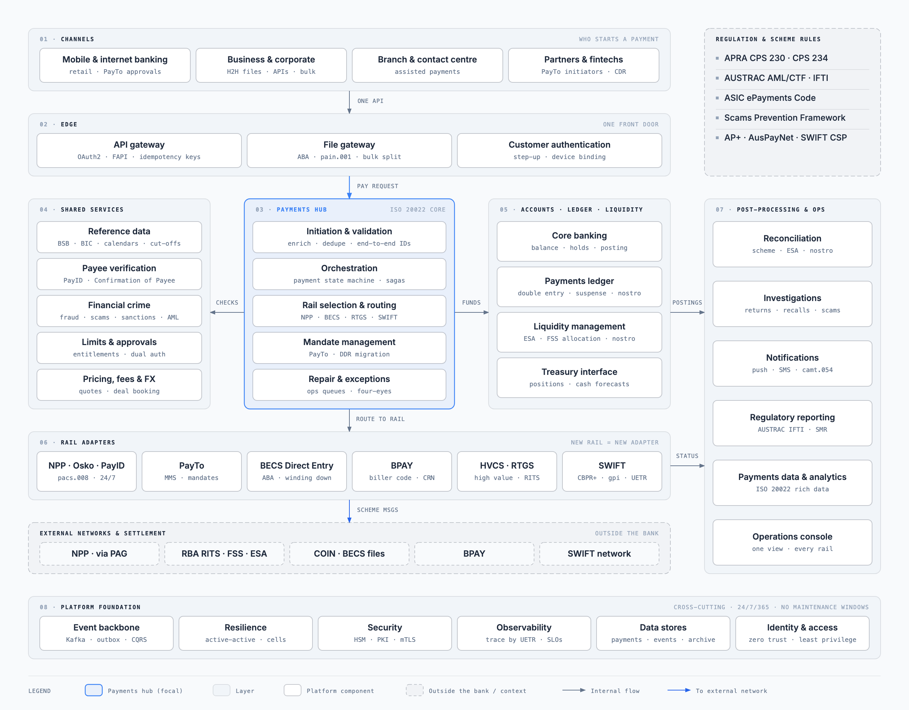
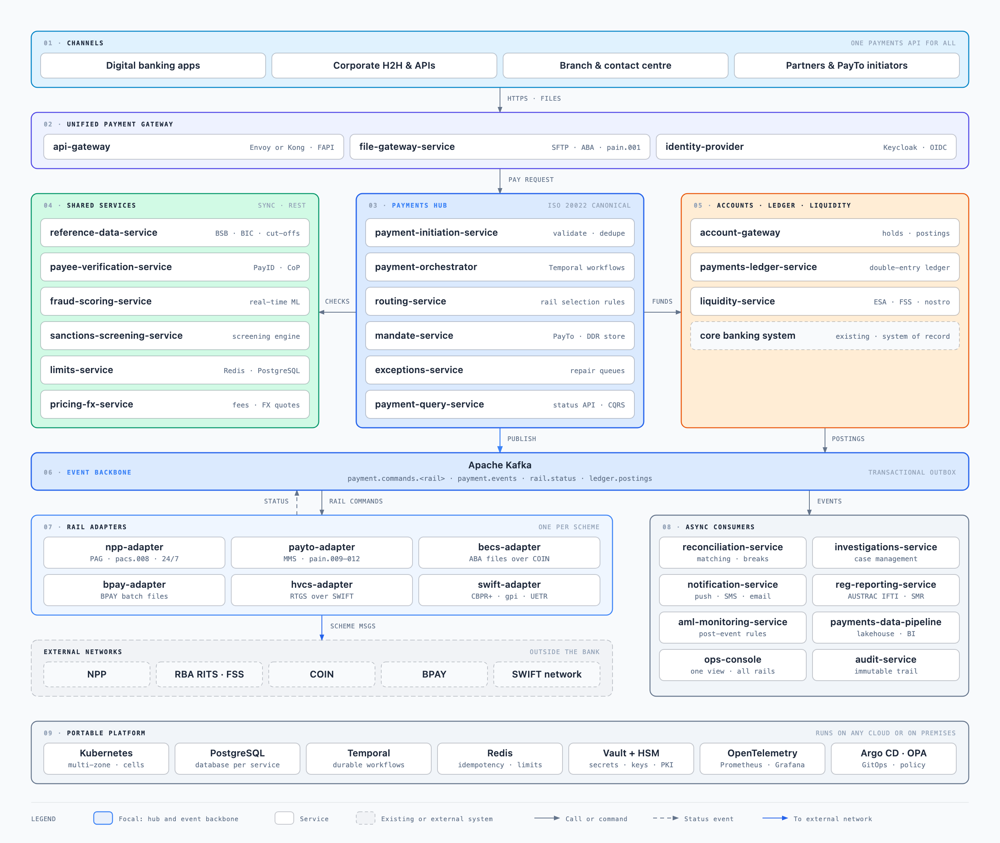
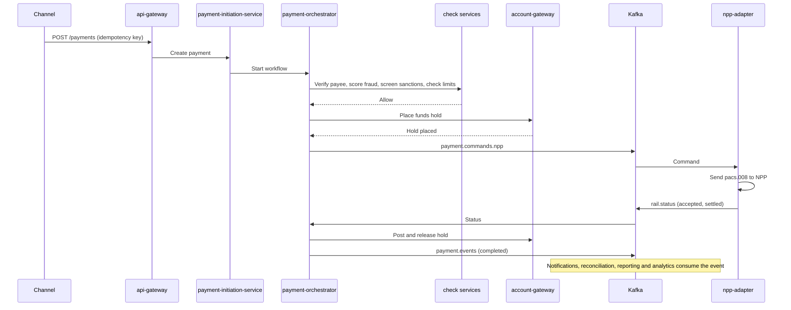
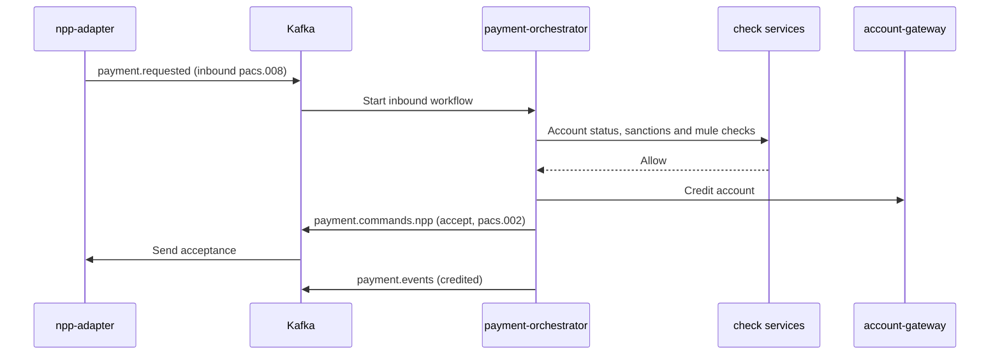

# Modern Payment Platform — Reference Architecture and Solution Design

**Scope:** The logical reference architecture, the services that implement it, and the portable technology they run on. The design is **cloud agnostic**: every building block uses open-source or portable technology that runs on any major cloud or on premises. [Section 13](#13-cloud-mapping) maps each building block to AWS, Azure and Google Cloud managed services for teams that prefer them.

**Context:** A bank with direct access to the Australian rails (NPP, PayTo, BECS, BPAY, high-value RTGS) and SWIFT. Rail details are in the [component deep dive](./03-component-deep-dive.md), and the benefits are in the [business use case](./01-business-use-case.md).

---

## Assumptions

The reference architecture rests on the assumptions below. Confirm each one with the business and the owning teams. The last column shows what changes in the design if an assumption turns out to be wrong.

| # | Area | Assumption | If it does not hold |
|---|------|------------|---------------------|
| 1 | Scheme participation | The bank is a direct participant in NPP (including PayTo), BECS, BPAY and high-value settlement through RITS, holds its own Exchange Settlement Account at the Reserve Bank, and is a SWIFT member | Rails reached through a sponsor bank connect to the sponsor instead of the scheme, and `liquidity-service` covers less of the settlement position |
| 2 | Scope | The platform is greenfield. This page describes the end state, delivered in the four phases in the business use case, starting with NPP | Extending an existing payments system means wrapping it behind adapters and migrating rail by rail, which changes the phasing |
| 3 | Core banking | The core banking system stays the system of record for customer accounts and exposes an API for balances, holds, postings and reversals that `account-gateway` can call. It may still have batch windows, which the payments ledger absorbs | Without a real-time hold API, the payments ledger must keep a shadow balance for every account and reconcile it with the core, which is a much bigger build |
| 4 | Channels | Mobile, internet banking and corporate channels already exist and are out of scope. They call the single Payments API through the edge | Channels built as part of this programme need their own design. The Payments API contract stays the same |
| 5 | Bought components | The sanctions screening engine, fraud platform, NPP gateway and SWIFT interface are bought. Each check answers within its share of the time budget in [section 5](#5-interaction-patterns), so the total stays near 600 ms | A slower check pushes instant payments past their budget. Options are caching, running checks in parallel, or choosing a different product |
| 6 | Adjacent platforms | The customer communication platform delivers notifications, an analytics platform receives the event stream, and the enterprise identity provider handles customer and staff identity | A missing platform must be built in this programme (for example, Keycloak for identity), which adds scope and changes ownership |
| 7 | Volumes | Peak volumes are not yet sized. They are assumed to fit horizontally scaled services and Kafka partitions within each cell | Very high peaks, such as payroll moving to NPP after the BECS wind-down, may need more cells or partitions. Load test before each phase |
| 8 | Cells | Customers can be assigned to a home cell by customer ID. Bank-wide functions such as the settlement account position, liquidity and reconciliation run across all cells | If customers cannot be cleanly partitioned, the platform runs active-active without cells and a fault can affect every customer |
| 9 | Hosting and data residency | The bank can run Kubernetes, self-managed or managed, in at least two Australian regions with three availability zones each. Payment data and keys stay onshore | With only one region, recovery from a regional failure falls back to the data centres and recovery time increases |
| 10 | Scheme connectivity | NPP gateways, the SWIFT interface and HSMs stay in two bank data centres or co-location sites, connected to the cloud regions by private links | Moving scheme connectivity into the cloud moves the adapters' network path and HSMs with it, and needs scheme and SWIFT approval |
| 11 | Operations | The bank has, or will build, a platform team that can run Kafka, Temporal, PostgreSQL and Kubernetes 24/7, or it uses the managed services in [section 13](#13-cloud-mapping) | Without these skills, use managed services for the stateful building blocks and plan for training |
| 12 | Rail roadmap | NPP, high-value settlement and SWIFT carry ISO 20022. BECS stays in service until its planned wind-down around 2030, and BPAY stays file-based | A different BECS timeline only changes when the BECS adapter is built or retired. The hub is unaffected |
| 13 | Regulation | The obligations that apply are APRA CPS 230 and CPS 234, AUSTRAC reporting and AML/CTF record keeping (at least 7 years), the SWIFT Customer Security Programme, the Privacy Act and the Scams Prevention Framework | New or changed obligations become new checks, reports or retention rules. The layered design stays the same |

---

## 1. Architecture principles

1. **Rail-agnostic hub.** The hub only works with the canonical ISO 20022 model. Every scheme difference lives in a rail adapter.
2. **Synchronous only where the customer is waiting.** Checks and funds reservation are synchronous calls inside the payment's time budget. Everything else is driven by events.
3. **Exactly-once effect.** Every request carries an idempotency key. Every state change and its event are written together (transactional outbox), so a retry never pays twice.
4. **Explicit payment state machine.** Each payment is a durable workflow with clear states, timeouts and compensating steps.
5. **Each service owns its data.** No shared database. Services share data through APIs and events.
6. **Always on.** Runs 24/7/365 across availability zones and regions, with zero-downtime releases.
7. **Secure by default.** Zero-trust networking, mutual TLS between services, keys in hardware security modules, least-privilege access.
8. **Portable.** Kubernetes, Kafka, PostgreSQL and other open standards, so the platform is not tied to one cloud.

---

## 2. Reference architecture (logical view)

The platform has eight layers. Channels reach a single Payments API through the edge. The **payments hub** validates, orchestrates and routes each payment, calling **shared services** for checks and the **accounts, ledger and liquidity** layer for funds. **Rail adapters** connect to the external networks. **Post-processing** handles reconciliation, investigations, notifications and reporting, and the **platform foundation** supports every layer. [Open the full diagram](pathname:///modern-payment-platform/diagrams/layered-architecture.html).

---

## 3. Solution design (service view)

The service view shows how the logical layers become deployable services:

- **Synchronous path (top half).** The hub services call check services and account services over gRPC, inside the payment's time budget.
- **Event backbone (middle).** The orchestrator publishes rail commands and payment events to Kafka. Adapters publish rail status back.
- **Asynchronous consumers (bottom right).** Reconciliation, notifications, reporting, AML monitoring and analytics consume events, so they never slow down a payment.

[Open the full diagram](pathname:///modern-payment-platform/diagrams/solution-design-services.html).

---

## 4. Service catalogue

### 4.1 Edge

| Service | Responsibility | Owns data | Interfaces |
|---------|---------------|-----------|------------|
| `api-gateway` | Authentication, rate limits, idempotency key checks, routing, API versioning | None (stateless) | REST from channels, gRPC to hub |
| `file-gateway-service` | Receives bulk files (ABA, ISO 20022 `pain.001`), validates them and splits them into payments | File records and acknowledgements | SFTP and REST in, `payment.requested` events out |
| `identity-provider` | Customer and partner identity, OAuth 2.0 and OpenID Connect, step-up authentication, FAPI profiles | Identities, clients, consents | OIDC |

### 4.2 Payments hub

| Service | Responsibility | Owns data | Interfaces |
|---------|---------------|-----------|------------|
| `payment-initiation-service` | Validates and enriches requests, detects duplicates, assigns end-to-end ID and UETR, starts the workflow | Payment requests | gRPC in. Starts orchestrator workflow |
| `payment-orchestrator` | Runs the payment state machine: checks, funds hold, routing, rail command, settlement, posting, compensation | Workflow state (in Temporal) | Calls check and account services. Publishes `payment.commands.<rail>` and `payment.events` |
| `routing-service` | Chooses the rail by reachability, amount, currency, urgency, cost and rail health | Routing rules, rail health | gRPC |
| `mandate-service` | PayTo mandate lifecycle and legacy direct debit authorities. Checks payments against mandate terms | Mandates | gRPC. Consumes and publishes `mandate.events` |
| `exceptions-service` | Repair queues for failed validation, screening hits and scheme rejects, with four-eyes approval | Exception cases | REST for the operations console. Consumes `payment.events` |
| `payment-query-service` | Fast payment status and history for channels and operations (read model) | Read-optimised payment views | REST and gRPC. Consumes `payment.events` |

### 4.3 Check services (synchronous)

| Service | Responsibility | Owns data | Interfaces |
|---------|---------------|-----------|------------|
| `reference-data-service` | BSB directory, NPP reachability, BIC directory, calendars, cut-offs, settlement instructions | Reference data sets | gRPC. Daily and on-change loads |
| `payee-verification-service` | PayID resolution and Confirmation of Payee | Lookup cache | gRPC. Calls NPP addressing and CoP services |
| `fraud-scoring-service` | Real-time fraud and scam risk score with reasons. Decides allow, challenge, hold or block | Features, model versions, decisions | gRPC. Usually wraps a vendor or in-house model |
| `sanctions-screening-service` | Screens parties and message content against DFAT, UN, OFAC and EU lists | Screening results, alerts | gRPC. Wraps a screening engine |
| `limits-service` | Customer, channel, payee and rail limits. Corporate approval rules | Limits and usage counters | gRPC. Redis for counters |
| `pricing-fx-service` | Fees, FX quotes with a short validity, FX deal booking | Price lists, quotes, deals | gRPC |

### 4.4 Accounts, ledger and liquidity

| Service | Responsibility | Owns data | Interfaces |
|---------|---------------|-----------|------------|
| `account-gateway` | Single adapter to the core banking system: balance, holds, postings, reversals. Runs 24/7 | None (pass-through with audit) | gRPC. Core banking API |
| `payments-ledger-service` | Double-entry sub-ledger for in-flight payments, suspense, clearing and nostro accounts | Ledger journals and balances | gRPC. Publishes `ledger.postings` |
| `liquidity-service` | Real-time settlement account position at the Reserve Bank, liquidity split between real-time and high-value settlement, nostro funding, alerts | Positions and forecasts | Consumes `rail.status` and `ledger.postings`. REST for treasury |

### 4.5 Rail adapters

| Service | Responsibility | Connects to |
|---------|---------------|-------------|
| `npp-adapter` | ISO 20022 messages (`pacs.008`, `pacs.002`, `pacs.004`, `camt.056`), 24/7 inbound and outbound, certificates | NPP through the Payments Access Gateway |
| `payto-adapter` | Mandate messages (`pain.009` to `pain.012`) and mandate-based payments | NPP Mandate Management Service |
| `becs-adapter` | Builds and reads ABA files per settlement window, returns and dishonours | BECS over COIN |
| `bpay-adapter` | Bill payment batch files | BPAY |
| `hvcs-adapter` | High-value ISO 20022 payments and RTGS settlement status | RITS through SWIFT |
| `swift-adapter` | CBPR+ `pacs.008` and `pacs.009`, gpi tracking, recalls, statements | SWIFT network through a SWIFT interface |

Every adapter consumes `payment.commands.<rail>`, publishes `rail.status`, and receives inbound payments, which it turns into `payment.requested` events for the hub.

### 4.6 Asynchronous consumers

| Service | Responsibility | Consumes |
|---------|---------------|----------|
| `reconciliation-service` | Matches scheme settlement reports, settlement account statements and nostro statements to the ledger. Manages breaks | `ledger.postings`, `rail.status`, statement files |
| `investigations-service` | Customer enquiries, recalls, returns, mistaken payments, scam claims | `payment.events` |
| `notification-service` | Customer and business notifications. Hands off to the customer communication platform | `payment.events` |
| `reg-reporting-service` | AUSTRAC IFTI and other reports, scheme and statistical reporting | `payment.events` |
| `aml-monitoring-service` | Post-event money-laundering pattern detection and alerts | `payment.events` |
| `payments-data-pipeline` | Streams events into the analytics platform for insights and model training | All topics |
| `ops-console` | One operations view across rails: search, actions, rail health, liquidity | Query and exceptions APIs |
| `audit-service` | Tamper-evident audit trail for every action and state change | All topics |

---

## 5. Interaction patterns

| Pattern | Used for | Technology |
|---------|----------|------------|
| Synchronous request and response | Calls where the customer is waiting: checks, funds hold, status queries | gRPC inside the platform, REST at the edge |
| Durable workflow | The payment lifecycle, with timeouts, retries and compensation | Temporal |
| Commands over events | Hub to rail adapters | Kafka topics per rail, keyed by payment ID |
| Domain events | Everything that happened to a payment, for downstream consumers | Kafka, with a schema registry and Avro or Protobuf schemas |
| Transactional outbox | Writing state and publishing the event without loss or duplication | Outbox table in each service database, relayed to Kafka (for example, with Debezium) |

**Time budget for an outbound instant payment** (illustrative, measured at the 95th percentile inside the bank):

| Step | Budget |
|------|--------|
| Gateway, authentication, idempotency | 30 ms |
| Validation and enrichment | 30 ms |
| Payee verification (cached where possible) | 150 ms |
| Fraud and scam scoring | 150 ms |
| Sanctions screening | 150 ms |
| Limits and funds hold | 60 ms |
| Routing and command to the NPP adapter | 30 ms |
| **Total before the payment leaves the bank** | **About 600 ms**, leaving most of the scheme's time limit for the network and the payee's bank |

---

## 6. Key flows

### 6.1 Outbound instant payment

### 6.2 Inbound instant payment

If any check fails or times out, the workflow rejects or returns the payment within the scheme's time limit and raises an exception case.

---

## 7. Event and topic design

| Topic | Producer | Main consumers | Key |
|-------|----------|----------------|-----|
| `payment.requested` | Initiation service, file gateway, rail adapters (inbound) | Orchestrator | Payment ID |
| `payment.commands.<rail>` | Orchestrator | The matching rail adapter | Payment ID |
| `rail.status` | Rail adapters | Orchestrator, liquidity, reconciliation | Payment ID |
| `payment.events` | Orchestrator | Query, notifications, reporting, AML, investigations, data pipeline, audit | Payment ID |
| `ledger.postings` | Ledger service | Reconciliation, liquidity, data pipeline | Account ID |
| `mandate.events` | Mandate service, PayTo adapter | Orchestrator, notifications | Mandate ID |

Rules: keying by payment ID keeps each payment's events in order. Schemas are versioned in a schema registry and only change in backward-compatible ways. Instant-payment topics are tuned for low latency. Retention is set per topic, and the long-term record lives in the data platform.

---

## 8. Data architecture

| Data | Store | Notes |
|------|-------|-------|
| Service data | PostgreSQL, one database per service | Strong consistency for payment state, ledger and mandates |
| Workflow state | Temporal (backed by PostgreSQL or Cassandra) | Durable history of every payment workflow |
| Counters and caches | Redis | Idempotency keys, limit usage, payee lookup cache |
| Events | Kafka | Short to medium retention, replayable |
| Read models | PostgreSQL or a search engine | Fast status and history queries |
| Analytics | Lakehouse with open table formats (Apache Iceberg) queried by Trino or Spark | Rich ISO 20022 data for insight and model training |
| Archive | Object storage with retention lock | At least 7 years for AML/CTF record keeping |

The canonical ISO 20022 payment model is used inside the hub and on events. Adapters translate to and from scheme formats such as ABA files.

---

## 9. Deployment and resilience

| Concern | Design |
|---------|--------|
| Compute | Kubernetes in at least two regions, each across three availability zones |
| Topology | Active-active across regions, with customers partitioned into **cells** so a fault affects only part of the customer base |
| Kafka | Replicated within each region, with cross-region replication (for example, MirrorMaker 2 or cluster linking) |
| PostgreSQL | High-availability clusters with synchronous replicas in the region and asynchronous replicas across regions (for example, CloudNativePG or Patroni) |
| Temporal | Multi-cluster replication, or a managed Temporal service |
| Scheme connectivity | NPP gateways, SWIFT interface and HSMs in two data centres or co-location sites, with private links to the cloud regions |
| Releases | GitOps with Argo CD, canary and blue-green releases, no maintenance windows |
| Recovery targets | Recovery point objective of about zero for payment state. Recovery time measured in minutes. Tested regularly under CPS 230 |
| Degraded modes | If fraud scoring times out, apply a defined fallback policy. If a rail is down, queue or reroute non-urgent payments |

---

## 10. Security architecture

| Control | Design |
|---------|--------|
| Identity | Keycloak or the enterprise identity provider. OAuth 2.0, OpenID Connect and FAPI 2.0 for partner and open banking APIs |
| Service-to-service | Service mesh (Istio or Linkerd) with mutual TLS and identity-based policies |
| Authorisation | Open Policy Agent for fine-grained rules. Four-eyes approval for sensitive operations |
| Secrets and keys | HashiCorp Vault for secrets. HSMs (PKCS#11) for signing keys and scheme certificates |
| Data protection | Encryption in transit and at rest. Tokenised or masked personal data in logs and analytics |
| Supply chain | Signed container images, software bill of materials, admission policies in the cluster |
| Compliance | APRA CPS 234 (information security), SWIFT Customer Security Programme attestation, Privacy Act |

---

## 11. Observability

- **OpenTelemetry** for traces, metrics and logs, collected into Prometheus, Grafana, Tempo and Loki (or any compatible backend).
- Every trace carries the payment ID, end-to-end ID and UETR, so one payment can be followed across all services and rails.
- **Business SLOs** per rail: for example, 95th-percentile outbound instant-payment time and success rate, alerting on budget burn.
- Dashboards for rail health, queue depth, exception backlog, liquidity position and reconciliation breaks.

---

## 12. Portable technology stack

| Building block | Portable choice | Notes |
|----------------|-----------------|-------|
| Container platform | Kubernetes | Any conformant distribution |
| API gateway | Envoy-based gateway or Kong | Idempotency and FAPI plug-ins |
| Identity | Keycloak | Or the enterprise identity provider |
| Workflow engine | Temporal | Self-hosted or Temporal Cloud |
| Event streaming | Apache Kafka (for example, Strimzi on Kubernetes) | With a schema registry |
| Database | PostgreSQL | One per service |
| Cache | Redis or Valkey | Idempotency and counters |
| Service mesh | Istio or Linkerd | Mutual TLS, traffic policy |
| Secrets | HashiCorp Vault or OpenBao | Plus HSMs for keys |
| Policy | Open Policy Agent (Gatekeeper) | Cluster and application policy |
| Observability | OpenTelemetry, Prometheus, Grafana, Tempo, Loki | |
| Delivery | Argo CD, signed images (Sigstore) | GitOps |
| Analytics | Apache Iceberg with Trino or Spark | Open table format |
| Object storage | Any S3-compatible store | Archive and data lake |
| Bought components | Sanctions screening engine, fraud platform, SWIFT interface, NPP gateway | Behind service interfaces so they can be replaced |

---

## 13. Cloud mapping

For teams that prefer managed services. Portable choices from section 12 also run on every option below.

| Building block | AWS | Azure | Google Cloud |
|----------------|-----|-------|--------------|
| Kubernetes | Amazon EKS | Azure Kubernetes Service | Google Kubernetes Engine |
| Event streaming | Amazon MSK | Event Hubs (Kafka endpoint) or Confluent Cloud | Managed Service for Apache Kafka |
| PostgreSQL | Amazon Aurora PostgreSQL or RDS | Azure Database for PostgreSQL | Cloud SQL or AlloyDB |
| Workflow engine | Temporal Cloud (Step Functions as a native alternative) | Temporal Cloud (Durable Functions as a native alternative) | Temporal Cloud (Workflows as a native alternative) |
| Cache | ElastiCache | Azure Managed Redis | Memorystore |
| API gateway | Amazon API Gateway | Azure API Management | Apigee |
| Identity | Amazon Cognito | Microsoft Entra External ID | Identity Platform |
| Secrets | AWS Secrets Manager, AWS KMS | Azure Key Vault | Secret Manager, Cloud KMS |
| HSM | AWS CloudHSM | Azure Managed HSM | Cloud HSM |
| Service mesh | Istio on EKS | Istio-based service mesh add-on for AKS | Cloud Service Mesh |
| Observability | CloudWatch, Managed Prometheus, Managed Grafana | Azure Monitor, Managed Prometheus, Managed Grafana | Cloud Monitoring, Managed Service for Prometheus |
| Object storage | Amazon S3 | Azure Blob Storage | Cloud Storage |
| Analytics | S3 with Iceberg, Athena or EMR | ADLS with Fabric or Databricks | BigQuery with BigLake |
| Private connectivity to data centres | AWS Direct Connect | Azure ExpressRoute | Cloud Interconnect |

**Portability guardrails:** use managed services through their open interfaces (Kafka protocol, PostgreSQL wire protocol, S3 API, OpenTelemetry), keep infrastructure as code per cloud, and avoid proprietary features in the payment path unless an ADR records the trade-off.

---

## 14. Architecture decisions

| # | Decision | Alternative rejected | Reason |
|---|----------|----------------------|--------|
| 1 | Rail-agnostic hub with one adapter per rail | Separate system per rail | One place for rules, controls and data. New rail means a new adapter |
| 2 | ISO 20022 canonical model | Proprietary model | All target rails speak it. Keeps rich data |
| 3 | Durable workflow engine for the payment lifecycle | Hand-built state tables and schedulers | Timeouts, retries and compensation are built in and auditable |
| 4 | Kafka event backbone with transactional outbox | Synchronous calls end to end | Decouples consumers and adapters. No lost or duplicated events |
| 5 | Real-time payments ledger in front of the core | Post directly to core banking | 24/7 operation without depending on batch-era core windows |
| 6 | Kubernetes and open-source building blocks | Cloud-specific serverless stack | Portability, consistent operations, multi-cloud or hybrid options |
| 7 | Buy screening, fraud platform and scheme gateways. Build orchestration, routing and experience | Build everything or buy one suite | Buy commodity parts, build what differentiates |

Record each as an ADR once agreed.
