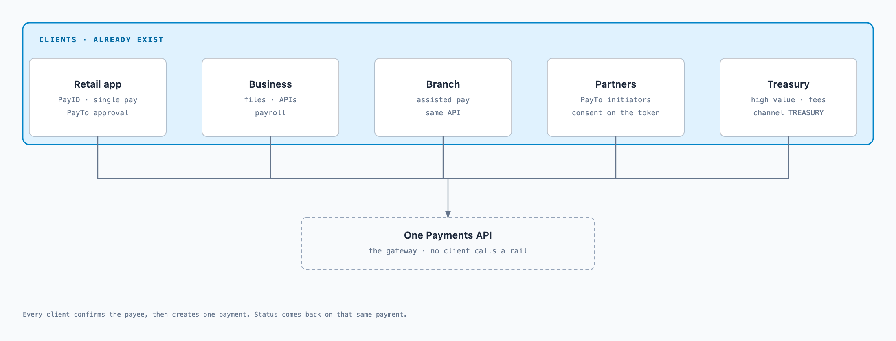

# Clients

Clients are the systems that ask the platform to pay someone. Mobile, internet banking, business APIs, bulk files, branch and treasury already exist. This programme does not rebuild them. It gives them one contract, and they stop talking to rails.

Back to the [reference architecture](./index.md). The door they call is the [unified payment gateway](./02-unified-payment-gateway.md).



[Open the diagram](pathname:///modern-payment-platform/diagrams/component-clients.html).

## Steps

The client follows one payment. It does not choose a rail.

1. Confirm the payee before submit. Resolve a PayID, or show the name the customer typed.
2. Create the payment with an idempotency key the client stores against that intent.
3. Treat `201` and status `SENT_TO_RAIL` as accepted to send. Settlement is not finished.
4. Poll or subscribe until the status is `POSTED`, `REJECTED`, `PENDING_EXCEPTION` or `RETURNED`.
5. On a timeout or a `503`, send the same key and the same body again.

## How to design a client

Design the client against the payment, not against a rail. The customer says "pay Sam $50". The client does not choose NPP, BECS or SWIFT. It may send `requestedRail` as a preference. Routing can refuse it.

| Client | What it starts | Design rule |
|--------|----------------|-------------|
| Retail app and internet banking | Single payments, PayID, scheduled payments, PayTo approval, international transfers | Show the payee name before the customer submits. Hide the rail |
| Business and corporate | Host-to-host files, payment APIs, payroll, approval chains | Keep the corporate's remittance data. Deliver status as a callback, not only a screen |
| Branch and contact centre | Assisted payments, recalls, investigations | Call the same API. A staff channel is not a side door into a rail |
| Partners and fintechs | PayTo initiation, embedded payments, later CDR action initiation | A partner token carries the consent. The partner cannot name a customer account the consent does not cover |
| Treasury and internal | High-value payments, fees, interest, loan drawdowns | Another channel id (`TREASURY`). Same payment resource |

Amounts are integers in minor units. `5000` with currency `AUD` is $50.00. The client never sends a decimal amount.

## API

The client calls the gateway. The normative wait is in the reference architecture: the call returns when the rail command is durable, or when the payment is declined. It does not stay open until the other bank settles.

### Resolve a PayID

This call happens **before** the customer presses Pay. They have typed an alias, such as an email, instead of a BSB and account number. The app asks the platform who that alias belongs to, shows the name, and lets the customer confirm it is the right person. It does not move money, and it does not return the account number. The account stays with NPP until a payment is actually sent.

`POST /v1/payids/resolve`

The customer typed Sam's email. `EMAL` means the alias is an email address.

**Request**

```json
{ "payId": "sam@example.com", "payIdType": "EMAL" }
```

**Response** `200`

```json
{ "name": "Sam Lee", "servedBy": "NPP" }
```

The app shows **Sam Lee**. `servedBy: NPP` means Sam's bank is on the New Payments Platform, so the later payment can be instant. If Sam's bank were not on NPP, `servedBy` would say so and routing would not treat this as an Osko payment.

| `payIdType` | What the customer typed |
|-------------|-------------------------|
| `EMAL` | Email address |
| `TELI` | Phone number |
| `AUBN` | Australian Business Number |
| `ORG` | Organisation identifier |

### Create a payment

`POST /v1/payments`

| Header | Required | Meaning |
|--------|----------|---------|
| `Authorization` | Yes | Customer, staff or partner token |
| `Idempotency-Key` | Yes | One key per intended payment. 1 to 64 characters. The client keeps it until it has stored the `paymentId` |
| `X-Channel` | Yes | `MOBILE`, `INTERNET`, `BRANCH`, `PARTNER`, `FILE` or `TREASURY` |

**Request**

```json
{
  "instructedAmount": { "currency": "AUD", "minorUnits": 5000 },
  "debtorAccount": { "bsb": "062000", "accountNumber": "12345678" },
  "creditor": {
    "name": "Sam Lee",
    "account": { "payId": "sam@example.com", "payIdType": "EMAL" }
  },
  "remittance": { "unstructured": "Dinner" },
  "purposeCode": "OTHR",
  "requestedRail": "NPP"
}
```

| Field | Required | Notes |
|-------|----------|-------|
| `instructedAmount` | Yes | Currency and minor units. A missing currency or a negative amount is rejected |
| `debtorAccount` | Yes for a customer payment | Omitted on a PayTo pull. Send `mandateId` instead |
| `creditor` | Yes | A PayID, or a BSB and account, plus the name the customer typed |
| `remittance` | No | Unstructured text, or structured references the beneficiary will reconcile |
| `purposeCode` | No | Required later when the chosen rail demands one |
| `requestedRail` | No | A preference. Routing decides |
| `mandateId` | For PayTo | The approved mandate this collection draws on |

Success is `201`. The payment has been sent as far as a durable rail command. It is not settled.

**Response** `201`

```json
{
  "paymentId": "8f1c0a2e-6b4d-4e1a-9c3f-2a7b6d0e11c4",
  "status": "SENT_TO_RAIL",
  "endToEndId": "INV-10428",
  "rail": "NPP",
  "creditor": { "nameCheck": "MATCH" }
}
```

`nameCheck` is `MATCH`, `CLOSE_MATCH`, `NO_MATCH` or `UNAVAILABLE`. A PayID the customer already confirmed is usually a cache hit.

| HTTP | Status in the body | What the client does |
|------|--------------------|----------------------|
| `201` | `SENT_TO_RAIL` | Store `paymentId`. Watch for settlement |
| `202` | `PENDING_EXCEPTION` | Tell the customer the payment is held for review. Do not retry as a new payment |
| `400` | — | The body is not a payment. Fix it. Do not reuse the key for a different body |
| `401` / `403` | — | Missing token, or a consent that does not allow this action |
| `409` | — | This key was already used for a different body |
| `422` | `REJECTED` | A check or the hold declined it. The body includes `paymentId` and `type` (`limit`, `sanctions`, `fraud`, `mandate` or `no-rail`) |
| `503` | — | Safe to retry with the same key and the same body |

The same key and the same body always return the original response. Errors use one problem shape: `type`, `title`, `status`, `detail`, and `paymentId` when one exists.

### Read status

`GET /v1/payments/{paymentId}` returns the canonical payment held by the [payments hub](./03-payments-hub.md): `status`, `rail`, `endToEndId`, and `schemeReferences` once the rail has them.

The client keeps calling this, or receives the webhook in the events section, until the status is terminal for the customer: `POSTED`, `REJECTED`, `PENDING_EXCEPTION` or `RETURNED`.

### Approve a PayTo mandate

`POST /v1/mandates/{mandateId}/decision`

**Request**

```json
{ "decision": "APPROVE" }
```

`decision` is `APPROVE`, `PAUSE` or `CANCEL`.

**Response** `200`. The body is the mandate status. The client does not send the collection. A later `POST /v1/payments` with that `mandateId` does.

## Events

Clients are not Kafka consumers. They receive facts through the API and through callbacks from `notification-service`, which reads `payment.events` and hands delivery to the customer communication platform.

| Callback | Who receives it | Body |
|----------|-----------------|------|
| Payment status webhook | The partner or the corporate API client | `paymentId`, `status`, `rail`, `endToEndId` |
| `pain.002` | A corporate that submitted `pain.001` | Accepted, rejected and pending counts for the file, then per-payment status |
| `camt.054` | A corporate that reconciles credits | The credit, the remittance, and the end-to-end id |

A missed webhook is recovered with `GET /v1/payments/{paymentId}`. The webhook is not the book of record.

## Files

A person does not upload a scheme file from the app. A corporate client does.

| File | Direction | What the client puts in it |
|------|-----------|----------------------------|
| ABA (Cemtex) | Client to the file gateway | One detail record per payee. Amounts in cents. The trace account is the client's account |
| ISO 20022 `pain.001` | Client to the file gateway | A group header and one payment instruction per payee. This is the format to prefer for new corporate connections |
| CSV | Client to the file gateway | The same fields as the create-payment body, one row per payment, for a client that cannot produce `pain.001` |
| Acknowledgement | File gateway to the client | File id, accepted count, rejected count, and a reason per rejected row |
| `pain.002` / `camt.054` | Platform to the client | Status and credit advice after the file has become payments |

The client uploads the file. It does not build an NPP message or an outbound BECS exchange file. The [gateway](./02-unified-payment-gateway.md) splits the upload into payments, and the [rails](./04-rails.md) page owns the scheme file that actually leaves the bank.
