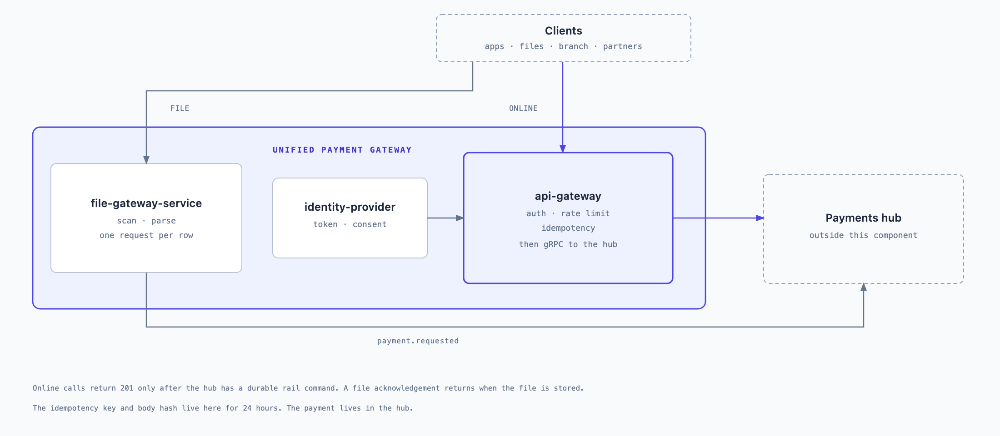

# Unified payment gateway

The gateway is the only door into the platform. A public request passes the WAF and DDoS controls in the [reference architecture](./index.md#request-protection) before it reaches this door. The gateway then authenticates the caller, stops a retry from paying twice, and holds the HTTP call until the [payments hub](./03-payments-hub.md) has a durable rail command or a decline. It does not choose a rail, score fraud, screen sanctions, or move money.

Back to the [reference architecture](./index.md). Callers are the [clients](./01-clients.md).



[Open the diagram](pathname:///modern-payment-platform/diagrams/component-gateway.html).

## Steps

Two fronts. Neither chooses a rail, scores fraud, screens sanctions, or moves money.

**Online**

1. Authenticate. Reject a token that does not match `X-Channel` and the debtor.
2. Reject a body that is not a payment, with `400`, before any hub call.
3. Look up the idempotency key. The same hash returns the stored response. A different hash returns `409`.
4. Forward to `payment-initiation-service` over REST. The caller id comes from the token. The body cannot override it.
5. Hold the connection until the hub has a durable rail command or a decline.
6. Map the hub result onto the HTTP status in the API section, and store that response with the key.

**File**

1. Scan the upload and store it.
2. Check the format. A row that is not a payment is named in the acknowledgement and is not sent on.
3. Acknowledge the file once it is stored and parsed. The call does not stay open for every row.
4. Emit one `payment.requested` per valid row. Each row then follows the same hub path as an online payment.

## How to design it

Three services, one door.

| Service | Build it to | It must not |
|---------|-------------|-------------|
| `api-gateway` | Terminate TLS, check the token, rate-limit, hash the body against `Idempotency-Key`, and forward a well-shaped request | Validate a BSB against the directory, apply a limit, or post |
| `file-gateway-service` | Accept a bulk file, scan it, check the format, split it into payment requests, and acknowledge the file | Screen a payment or post it. Each row becomes a `payment.requested` for the hub |
| `identity-provider` | Issue tokens, hold consents, and step up a high-risk payment | Store the payment. It stores clients, tokens and consents |

A crash after the hub has published the rail command still returns the same `201` on retry, because the key is stored with the response.

The idempotency record lives in Redis or Valkey for 24 hours: the key, the body hash, and the response. The payment itself lives in the hub.

## API

The resource shapes are the client contract on the [clients](./01-clients.md) page. This is how the gateway enforces them.

| Check | Where | Result |
|-------|-------|--------|
| Token, consent, channel | Gateway | `401` or `403` |
| JSON shape, currency present, amount not negative, header lengths | Gateway | `400` |
| Key reused with a different body hash | Gateway | `409` |
| BSB directory, limits, fraud, sanctions, mandate, no rail, hold | Hub, during the same call | `422` with `paymentId`, `status: REJECTED` and a `type` |
| A person must decide | Hub | `202` with `status: PENDING_EXCEPTION` |
| Rail command durable | Hub | `201` with `status: SENT_TO_RAIL` |
| Hub unavailable before a result is stored | Gateway | `503`. The client retries the same key |

The gateway copies these response fields and does not invent others: `paymentId`, `status`, `endToEndId`, `rail`, `creditor.nameCheck`.

Internal call, gateway to initiation:

| Field | Source |
|-------|--------|
| `idempotencyKey` | Header |
| `channel` | `X-Channel`, checked against the token |
| `callerId` | Token. Never the body |
| `request` | The create-payment body, unchanged |

Initiation returns the hub result. The gateway stores it under the key and writes the HTTP status.

File intake is a different resource.

`POST /v1/files` with `Content-Type: multipart/form-data` or an SFTP drop into the client's known directory.

| Field | Meaning |
|-------|---------|
| `fileType` | `ABA`, `PAIN_001` or `CSV` |
| `fileName` | The client's name for the file. Used in the acknowledgement |
| `content` | The bytes. Rejected if the malware scan fails |

Response `202`:

```json
{
  "fileId": "f-2026-11-14-18",
  "status": "ACCEPTED",
  "acceptedCount": 240,
  "rejectedCount": 2
}
```

A rejected row names the line and the reason. Those rows never become payments.

## Events

| Topic | When the gateway publishes | Payload |
|-------|----------------------------|---------|
| `payment.requested` | A file row has passed format checks | `paymentId`, `fileId`, `idempotencyKey` (the file id plus the row number), `channel: FILE`, and the same payment fields as `POST /v1/payments` |

The online path does not publish `payment.requested`. Initiation starts the workflow from the REST call, which is the same fact. Consumers must not post or call a rail from this topic. The orchestrator is the only consumer that starts work.

The gateway consumes nothing from Kafka.

## Files

| File | The gateway does | The gateway does not |
|------|------------------|----------------------|
| ABA | Check record types `0`, `1` and `7`. Check that detail amounts are cents and that the trailer totals match the details. Split each `1` record into a payment | Build the BECS file that is exchanged over COIN. That is the BECS adapter |
| `pain.001` | Check the group header and each payment instruction. Split into payments. Keep the message id for the later `pain.002` | Send the file to a rail |
| CSV | Map columns onto the create-payment body. Reject a row with a missing amount | Infer a rail from the file name |
| Acknowledgement | Write `fileId`, counts, and per-row errors back to the client by the same channel the file arrived on | Include scheme settlement results. Those arrive later as `pain.002` and `camt.054` |

Stored with the file record: `fileId`, client id, hash of the bytes, received time, and the acknowledgement. A second upload of the same hash returns the original acknowledgement.
