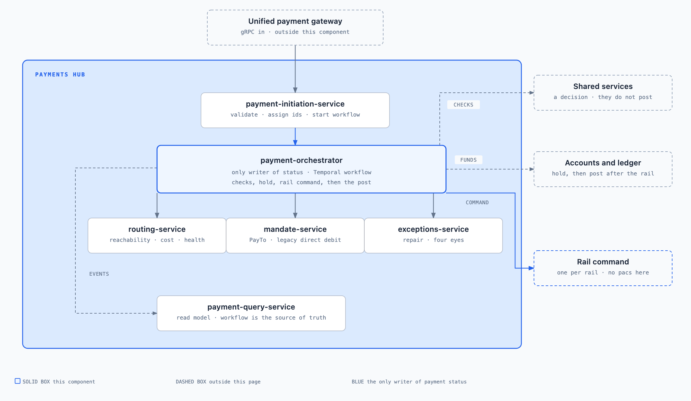

# Payments hub

The hub is the product. It validates a payment, runs the checks, places a hold, chooses one rail, and is the only service that sends the rail command and the only service that posts. It speaks the canonical payment. Scheme messages stay in the [rails](./04-rails.md).

Back to the [reference architecture](./index.md). The states and the two normative sequences live there, in sections 4 and 5. This page is how to build the hub so those rules hold.



[Open the diagram](pathname:///modern-payment-platform/diagrams/component-payments-hub.html).

## Steps

One workflow per payment. Only `payment-orchestrator` writes the next state.

**Outbound.** The caller waits through step 6.

1. Receive the request. Assign `paymentId`, `endToEndId`, and `uetr` when the payment may leave Australia. State `RECEIVED`.
2. Validate and enrich. Reject a duplicate or a bad request. State `VALIDATED`.
3. Call payee, fraud, sanctions and limits, in that order. A timeout is the decision on the [shared services](./06-shared-services.md) page. Do not retry a check inside this path. State `SCREENED`.
4. Place the hold through [accounts and ledger](./05-accounts-and-ledger.md). If the hold does not answer, do not send. State `FUNDS_RESERVED`.
5. Choose one rail. State `ROUTED`.
6. Publish `payment.commands.<rail>` from the outbox. State `SENT_TO_RAIL`. This is what the caller is returned.

After the caller is released, and only when `rail.status` is durable:

7. Record scheme acceptance where the scheme separates acceptance from settlement. State `ACCEPTED`.
8. Record settlement. State `SETTLED`.
9. Post, then emit `payment.events`. State `POSTED`.

**Inbound.** The scheme is the caller, so the reply is part of the wait. There is no hold.

1. Take `payment.requested` from the adapter. State `RECEIVED`.
2. Screen account status, sanctions and the mule signal. State `SCREENED`.
3. Post the credit, or reject with no credit. State `POSTED` or `REJECTED`.
4. Publish `REPLY`. The adapter sends `pacs.002`.

`REJECTED` and `RETURNED` are terminal. `PENDING_EXCEPTION` waits for a person. Notification is not a state. A slow webhook does not make the payment incomplete.

## How to design it

| Service | Owns | Must not |
|---------|------|----------|
| `payment-initiation-service` | The request, `paymentId`, `endToEndId`, and `uetr` when the payment may leave Australia | Call a rail or the core |
| `payment-orchestrator` | The workflow and the only allowed next state | Speak `pacs`, ABA, or the core API. It calls `account-gateway` and publishes a command |
| `routing-service` | Routing rules and a view of rail health | Move money, or override a sanctions block |
| `mandate-service` | PayTo and legacy direct-debit terms | Send the collection |
| `exceptions-service` | The case, the maker and the checker | Release a payment by itself. Release goes back through the orchestrator |
| `payment-query-service` | A read model built from `payment.events` | Be the source of truth. The workflow is |

Design the orchestrator as one workflow per payment, in Temporal, with the state written in the same transaction as its outbox event.

Compensations sit on the workflow. A scheme reject after `SENT_TO_RAIL` releases the hold and does not post the customer credit. A post that fails after `SETTLED` stays at `SETTLED` and is retried. The rail command is not sent again. A check that times out is not retried inside the accept path. The timeout decision for each check is on the [shared services](./06-shared-services.md) page and in [section 4.2](./index.md#42-if-a-step-does-not-answer).

Routing chooses the rail from reachability, amount, currency, urgency, cost, customer terms and rail health. A payee that is not on NPP can fall back to BECS. A non-AUD or offshore payment goes to SWIFT. High value goes to HVCS. An instant payment is not silently turned into a batch payment. NPP-first matters because BECS is winding down: retiring it removes an adapter.

Mandates are a store synchronised with the PayTo Mandate Management Service. A collection is checked against amount, frequency and status before it is allowed to start. Legacy direct-debit authorities live in the same service so the migration to PayTo does not create a second book.

Exceptions are a queue for failed validation, sanctions hits and scheme rejects. Two people must agree a repair. The orchestrator is the service that then moves the payment.

Build it in this order:

1. Persist the canonical payment and the idempotent create.
2. Encode the state machine so only the orchestrator writes `status`.
3. Call the shared services and the account gateway through the contracts on their pages.
4. Publish the rail command from the outbox, keyed by `paymentId`.
5. Apply `rail.status` by posting, then emit `payment.events`.
6. Project those events into the query service.

## API

Initiation is REST from the [gateway](./02-unified-payment-gateway.md). The request is the client body plus `idempotencyKey`, `channel` and `callerId`. The response is the result the gateway maps to HTTP: `paymentId`, `status`, `endToEndId`, `rail` and `nameCheck`.

`GET` status is served by `payment-query-service` from the read model. A query that arrives before the first event is served from the workflow.

Mandate decision, from the client API, is REST `DecideMandate` on `mandate-service`: `mandateId`, `decision` (`APPROVE`, `PAUSE`, `CANCEL`), and the customer id from the token. The response is the mandate status. The service publishes `mandate.events` and synchronises with the PayTo adapter.

The orchestrator's other calls are not its own API. It is the client of [shared services](./06-shared-services.md), [accounts and ledger](./05-accounts-and-ledger.md) and the rail command below.

## Canonical payment

This is the document the hub stores and puts on `payment.events`. Amounts are minor units. Times are UTC.

| Field | Set by | Meaning |
|-------|--------|---------|
| `paymentId` | Initiation | Stays for the life of the payment |
| `idempotencyKey` | The caller, via the gateway | A retry resolves to this same payment |
| `endToEndId` | Initiation | The reference the customer and the other bank can quote |
| `uetr` | Initiation, when the payment may go to SWIFT | Empty for a domestic NPP payment |
| `direction` | Initiation, or the inbound adapter | `OUTBOUND` or `INBOUND` |
| `status` | Orchestrator only | A state from the reference architecture |
| `rail` | Routing | `NPP`, `PAYTO`, `BECS`, `BPAY`, `HVCS` or `SWIFT`. Empty until `ROUTED` |
| `instructedAmount` | Caller | `{ "currency": "AUD", "minorUnits": 5000 }` |
| `debtor` | Caller, enriched by initiation | Customer id, name, and BSB plus account |
| `creditor` | Caller, enriched by payee verification | Confirmed name, `nameCheck`, and the account the rail will be given |
| `remittance` | Caller | Unstructured text, or structured references |
| `purposeCode` | Caller or initiation | Present when the rail requires it |
| `holdId` | Account gateway | Set at `FUNDS_RESERVED`. Cleared when the hold is released or captured |
| `schemeReferences` | The adapter, via `rail.status` | Scheme ids. The hub stores them and does not interpret them |

```json
{
  "paymentId": "8f1c0a2e-6b4d-4e1a-9c3f-2a7b6d0e11c4",
  "idempotencyKey": "app-2026-11-14-9f3a",
  "endToEndId": "INV-10428",
  "uetr": null,
  "direction": "OUTBOUND",
  "status": "SENT_TO_RAIL",
  "rail": "NPP",
  "instructedAmount": { "currency": "AUD", "minorUnits": 5000 },
  "debtor": {
    "customerId": "C123",
    "name": "Alex Morgan",
    "account": { "bsb": "062000", "accountNumber": "12345678" }
  },
  "creditor": {
    "name": "Sam Lee",
    "nameCheck": "MATCH",
    "account": { "payId": "sam@example.com", "payIdType": "EMAL" }
  },
  "remittance": { "unstructured": "Dinner" },
  "holdId": "h-88c1"
}
```

## Events

| Topic | The hub | Payload that matters |
|-------|---------|----------------------|
| `payment.requested` | Consumes it to start a workflow for a file row or an inbound payment | The canonical fields known so far, plus `direction` |
| `payment.commands.<rail>` | Publishes `SEND`, `RETURN` or `REPLY` after the command is durable | `paymentId`, `command`, `rail`, and the canonical fields the adapter may map. No workflow internals |
| `rail.status` | Consumes it. Moves to `ACCEPTED`, `SETTLED`, `REJECTED` or `RETURNED`, then posts | `paymentId`, `outcome`, `schemeCode`, `schemeReferences`, `settledAt` |
| `payment.events` | Publishes one event per state, after that state is durable | The canonical payment |
| `mandate.events` | Mandate service publishes. Orchestrator consumes, and refuses a collection whose mandate is not approved | `mandateId`, `status`, `debtorCustomerId`, amount cap, frequency |

`payment.events` may update a read model, notify, report, monitor and audit. Consumers do not move money from it. Investigations and the operations console read it and call the exceptions API when a person acts. That action comes back as a command to the orchestrator, which is what changes the payment.

## Files

The hub has no file interface. A bulk file is already one payment per row by the time it reaches initiation. Scheme files are built by the rail adapter. The hub's record of a file payment is `fileId` on the request, kept so a `pain.002` can be assembled later by the notification path.
