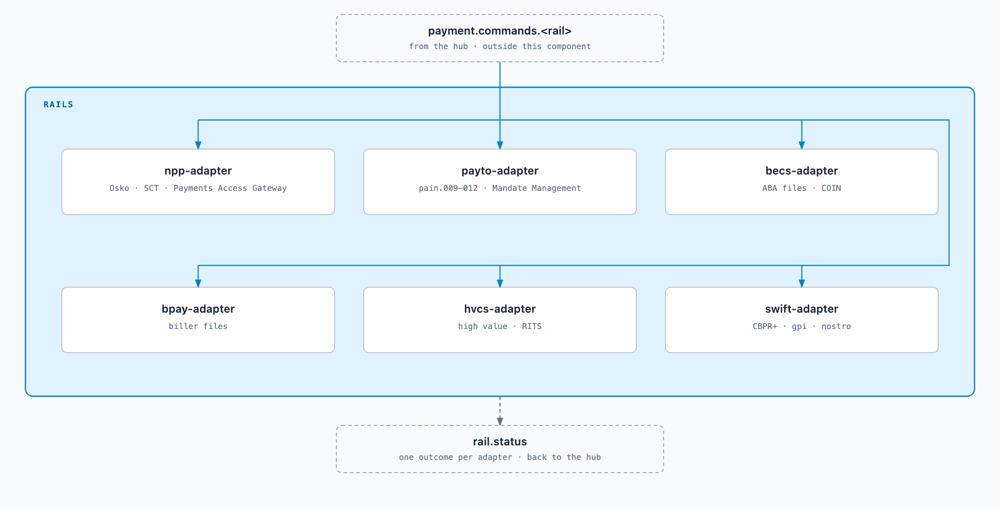

# Rails

A rail adapter translates the canonical payment into one scheme and holds the connection to that scheme. Adding a rail adds an adapter. The [payments hub](./03-payments-hub.md) does not change.

Back to the [reference architecture](./index.md). The outbound and inbound sequences on that page are the pattern. The variants below are the same pattern on a different adapter.

[Open the diagram](pathname:///modern-payment-platform/diagrams/component-rails.html).

## Steps

Every adapter follows the same two paths. The scheme differs. The hub does not.

**Outbound**

1. Consume one command on `payment.commands.<rail>`. A second command with the same `paymentId` and the same `command` is ignored.
2. Map the canonical payment onto that scheme's message or file.
3. Send it. Certificates, sessions and cut-offs stay inside the adapter.
4. Publish `rail.status` only after the scheme has acknowledged that fact. A failed send stays with this adapter. It does not open a second rail.

**Inbound**

1. Take the scheme message and publish `payment.requested`.
2. Wait for a `REPLY` command.
3. Send `pacs.002`, or the scheme's equivalent, from that command.

NPP inbound has a scheme time limit of seconds. The adapter gets the message onto the hub quickly. The hub screens, credits and answers inside that limit. BECS and BPAY move on windows. The workflow timer matches the window. The adapter does not invent a shorter one.

## How to design an adapter

| Adapter | Build it to | It must not |
|---------|-------------|-------------|
| `npp-adapter` | `pacs.008` and `pacs.002` through the Payments Access Gateway, returns (`pacs.004`), recalls (`camt.056`, `camt.029`), certificates, 24/7 | Re-score fraud or choose a different rail when NPP rejects |
| `payto-adapter` | Mandate messages `pain.009` to `pain.012` with the Mandate Management Service, and the payment that follows an approved mandate | Store the mandate as the system of record. `mandate-service` does |
| `becs-adapter` | ABA files per settlement window, over COIN. Returns and dishonours | Call BECS for an instant payment the customer was promised on NPP |
| `bpay-adapter` | Outbound bill-payment files. Inbound biller files when the bank is a biller's bank | Validate a CRN by calling the hub's fraud service again |
| `hvcs-adapter` | High-value ISO 20022 over SWIFT, RITS settlement status, queue management | Settle against the ESA from inside the adapter. Liquidity watches the position. The orchestrator posts |
| `swift-adapter` | CBPR+ `pacs.008` and `pacs.009`, gpi and the UETR, `camt.056`, Swift Go, beneficiary pre-validation, nostro statements (`camt.053`) | Book the FX deal. Pricing does that |

Every adapter consumes `payment.commands.<rail>`, publishes `rail.status`, and turns an inbound payment into `payment.requested`. A second command with the same `paymentId` and the same `command` is ignored.

Build a new adapter in this order:

1. Map the canonical payment onto the scheme message or file, and the scheme message back onto `rail.status`.
2. Make the send idempotent on `paymentId`.
3. Own certificates, sessions and cut-offs inside the adapter.
4. Publish status only after the scheme has acknowledged that fact.
5. On inbound, publish `payment.requested` and wait for a `REPLY` command before sending `pacs.002` or the scheme's equivalent.

## The rails

| Rail | What it is | Settlement | What the adapter speaks | Connection |
|------|------------|------------|-------------------------|------------|
| NPP, with Osko and PayID | Real-time account to account, 24/7 | Line by line in the Fast Settlement Service, inside RITS | `pacs.008`, `pacs.002`, `pacs.004`, `camt.056`, `camt.029` | Payments Access Gateway, with PKI |
| PayTo | A payer approves a mandate. An initiator pulls funds | Real time, over NPP | `pain.009` to `pain.012`, then an NPP payment | Mandate Management Service |
| BECS / Direct Entry | Bulk credits and debits. Winding down, with migration to NPP planned by about 2030 | Deferred net settlement in RITS, several times a day | ABA files | COIN |
| BPAY | Bills, addressed by biller code and customer reference | Batch net settlement | BPAY files | BPAY connectivity |
| HVCS / RITS | High value, one payment at a time | Real time in RITS hours, across Exchange Settlement Accounts | ISO 20022 over SWIFT, Y-copy | SWIFT and RITS |
| SWIFT | Cross-border, through correspondents | Minutes to days, on nostro accounts | CBPR+ `pacs.008`, `pacs.009`, `camt.053`. MT payment instructions ended in November 2025 | SWIFT interface. gpi for tracking. Swift Go for low value |

## API

Adapters do not expose a public REST API. The hub does not call them with a request that can time out and be ambiguous. The command is the API.

Command, on `payment.commands.<rail>`:

| Field | Meaning |
|-------|---------|
| `paymentId` | Idempotency key. A second `SEND` is ignored |
| `command` | `SEND`, `RETURN` or `REPLY` |
| `rail` | Must match the topic |
| `canonical` | The payment fields the adapter may map |

`REPLY` is the inbound accept or reject. For NPP it becomes `pacs.002`.

Status, on `rail.status`:

| Field | Meaning |
|-------|---------|
| `paymentId` | Which payment |
| `outcome` | `ACCEPTED`, `REJECTED`, `SETTLED`, `PENDING` or `RETURNED` |
| `schemeCode` | The scheme's code. Stored for investigations. The hub does not branch on it |
| `schemeReferences` | Ids the scheme or the other bank assigned |
| `settledAt` | Present when `outcome` is `SETTLED` |

The hub posts only after this status is durable. A `SETTLED` status with no journal is an incomplete payment.

### What the adapter maps

NPP and SWIFT customer credit (`pacs.008`), from the canonical payment:

| Canonical | Scheme element |
|-----------|----------------|
| A new message id | Group header |
| `endToEndId` | End-to-end identification |
| `uetr` | UETR. SWIFT only. NPP leaves it empty |
| `instructedAmount` | Settlement amount and currency |
| `debtor` | Debtor name and account |
| `creditor` | Creditor name and account. A PayID has already been resolved to a BSB and account before this map |
| `remittance` | Remittance information, truncated to the scheme limit here |
| `purposeCode` | Purpose, where the scheme requires it |

`pacs.002` maps back to `outcome`. For NPP, acceptance with settlement complete is `SETTLED`. A technical reject is `REJECTED`.

PayTo mandate create and change (`pain.009` to `pain.012`) map from `mandate.events`, not from a payment command. The payment under an approved mandate is still a `SEND` on the NPP command topic.

## Events

| Topic | Adapter |
|-------|---------|
| `payment.commands.<rail>` | Consumes. One topic per rail so a BECS file build is not blocked by the NPP partition |
| `rail.status` | Publishes. Liquidity and reconciliation consume it as well as the hub |
| `payment.requested` | Publishes for an inbound payment, with `direction: INBOUND` and the canonical fields it could fill |
| `mandate.events` | PayTo adapter publishes a mandate change that arrived from the Mandate Management Service. `mandate-service` is the store |

## Files

| Rail | File or message the adapter owns |
|------|----------------------------------|
| NPP and HVCS | No bulk file. ISO 20022 messages and scheme reports |
| PayTo | Mandate messages. No customer file |
| BECS | Outbound ABA per settlement window. Inbound ABA for credits, debits, returns and dishonours. The trailer must match the detail totals before the file is sent |
| BPAY | Outbound bill-payment file (biller code, CRN, amount in cents). Inbound biller file when the bank sponsors the biller |
| SWIFT | `camt.053` nostro statement, used by reconciliation. Payment instructions are messages, not files |

ABA detail the BECS adapter writes from the canonical payment: record type `1`, destination BSB and account, transaction code, amount in cents, account title, lodgement reference, trace BSB and account, remitter name. Record `0` is the header. Record `7` is the file total. The client's upload ABA is a different file. The [gateway](./02-unified-payment-gateway.md) has already split it. This ABA is the one COIN carries.

## Variant flows

### Outbound Osko

1. The client resolves the PayID and the customer confirms the name.
2. `POST /v1/payments` runs the accept path. The response is `201` and `SENT_TO_RAIL`.
3. The NPP adapter sends `pacs.008` through the Payments Access Gateway.
4. `pacs.002` comes back. Settlement is in the Fast Settlement Service.
5. The hub posts, releases or captures the hold, and emits `payment.events`. The customer sees the outcome from status and notification, usually within seconds.

### Inbound NPP

1. `pacs.008` arrives. The adapter publishes `payment.requested`.
2. The hub checks account status, sanctions and the mule signal.
3. On allow, the hub credits the account and publishes `REPLY`. The adapter sends `pacs.002`.
4. On a failed or unanswered check, the hub rejects inside the scheme limit, posts no credit, and opens a case where a person is required.

### PayTo

1. An initiator's bank creates a mandate. The Mandate Management Service notifies the PayTo adapter, which emits `mandate.events`.
2. The customer approves in the app. `mandate-service` and the Mandate Management Service are both updated.
3. A later payment names that `mandateId`. The hub checks the terms, then the payment follows the outbound NPP flow.

### Payroll file

1. The corporate uploads ABA or `pain.001`. The gateway acknowledges the file and emits one `payment.requested` per row.
2. Each row is screened. The hub reserves funds for that payment.
3. Routing sends an NPP-reachable payee in real time and leaves the rest for BECS. That split is what makes the BECS wind-down a routing change.
4. The BECS adapter builds the window's file, exchanges it over COIN, and publishes status as returns and dishonours arrive.

### SWIFT with FX

1. The customer asks to pay USD. Pricing returns a quote. A second call books it. Without a booked quote the hub does not send.
2. Sanctions and fraud run on the accept path. The SWIFT adapter can pre-validate the beneficiary after that, before the command, when the scheme offers it.
3. The hub debits AUD and the ledger records the USD nostro position.
4. The adapter sends CBPR+ `pacs.008` with the UETR. gpi updates become `rail.status` of `PENDING`, then `SETTLED` when the beneficiary bank confirms.
5. Reporting builds the AUSTRAC IFTI from `payment.events`. Reconciliation matches `camt.053` to the nostro journal.

### High-value RTGS

1. Routing selects HVCS from the amount and the customer terms.
2. The adapter sends ISO 20022 over SWIFT. RITS settles across Exchange Settlement Accounts when liquidity is there.
3. `rail.status` of `SETTLED` is what the hub posts on. Liquidity updates the ESA position from that status and from `ledger.postings`.

## Glossary

| Term | Meaning |
|------|---------|
| ADI | Authorised deposit-taking institution, an APRA-licensed bank |
| AP+ | Australian Payments Plus, operator of NPP, BPAY and eftpos |
| AusPayNet | Australian Payments Network, the body for the BECS and HVCS frameworks |
| BSB | Bank-State-Branch, the Australian account routing code |
| CBPR+ | SWIFT's ISO 20022 cross-border usage guidelines |
| COIN | The private network used to exchange BECS files |
| CoP | Confirmation of Payee |
| ESA | Exchange Settlement Account at the Reserve Bank |
| FSS | Fast Settlement Service, the Reserve Bank's 24/7 settlement for NPP |
| HVCS | High Value Clearing System |
| IFTI | International Funds Transfer Instruction, the AUSTRAC report |
| MMS | Mandate Management Service, for PayTo |
| PAG | Payments Access Gateway, the participant's NPP connection |
| RITS | Reserve Bank Information and Transfer System |
| UETR | Unique end-to-end transaction reference, used by SWIFT gpi |
