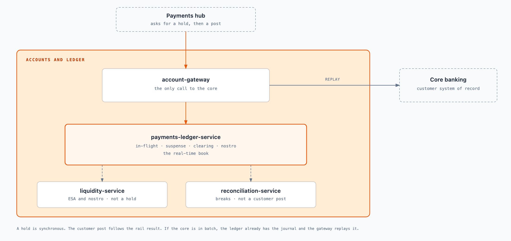

# Accounts and ledger

Customer money moves only when the [payments hub](./03-payments-hub.md) asks this layer to move it. The core banking system stays the system of record for the customer account. The payments ledger is the real-time book for money in flight, suspense, clearing and nostro. `account-gateway` is the only service that calls the core.

Back to the [reference architecture](./index.md). Section 7 is the split between the core and the ledger. This page is how to build the calls and the journals.

[Open the diagram](pathname:///modern-payment-platform/diagrams/component-accounts.html).

## Steps

The hub asks. This layer moves the money. The core stays the customer system of record.

**Outbound**

1. `PlaceHold` for `paymentId` and the instructed amount. If this call does not answer, the hub does not send. A retry of the same `paymentId` returns the same `holdId` and does not reserve the amount twice.
2. Write the reservation journal. There is no final customer debit yet.
3. On `SETTLED`, capture the hold, debit the customer, credit clearing for that rail, and post to the core.
4. On `REJECTED`, release the hold. Write no clearing entry.
5. If the core is inside a batch window, the ledger already has the journal. `account-gateway` replays the posting when the core is open. The replay is idempotent on `paymentId`.

**Inbound**

1. Credit the customer and debit clearing.
2. Replay onto the core the same way when the core was closed.

**After the payment**

Liquidity reads `rail.status` and `ledger.postings`. It does not sit on the accept path, and it does not decline a payment the hub has already sent. Reconciliation matches scheme, ESA and nostro statements to journals. A break is a case. It is not cleared by posting the customer again.

## How to design it

| Service | Owns | Must not |
|---------|------|----------|
| `account-gateway` | An audit of each core call: `paymentId`, the action, and the core's reference | Keep a balance. The core and the payments ledger do |
| `payments-ledger-service` | Double-entry journals for in-flight, suspense, clearing, nostro and fee income | Call a scheme, or post because a statement arrived |
| `liquidity-service` | The Exchange Settlement Account position, the split between FSS and RTGS, nostro forecasts, alerts | Reserve a customer's funds |
| `reconciliation-service` | Breaks between the ledger and the scheme, ESA and nostro statements | Post a customer payment to clear a break. A break is a case |

The greenfield choice is a real-time ledger in front of the core. The hold on an outbound payment is synchronous, so the money cannot be spent twice while the rail call is in flight. The customer posting follows the rail result. If the core is inside a batch window, the ledger already has the journal and `account-gateway` replays the posting when the core is open. That replay is idempotent on `paymentId`.

Design the books so every payment is a balanced set of journals:

| Moment | Customer side | Platform side |
|--------|---------------|---------------|
| Outbound hold | Reservation against the available balance. No final debit yet | `holdId` stored on the payment |
| Outbound `SETTLED` | Capture the hold. Debit the customer | Credit clearing for that rail |
| Outbound `REJECTED` | Release the hold | No clearing entry |
| Inbound credit | Credit the customer | Debit clearing |
| Fee | Debit the customer, or net it from the payment | Credit fee income |
| SWIFT FX | Debit the AUD account for the booked amount | Credit the USD nostro position |

Liquidity can ask routing to throttle a rail when the ESA or a nostro cannot fund the next window. That ask does not decline a payment the hub has already sent.

Build it in this order:

1. `PlaceHold` and `Post`, idempotent on `paymentId`.
2. The journal pairs above, with an immutable journal id.
3. The replay onto the core when the core was closed.
4. Statement ingestion for reconciliation, matched to journals and not to scheme messages.
5. The liquidity position from the same journals plus ESA and nostro statements.

## API

REST from the orchestrator to `account-gateway`. The core's own API is behind this one and is not called by anyone else.

### Place a hold

Request: `paymentId`, customer account, `instructedAmount`.

Response: `holdId`.

If this call does not answer, the hub does not send the payment. A retry of the same `paymentId` returns the same `holdId` and does not reserve the amount twice.

### Post

Request: `paymentId`, `holdId` when there is one, and `outcome`.

| `outcome` | Effect |
|-----------|--------|
| `SETTLED` | Capture the hold and write the outbound journals. Return the journal ids |
| `REJECTED` | Release the hold. Return no customer debit |
| `CREDIT` | Inbound. Credit the customer and debit clearing. There is no `holdId` |

A retry returns the original journal ids. Posting is repeated until it succeeds. It is not a reason to send the rail command again.

### Reverse

Request: `paymentId` and the journal ids to reverse. Used when a settled payment is later `RETURNED`. The response is the reversing journal ids. The original journals stay in the book.

Treasury reads liquidity over REST: the ESA position, the FSS and RTGS split, and each nostro. That API does not move customer funds.

## Events

| Topic | This layer |
|-------|------------|
| `ledger.postings` | Published after the journal commits. Keyed by account id. Payload: `paymentId`, journal ids, accounts, amount in minor units, and `outcome` |
| `rail.status` | Consumed by liquidity and by reconciliation. Not a trigger to post. The orchestrator posts, then the journal event follows |
| `payment.events` | Not consumed here. The posting command is the REST call, so the ledger does not race the workflow |

Reconciliation, liquidity and the data pipeline may read `ledger.postings`. They may not rewrite a journal.

## Files

The customer payment is not a file. These files close the books. Reconciliation matches them to journals and ages anything that does not match.

| File | Source | Matched to |
|------|--------|------------|
| Scheme settlement report | NPP, BECS, BPAY, HVCS | The clearing account for that rail and window |
| ESA statement | Reserve Bank | FSS and RTGS totals held by liquidity |
| `camt.053` nostro statement | SWIFT | The nostro journals for that currency and value date |
| Core posting acknowledgement | Core banking | The replay of a journal that waited for the core window |

A break record stores the statement line, the journal it was tested against, the age, and the case id. It does not store a second copy of the payment.
