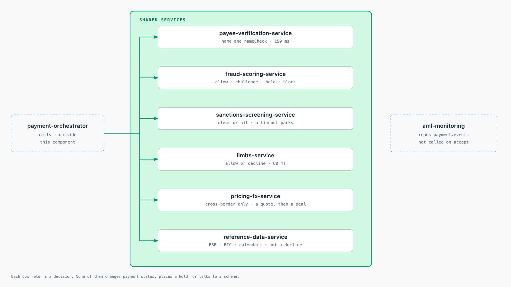

# Shared services

Shared services are the checks the [payments hub](./03-payments-hub.md) runs once, for every rail. A rule changes in one place. A new rail inherits it. Each service returns a decision. None of them changes payment status, places a hold, or talks to a scheme.

Back to the [reference architecture](./index.md). What happens when a check does not answer is in [section 4.2](./index.md#42-if-a-step-does-not-answer). This page is the request and the response.

[Open the diagram](pathname:///modern-payment-platform/diagrams/component-shared-services.html).

## Steps

The orchestrator calls these in order, on the accept path, for every rail. Each call returns a decision. None of them changes payment status, places a hold, or talks to a scheme. A check that does not answer is not retried inside the accept path. The outcome of each timeout is in [section 4.2](./index.md#42-if-a-step-does-not-answer).

1. Payee verification. If it does not answer, continue with `nameCheck` of `UNAVAILABLE`. Fraud policy decides. This call does not block a payment.
2. Fraud scoring. If it does not answer, use the configured fallback. A new payee above the threshold is held for a person and is not sent.
3. Sanctions screening. A hit, and a timeout, parks the payment. Do not send.
4. Limits. A decline, a timeout, or a missing limit declines the payment. A missing limit is not an open limit.
5. Pricing, and only for a cross-border payment. Book the quote before the hub sends. If pricing does not answer, do not send.

Reference data is read during these calls and during routing. A missing directory entry is a fact for the caller. It is not itself a decline.

AML monitoring is not one of these steps. It reads `payment.events` after the payment, because pattern detection needs history.

## How to design them

| Service | Returns | Owns | Must not |
|---------|---------|------|----------|
| `reference-data-service` | Whether a BSB, BIC or PayID domain is real, and whether the rail is open | BSB directory, NPP reachability, BIC directory, calendars, cut-offs, settlement instructions | Decide the payment |
| `payee-verification-service` | The payee name and `nameCheck` | A short-lived lookup cache | Block a payment. A `NO_MATCH` is a result the fraud policy and the customer confirmation use |
| `fraud-scoring-service` | `ALLOW`, `CHALLENGE`, `HOLD` or `BLOCK`, with reasons and the model version | Features, the model version, the decision | Post, or talk to a rail |
| `sanctions-screening-service` | `CLEAR` or `HIT`, with the list and the match strength | The result and the alert | Clear its own hit. A person does that through exceptions, and the orchestrator moves the payment |
| `limits-service` | `ALLOW` or `DECLINE`, and the limit that failed | Limits and usage counters | Move the funds it is counting |
| `pricing-fx-service` | A quote, then a booked deal | Price lists, the quote, the deal | Send the SWIFT message |

Fraud scoring and sanctions screening are bought, and wrapped so the product can be replaced.

Build each service so the decision is explainable: the response carries the reason codes and the version of the rule or the model. The hub stores that on the workflow history. The service stores the decision in its own database. Neither reads the other's tables.

Reference data is loaded on a schedule and on change, from the files below. Payments read a published version. A half-loaded directory is never the version in use.

Corporate approval, such as two approvers above an amount, is a limit rule. The client collects the approvals. `limits-service` checks that they are present and current. It does not host the approval screen.

## API

REST from the orchestrator. Amounts are minor units. The canonical payment is the one on the [hub](./03-payments-hub.md) page. Each call sends only the fields below. The protocol is subject to what the product offers and what meets the non-functional requirements, as noted in the [reference architecture](./index.md#45-how-the-services-talk).

### Payee verification

Request: the PayID or the BSB and account, and the name the customer typed.

Response: `name`, `nameCheck` (`MATCH`, `CLOSE_MATCH`, `NO_MATCH`, `UNAVAILABLE`), and the account to credit. The account number is not returned to the channel. A PayID the client already resolved should hit the cache.

### Fraud scoring

Request: the canonical payment, the channel, and the device id when the client sent one.

Response: `ALLOW`, `CHALLENGE`, `HOLD` or `BLOCK`, reason codes, and the model version. `HOLD` and `BLOCK` become `PENDING_EXCEPTION` or `REJECTED` in the hub, which is what the caller sees.

The same service is where scam friction lives: a warning or a cooling-off is a `CHALLENGE` or a `HOLD`, driven by the Scams Prevention Framework. The service does not show the warning. The client does, from the reason code.

### Sanctions screening

Request: debtor, creditor, and the remittance text.

Response: `CLEAR` or `HIT`, the list (`DFAT`, `UN`, `OFAC`, `EU`), and the match strength. Lists include the ones a USD or EUR payment must use, not only the Australian list. A `HIT`, and a timeout, park the payment. The service records the alert. `exceptions-service` is where a person works it.

### Limits

Request: customer, channel, amount, payee, and the rail routing proposes.

Response: `ALLOW` or `DECLINE`, and the limit that failed (customer, channel, payee, rail, or approval). Counters live in Redis. Reserving the counter and releasing it on `REJECTED` are idempotent on `paymentId`.

### Pricing and FX

Request: amount, sell currency, buy currency, and the customer segment.

Response: `quoteId`, rate, fee in minor units, charge option (`OUR`, `SHA` or `BEN`), and an expiry in seconds.

A second call, `BookQuote`, takes `quoteId` and `paymentId` and returns `dealId`. The hub does not send a cross-border payment without a `dealId`. An expired quote is declined and the client must ask again.

### Reference data

Request: a BSB, a BIC, a currency, or a rail and a timestamp.

Response: the directory facts and the version. Routing and the adapters ask this. It is not a payment decision. Cut-offs, RITS hours, BECS windows and SWIFT currency cut-offs are part of the response so they are not hard-coded in an adapter.

## Events

These services do not publish `payment.events` and do not consume it, apart from AML monitoring.

| Stream | Who | What it is for |
|--------|-----|----------------|
| `payment.events` | `aml-monitoring-service`, which is an asynchronous consumer, not an accept-path check | Structuring, layering and other patterns. An alert becomes a case. It does not stop a payment that has already been sent |
| Reference-data publication | `reference-data-service` | A version id consumers can pin to. A payment in flight keeps the version it started with |

Sanctions alerts are rows in the screening service, read by the exceptions API. They are not a second payment topic.

## Files

| File | Loaded by | Used for |
|------|-----------|----------|
| BSB directory | Reference data, from AusPayNet | Is this BSB real, and which institution serves it |
| NPP reachability | Reference data | Can this payee be reached on NPP, or must routing use BECS |
| BIC directory | Reference data, from SWIFT | Correspondent and beneficiary bank identity |
| Holiday and cut-off calendars | Reference data | Australian state holidays, RITS hours, BECS windows, SWIFT currency cut-offs |
| Standard settlement instructions | Reference data | Which nostro a currency uses |
| Sanctions lists | The screening engine, on the vendor's feed | DFAT, UN, OFAC, EU. The platform does not parse the raw list in the hub |
| Fee tables | Pricing | A versioned price list per rail, product and segment. A payment stores the version it was quoted on |

None of these files is a payment file. A bad load is rejected and the previous version stays in service.
