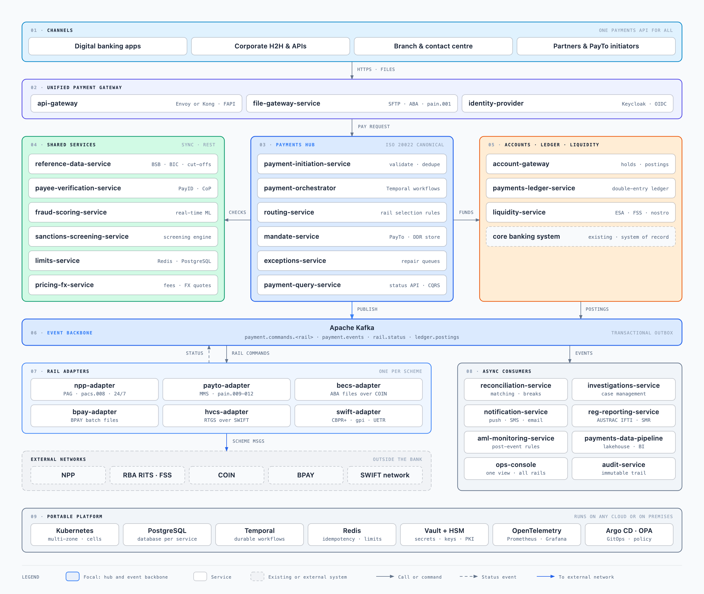
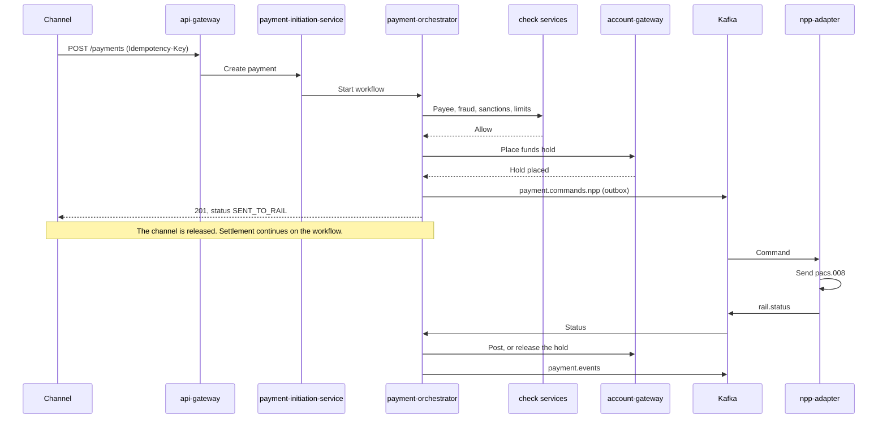
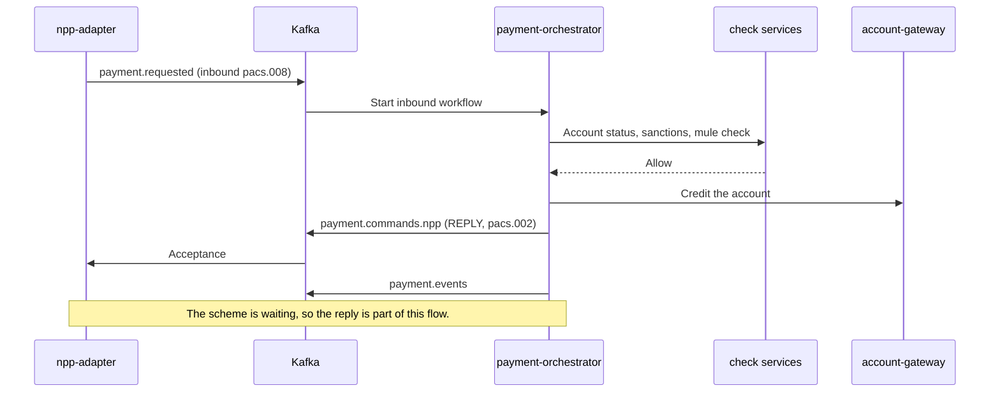

# Modern Payment Platform — Reference Architecture and Solution Design

**Scope:** The services that make up the platform, the rules that keep a payment consistent, and the portable technology they run on. The design is **cloud agnostic**. [Section 12](#12-cloud-mapping) maps each building block to AWS, Azure and Google Cloud for teams that prefer managed services. The public edge may be Akamai. See [request protection](#request-protection).

**Context:** A bank with direct access to the Australian rails (NPP, PayTo, BECS, BPAY, high-value RTGS) and SWIFT. The [executive brief](../00-exec-brief.md) is the short version, and the benefits are in the [business use case](../01-business-use-case.md). How to design each part, including the request and response, is on [clients](./01-clients.md), the [unified payment gateway](./02-unified-payment-gateway.md), the [payments hub](./03-payments-hub.md), [rails](./04-rails.md), [accounts and ledger](./05-accounts-and-ledger.md) and [shared services](./06-shared-services.md).

**Design rule:** Only `payment-orchestrator` advances a payment. While the caller is waiting it runs the checks and the funds hold, then makes one rail command durable. It posts only after the rail status is durable. Event consumers are not on that path.

---

## Assumptions

The design rests on the assumptions below. Confirm each one with the business and the owning teams. The last column shows what changes if an assumption is wrong.

| # | Area | Assumption | If it does not hold |
|---|------|------------|---------------------|
| 1 | Scheme participation | The bank is a direct participant in NPP (including PayTo), BECS, BPAY and high-value settlement through RITS, holds its own Exchange Settlement Account at the Reserve Bank, and is a SWIFT member | Rails reached through a sponsor bank connect to the sponsor instead of the scheme, and `liquidity-service` covers less of the settlement position |
| 2 | Scope | The platform is greenfield. This page describes the end state, delivered in the four phases in the business use case, starting with NPP. Card rails are out of scope | Extending an existing payments system means wrapping it behind adapters and migrating rail by rail, which changes the phasing. Taking cards later brings PCI DSS into scope |
| 3 | Core banking | The core stays the system of record for customer accounts and exposes an API for balances, holds, postings and reversals that `account-gateway` can call. It may still have batch windows. The payments ledger covers in-flight money during those windows. It does not keep a shadow of every account | Without a real-time hold API, the payments ledger must shadow every account and reconcile it with the core, which is a much larger build |
| 4 | Channels | Mobile, internet banking and corporate channels already exist and are out of scope. They call the unified payment gateway | Channels built in this programme need their own design. The Payments API contract stays the same |
| 5 | Bought components | The sanctions screening engine, fraud platform, NPP gateway and SWIFT interface are bought. Each check answers on the accept path, before the rail command. The outcome when a check does not answer is in [section 4](#42-if-a-step-does-not-answer) | A check that cannot answer is cached, run differently, or replaced. The timeout outcome stays as defined |
| 6 | Adjacent platforms | The customer communication platform delivers notifications, an analytics platform receives the event stream, and the enterprise identity provider handles customer and staff identity | A missing platform is built in this programme (for example Keycloak for identity), which adds scope and changes ownership |
| 7 | Volumes | Peak volumes are not yet sized. They are assumed to fit horizontally scaled services and Kafka partitions within each cell | Very high peaks, such as payroll moving to NPP after the BECS wind-down, may need more cells or partitions. Load test before each phase |
| 8 | Cells | Customers can be assigned to a home cell by customer ID. The settlement account position, liquidity, reconciliation and scheme sessions run across all cells | If customers cannot be partitioned, the platform runs as one active-active estate and a fault can affect every customer |
| 9 | Hosting and data residency | The bank can run Kubernetes, self-managed or managed, in at least two Australian regions with three availability zones each. Payment data and keys stay onshore | With one region, recovery from a regional failure falls back to the data centres and recovery time increases |
| 10 | Scheme connectivity | NPP gateways, the SWIFT interface and HSMs stay in two bank data centres or co-location sites, connected to the cloud regions by private links | Moving scheme connectivity into the cloud moves the adapters' network path and the HSMs with it, and needs scheme and SWIFT approval |
| 11 | Operations | The bank has, or will build, a platform team that can run Kafka, Temporal, PostgreSQL and Kubernetes 24/7, or it uses the managed services in [section 12](#12-cloud-mapping) | Without these skills, use managed services for the stateful building blocks and plan for training |
| 12 | Rail roadmap | NPP, high-value settlement and SWIFT carry ISO 20022. BECS stays until its planned wind-down around 2030 and is reached only through its adapter. BPAY stays file-based | A different BECS date changes when that adapter is built or removed. The hub stays as it is |
| 13 | Regulation | The obligations that apply are APRA CPS 230 and CPS 234, AUSTRAC reporting and AML/CTF record keeping (at least 7 years), the SWIFT Customer Security Programme, the Privacy Act and the Scams Prevention Framework | New or changed obligations become new checks, reports or retention rules. The service boundaries stay the same |

---

## 1. Architecture principles

1. **Rail-agnostic hub.** The hub works with the canonical ISO 20022 model. Scheme differences live in a rail adapter.
2. **Synchronous only while a caller is waiting.** Checks and the funds hold finish before the caller is released. The rail outcome and the posting run on the workflow after that. Inbound is the exception: the scheme is the caller, so the accept or reject finishes before the adapter replies.
3. **Exactly-once effect.** Every request carries an idempotency key. State and the event that describes it are written together, through a transactional outbox.
4. **One payment state machine.** Each payment is a durable workflow. One service advances it. Timeouts and compensating steps are part of the workflow, not of each adapter.
5. **Each service owns its data.** No shared database. Services share data through APIs and events.
6. **Always on.** The platform runs 24/7/365 across availability zones and regions, and releases have no maintenance window.
7. **Secure by default.** Zero-trust networking, mutual TLS between services, keys in hardware security modules, least-privilege access.
8. **Portable.** Kubernetes, Kafka, PostgreSQL and the other open standards in [section 11](#11-technology-stack), so the payment path is not tied to one cloud.

---

## 2. Service architecture

This is the build view. Read it from the channels down to the Kafka band, then out to the adapters and across to the consumers.

Everything above the event backbone is on the accept path: REST, while the caller is waiting. See [section 4](#4-consistency-time-and-state). Publishing the rail command is the handoff. Adapters and consumers take work from the log. They do not call back into the hub to finish the payment.

Fraud scoring and sanctions screening are shared services on the accept path. AML monitoring is an asynchronous consumer. It runs after the event, because pattern detection needs history.

The regulation context sits on the [layered diagram](pathname:///modern-payment-platform/diagrams/layered-architecture.html). This page is the service view. The design pages own the fields on each call.

[Open the service diagram](pathname:///modern-payment-platform/diagrams/solution-design-services.html).

---

## 3. Service catalogue

Six boundaries hold across the catalogue:

1. The gateway authenticates and deduplicates. It does not apply a business rule, so a channel cannot skip a check by calling past it.
2. Only the orchestrator sends a payment to a rail, and only the orchestrator posts.
3. A shared service returns a decision. It does not change payment state, so a fraud or sanctions product can be replaced without rewriting the hub.
4. An adapter translates to the scheme. It does not choose the rail or override a block.
5. Core banking is reached only through `account-gateway`.
6. Reconciliation, notifications, reporting, AML monitoring and analytics read events. They are not on the accept path.

What each service must refuse, and the fields on each call, are on the design page for that part.

### 3.1 Unified payment gateway

Mobile, internet banking, business APIs and bulk files enter here. The gateway is stateless. It does not choose the rail. The caller contract is on the [clients](./01-clients.md) page. How the door is built is on the [unified payment gateway](./02-unified-payment-gateway.md) page.

| Service | Responsibility | Owns data | Interfaces |
|---------|---------------|-----------|------------|
| `api-gateway` | Authentication, rate limits, idempotency key checks, routing to the hub, API versioning | None (stateless) | REST from channels and to the hub |
| `file-gateway-service` | Receives bulk files (ABA, ISO 20022 `pain.001`), validates the file and splits it into payments | File records and acknowledgements | SFTP and REST in, `payment.requested` out |
| `identity-provider` | Customer and partner identity, OAuth 2.0 and OpenID Connect, step-up authentication, FAPI profiles | Identities, clients, consents | OIDC |

### 3.2 Payments hub

| Service | Responsibility | Owns data | Interfaces |
|---------|---------------|-----------|------------|
| `payment-initiation-service` | Validates and enriches the request, detects duplicates, assigns the end-to-end ID and the UETR, starts the workflow | Payment requests | REST in. Starts the orchestrator workflow |
| `payment-orchestrator` | Runs the state machine: checks, funds hold, routing, rail command, settlement, posting, compensation | Workflow state | Calls check and account services. Publishes `payment.commands.<rail>` and `payment.events` |
| `routing-service` | Chooses the rail from reachability, amount, currency, urgency, cost and rail health | Routing rules, rail health | REST |
| `mandate-service` | PayTo mandate lifecycle and legacy direct debit authorities. Checks a collection against the mandate terms | Mandates | REST. Consumes and publishes `mandate.events` |
| `exceptions-service` | Repair queues for failed validation, screening hits and scheme rejects, with four-eyes approval | Exception cases | REST for the operations console. Consumes `payment.events` |
| `payment-query-service` | Payment status and history for channels and operations | Read model built from events | REST. Consumes `payment.events` |

The query service is a copy. The workflow is the source of truth for status. The canonical payment and the workflow design are on the [payments hub](./03-payments-hub.md) page.

### 3.3 Shared services

Called by the orchestrator on the accept path, for every rail. What happens when a check does not answer is in [section 4](#42-if-a-step-does-not-answer). The request and response for each check is on the [shared services](./06-shared-services.md) page.

| Service | Responsibility | Owns data | Interfaces |
|---------|---------------|-----------|------------|
| `reference-data-service` | BSB directory, NPP reachability, BIC directory, calendars, cut-offs, settlement instructions | Reference data sets | REST. Daily and on-change loads |
| `payee-verification-service` | PayID resolution and Confirmation of Payee | Lookup cache | REST. Calls NPP addressing and CoP services |
| `fraud-scoring-service` | Real-time fraud and scam score, with reasons. Returns allow, challenge, hold or block | Features, model versions, decisions | REST. Wraps a vendor or in-house model |
| `sanctions-screening-service` | Screens parties and message content against DFAT, UN, OFAC and EU lists | Screening results, alerts | REST. Wraps a screening engine |
| `limits-service` | Customer, channel, payee and rail limits. Corporate approval rules | Limits and usage counters | REST. Redis for counters |
| `pricing-fx-service` | Fees, FX quotes with a short validity, FX deal booking | Price lists, quotes, deals | REST. On the accept path for a cross-border payment |

### 3.4 Accounts, ledger and liquidity

| Service | Responsibility | Owns data | Interfaces |
|---------|---------------|-----------|------------|
| `account-gateway` | The only adapter to the core: balance, hold, posting, reversal | An audit of each core call. No balances | REST. Core banking API |
| `payments-ledger-service` | Double-entry book for in-flight payments, suspense, clearing and nostro | Ledger journals and balances | REST. Publishes `ledger.postings` |
| `liquidity-service` | Settlement account position at the Reserve Bank, the split between real-time and high-value settlement, nostro funding, alerts | Positions and forecasts | Consumes `rail.status` and `ledger.postings`. REST for treasury |

The core remains the system of record for the customer account. See [section 7](#7-data-architecture) for how the ledger and the core share that job. The calls and the journals are on the [accounts and ledger](./05-accounts-and-ledger.md) page.

### 3.5 Rail adapters

| Service | Responsibility | Connects to |
|---------|---------------|-------------|
| `npp-adapter` | ISO 20022 (`pacs.008`, `pacs.002`, `pacs.004`, `camt.056`), 24/7 inbound and outbound, certificates | NPP through the Payments Access Gateway |
| `payto-adapter` | Mandate messages (`pain.009` to `pain.012`) and mandate-based payments | NPP Mandate Management Service |
| `becs-adapter` | ABA files per settlement window, returns and dishonours | BECS over COIN |
| `bpay-adapter` | Bill payment batch files | BPAY |
| `hvcs-adapter` | High-value ISO 20022 payments and RTGS settlement status | RITS through SWIFT |
| `swift-adapter` | CBPR+ `pacs.008` and `pacs.009`, gpi tracking, recalls, statements | SWIFT network through a SWIFT interface |

Every adapter consumes `payment.commands.<rail>`, publishes `rail.status`, and turns an inbound payment into a `payment.requested` event. A duplicate command with the same `paymentId` is ignored. Scheme behaviour, message shapes and the variant flows are on the [rails](./04-rails.md) page.

### 3.6 Asynchronous consumers

| Service | Responsibility | Consumes |
|---------|---------------|----------|
| `reconciliation-service` | Matches scheme settlement reports, settlement account statements and nostro statements to the ledger. Manages breaks | `ledger.postings`, `rail.status`, statement files |
| `investigations-service` | Customer enquiries, recalls, returns, mistaken payments, scam claims | `payment.events` |
| `notification-service` | Customer and business notifications. Hands off to the customer communication platform | `payment.events` |
| `reg-reporting-service` | AUSTRAC IFTI and other reports, scheme and statistical reporting | `payment.events` |
| `aml-monitoring-service` | Money-laundering patterns and alerts after the event | `payment.events` |
| `payments-data-pipeline` | Streams events into the analytics platform | All topics |
| `ops-console` | One operations view: search, actions, rail health, liquidity | Query and exceptions APIs |
| `audit-service` | Tamper-evident trail of actions and state changes | All topics |

A failed notification or a late report does not change the payment. The consumer retries from the log, or raises a case.

---

## 4. Consistency, time and state

### 4.1 Where a caller waits

| Caller | Waits until | Does not wait for |
|--------|-------------|-------------------|
| A channel, on an outbound payment | Checks, funds hold, and a durable rail command. The response is `201` with status `SENT_TO_RAIL`, or a decline | Scheme acceptance, settlement, posting, notification |
| The scheme, on an inbound payment | Account checks, sanctions, the credit or the reject, and the `pacs.002` reply | Customer notification and reconciliation |
| Treasury, operations, reporting | Nothing on the payment path | They read events and query APIs |

Channels that need to show "paid" subscribe to status or poll `payment-query-service`. The HTTP call is not held open for the other bank.

### 4.2 If a step does not answer

The steps run in this order so a decline happens before a hold where the check does not need the hold, and the hold happens before the command.

| Step | If it does not answer |
|------|------------------------|
| Gateway, authentication, idempotency | Reject the call. The same key can be retried |
| Validation and enrichment | Reject. No hold and no rail command |
| Payee verification, cached where a PayID was already confirmed | Continue. The name check is `UNAVAILABLE` and the fraud policy decides |
| Fraud and scam scoring | Apply the configured fallback. A new payee above the threshold is held for a person, and is not sent |
| Sanctions screening | Do not send. Park the payment for a person |
| Limits and funds hold | Do not send. No answer from limits is a decline |
| Routing and the durable rail command | Do not return success. The outbox retries the publish |

A cross-border payment adds a booked FX quote before the command. If pricing does not answer, the payment is not sent.

A timeout is a decision. The orchestrator does not retry a check inside the accept path. Posting is the opposite: it is retried until it succeeds, and it is idempotent on `paymentId`, so a failed post never causes a second send to the rail.

### 4.3 Idempotency

| Boundary | Key | A duplicate |
|----------|-----|-------------|
| Channel request | Caller idempotency key | Same body returns the original payment. A different body is rejected |
| Workflow, ledger and events | `paymentId` | A retried step does not hold, post or emit a second effect |
| Rail command | `paymentId` on `payment.commands.<rail>` | The adapter ignores a second `SEND` |
| Inbound scheme message | Scheme transaction identity, mapped to `paymentId` | A repeated `pacs.008` is acknowledged and is not credited twice |

The key is stored with the body hash at the gateway for 24 hours. The field-level API is on the [unified payment gateway](./02-unified-payment-gateway.md) page.

### 4.4 Payment states

The orchestrator is the only writer. Notification is not a state. A consumer may lag behind `POSTED` without the payment being incomplete.

Outbound:

`RECEIVED → VALIDATED → SCREENED → FUNDS_RESERVED → ROUTED → SENT_TO_RAIL → ACCEPTED → SETTLED → POSTED`

Inbound, where the payment is a credit rather than a hold:

`RECEIVED → SCREENED → POSTED`, then the `pacs.002` reply. There is no funds hold.

| State | Meaning |
|-------|---------|
| `RECEIVED` | The workflow has started |
| `VALIDATED` | The request is well formed, enriched and not a duplicate |
| `SCREENED` | Payee, fraud, sanctions and limits have allowed it. Inbound uses account status, sanctions and the mule check |
| `FUNDS_RESERVED` | The hold is in place. Outbound only |
| `ROUTED` | A rail has been chosen |
| `SENT_TO_RAIL` | The command is durable. This is the outbound accept response |
| `ACCEPTED` | The scheme has accepted the payment and settlement is still outstanding, where the scheme separates the two |
| `SETTLED` | The scheme has settled. The customer posting is not done yet |
| `POSTED` | The ledger post has been applied and the hold has been captured or released. Terminal for the money movement |
| `REJECTED` | A check, the hold, or the scheme declined it. Any hold has been released. Terminal |
| `PENDING_EXCEPTION` | A person has to decide. Release goes back through the orchestrator, with four-eyes approval |
| `RETURNED` | A settled payment was later returned or recalled |

A reject before `SENT_TO_RAIL` leaves no scheme message. A scheme reject after send releases the hold and does not post the customer credit. A post that fails after `SETTLED` stays at `SETTLED` and is retried. The rail command is not sent again.

Rail timeouts differ. NPP must accept or reject inside the scheme limit, measured in seconds. BECS and BPAY move on settlement windows and cut-offs. Those timers sit on the workflow.

### 4.5 How the services talk

| Mechanism | Used for | Choice |
|-----------|----------|--------|
| Request and response | Accept-path checks, the funds hold, status queries | REST |
| Durable workflow | The state machine, timers and compensation | Temporal |
| Command | Hub to one rail adapter | Kafka topic per rail, keyed by `paymentId` |
| Domain event | Facts other services may react to | Kafka, schema registry, Avro or Protobuf |
| Transactional outbox | The state write and the publish | Outbox table in the service database, relayed to Kafka |

:::note
The protocol for a call to an internal service, a bought product, or a rail is subject to what that product offers and what meets the non-functional requirements. REST is the working choice between the platform's own services. A product that speaks something else is wrapped, so the hub keeps one contract. Scheme messages stay in the adapter.
:::

---

## 5. Canonical flows

These two flows are the normative patterns. PayTo, BECS payroll, SWIFT with FX, and high-value RTGS are the same patterns with a different adapter. Those variants are on the [rails](./04-rails.md) page.

### 5.1 Outbound instant payment

A decline from a check or from the hold returns to the channel before any rail command. The payment is `REJECTED` or `PENDING_EXCEPTION`.

### 5.2 Inbound instant payment

If a check fails or does not answer, the workflow rejects inside the scheme time limit, sends no credit, and opens an exception case where a person is required.

---

## 6. Topics

| Topic | Producer | Main consumers | Key |
|-------|----------|----------------|-----|
| `payment.requested` | Initiation, file gateway, inbound rail adapters | Orchestrator | Payment ID |
| `payment.commands.<rail>` | Orchestrator | The matching rail adapter | Payment ID |
| `rail.status` | Rail adapters | Orchestrator, liquidity, reconciliation | Payment ID |
| `payment.events` | Orchestrator, after the new state is durable | Query, notifications, reporting, AML, investigations, data pipeline, audit | Payment ID |
| `ledger.postings` | Ledger service, after the journal commits | Reconciliation, liquidity, data pipeline | Account ID |
| `mandate.events` | Mandate service, PayTo adapter | Orchestrator, notifications | Mandate ID |

The key is the partition key, so one payment stays in order. Schemas are versioned and change in backward-compatible ways. Retention on a topic is for replay. The books and records are the ledger, the workflow history and the archive in [section 7](#7-data-architecture).

---

## 7. Data architecture

| Data | Store | Notes |
|------|-------|-------|
| Service data | PostgreSQL, one database per service | Payment requests, mandates, journals, cases |
| Workflow state | Temporal, backed by PostgreSQL or Cassandra | The history of each payment workflow |
| Counters and caches | Redis or Valkey | Idempotency keys, limit usage, payee lookup cache |
| Events | Kafka | Replay window. Not the system of record |
| Read models | PostgreSQL or a search engine | Status and history. Built from `payment.events` |
| Analytics | Lakehouse, Apache Iceberg, queried by Trino or Spark | ISO 20022 data for insight and model training |
| Archive | Object storage with a retention lock | At least 7 years for AML/CTF record keeping |

The core remains the system of record for the customer account. The payments ledger is the real-time book for money in flight, suspense, clearing and nostro. A customer hold on an outbound payment is synchronous, through `account-gateway`. If the core cannot take the final posting during a batch window, the ledger already has the journal and the gateway replays it when the core is open. That replay is idempotent on `paymentId`.

Adapters translate between this model and scheme formats such as ABA. The hub does not store scheme messages as its own model. It stores the canonical payment and the scheme references the adapter returns.

---

## 8. Deployment and failure domains

| Concern | Design |
|---------|--------|
| Compute | Kubernetes in at least two Australian regions, three availability zones in each |
| Topology | Active-active. Customers are partitioned into cells by customer ID |
| Event log | Replicated inside the region. An asynchronous copy in the other region |
| Databases | Synchronous replica inside the region. Asynchronous replica across regions |
| Workflow | Replicated with the workflow store, so a cell can resume a payment after a node loss |
| Scheme connectivity | NPP gateways, the SWIFT interface and HSMs in two data centres or co-location sites, on private links to the regions |
| Releases | GitOps. Canary and blue-green. No maintenance window |
| Recovery | Recovery point of about zero for payment state. Recovery time measured in minutes, and tested under CPS 230 |
| Rail degradation | A down rail queues or reroutes a non-urgent payment where the customer terms allow it. An instant payment is not silently turned into a batch payment |

A fault should stop as little as possible:

| Failure | What stops | What continues |
|---------|------------|----------------|
| One availability zone | Nothing the customer can see, once the zone is drained | The other zones in the region |
| One cell | New payments for customers whose home is that cell | Every other cell. Commands already on the log still settle |
| One region | The cells in that region | The other region, using the surviving link to the scheme data centres |
| One scheme data centre | New sends that depended on that path | The second data centre. In-flight payments resume from the workflow |

Liquidity, reconciliation and the scheme sessions are bank-wide. They are not deployed once per cell, because there is one Exchange Settlement Account and one scheme membership.

---

## 9. Security architecture

The products that implement these controls are in [section 11](#11-technology-stack).

| Control | Design |
|---------|--------|
| Identity | OAuth 2.0, OpenID Connect and FAPI 2.0 for partner and open banking APIs. Customer and staff identity come from the enterprise identity provider |
| Service-to-service | Mutual TLS and identity-based policy on the service mesh. A service that is not on the mesh cannot call the hub |
| Authorisation | Policy evaluated outside the service code. Four-eyes approval for a repair, a limit change and a manual release |
| Secrets and keys | Application secrets in a secrets manager. Signing keys and scheme certificates in HSMs |
| Data protection | Encryption in transit and at rest. Personal data tokenised or masked in logs and in the analytics store |
| Supply chain | Signed container images, a software bill of materials, and admission control on the cluster |
| Compliance | APRA CPS 234, the SWIFT Customer Security Programme, and the Privacy Act. Card data is out of scope |
| Request protection | A WAF and DDoS protection on the public edge, in front of the Payments API. The edge is the cloud service or Akamai. See below |

### Request protection

A public request is inspected before it reaches `api-gateway` or `file-gateway-service`. This layer is the cloud edge, or Akamai in front of the cloud. The payment services do not implement their own WAF.

| Threat | What stops it | Where |
|--------|----------------|-------|
| A flood of packets or connections | DDoS protection | Every public address, including the file-transfer address |
| A malformed or abusive HTTP call | Web application firewall | The HTTPS edge, in front of the Payments API |
| One client above its call rate | A rate rule at the edge, then the gateway's own limit | The edge drops it before the call is accepted onto the payment path |
| A caller who is not allowed to pay | Token, consent, and the idempotency check | The gateway, after the WAF has passed the request |
| Fraud, sanctions, or no balance | The accept path | The hub, after the request is inside the platform |

The WAF runs the OWASP core rule set, a limit on body size, a block on methods the API does not use, and a rate rule per source and per token. It does not score fraud, screen sanctions, or check a balance.

File transfer is not HTTP, so the WAF does not see an SFTP drop. Those addresses are still covered by DDoS protection, and the file gateway scans the bytes. NPP and SWIFT sessions arrive on the private links in [section 12](#12-cloud-mapping) and do not pass through this public edge.

| Role | AWS | Azure | Google Cloud | Akamai |
|------|-----|-------|--------------|--------|
| DDoS protection | AWS Shield Standard on every public resource. **AWS Shield Advanced** on the Payments API and the file edge | Azure DDoS Infrastructure Protection on the network. **Azure DDoS Network Protection** on the public endpoints | **Cloud Armor** always-on network DDoS protection. Cloud Armor Enterprise where adaptive protection is required | Edge DDoS on Ion for public HTTP. **Akamai Prolexic** on the Payments API and the file edge |
| Web application firewall | **AWS WAF** on CloudFront, with the managed rule groups | **Azure Web Application Firewall** on Azure Front Door | **Cloud Armor** security policy on the external load balancer | **Akamai App & API Protector** on Ion, with the managed rule sets |
| Public HTTPS edge | Amazon CloudFront | Azure Front Door | Global external Application Load Balancer | Akamai Ion |

Shield Advanced, Azure DDoS Network Protection, Cloud Armor Enterprise and Akamai Prolexic include a response team and protection of the payment edge during an attack. On the cloud, the baseline tier stays on for every other public address. Akamai sits in front of the origin. The origin is the cloud load balancer. NPP and SWIFT sessions stay on the private links and do not pass through Akamai.

---

## 10. Observability

- Traces, metrics and logs leave each service through OpenTelemetry.
- Every trace carries the payment ID, the end-to-end ID and the UETR, so one payment can be followed across the hub, the ledger and the rail.
- Business SLOs are per rail: the time from submission to a durable rail command, and the success rate of payments that were sent. Alerts fire on that time and on the success rate.
- Operators have one view of rail health, consumer lag, the exception backlog, the liquidity position and open reconciliation breaks.

---

## 11. Technology stack

Each row is the chosen product. Earlier sections describe the control. They do not name a second product.

| Building block | Choice | Constraint |
|----------------|--------|------------|
| Container platform | Kubernetes | A conformant distribution, in Australia |
| API gateway | An Envoy-based gateway, or Kong | Idempotency and FAPI extensions |
| Identity | The enterprise identity provider, or Keycloak where the bank has none | OIDC. Payment services do not store passwords |
| Workflow engine | Temporal | Self-hosted or Temporal Cloud |
| Event streaming | Apache Kafka, for example Strimzi | A schema registry beside it |
| Database | PostgreSQL | One database per service |
| Cache | Redis or Valkey | Idempotency keys and limit counters |
| Service mesh | Istio or Linkerd | Mutual TLS |
| Secrets | HashiCorp Vault or OpenBao | HSMs (PKCS#11) for signing keys and scheme certificates |
| Policy | Open Policy Agent, with Gatekeeper on the cluster | Application policy and admission policy |
| Observability | OpenTelemetry, Prometheus, Grafana, Tempo, Loki | Any backend that accepts OpenTelemetry |
| Delivery | Argo CD, images signed with Sigstore | GitOps |
| Analytics | Apache Iceberg, queried by Trino or Spark | Open table format |
| Object storage | An S3-compatible store | Archive and the data lake |
| Bought components | Sanctions screening, the fraud platform, the NPP gateway, the SWIFT interface | Behind the service interface, so the product can be replaced |
| Edge protection | The cloud WAF and DDoS service, or Akamai, in [section 9](#request-protection) and [section 12](#12-cloud-mapping) | In front of the public Payments API and the file edge. Scheme links stay on the private path |

---

## 12. Cloud mapping

Managed equivalents for a team that does not want to operate the stack above. The payment services stay the same.

| Building block | AWS | Azure | Google Cloud |
|----------------|-----|-------|--------------|
| Kubernetes | Amazon EKS | Azure Kubernetes Service | Google Kubernetes Engine |
| Event streaming | Amazon MSK | Event Hubs (Kafka endpoint) or Confluent Cloud | Managed Service for Apache Kafka |
| PostgreSQL | Amazon Aurora PostgreSQL or RDS | Azure Database for PostgreSQL | Cloud SQL or AlloyDB |
| Workflow engine | Temporal Cloud | Temporal Cloud | Temporal Cloud |
| Cache | ElastiCache | Azure Managed Redis | Memorystore |
| API gateway | Amazon API Gateway | Azure API Management | Apigee |
| Identity | Amazon Cognito | Microsoft Entra External ID | Identity Platform |
| Secrets | AWS Secrets Manager and AWS KMS | Azure Key Vault | Secret Manager and Cloud KMS |
| HSM | AWS CloudHSM | Azure Managed HSM | Cloud HSM |
| Service mesh | Istio on EKS | Istio-based service mesh add-on for AKS | Cloud Service Mesh |
| Observability | CloudWatch, Managed Prometheus, Managed Grafana | Azure Monitor, Managed Prometheus, Managed Grafana | Cloud Monitoring, Managed Service for Prometheus |
| Object storage | Amazon S3 | Azure Blob Storage | Cloud Storage |
| Analytics | S3 with Iceberg, Athena or EMR | ADLS with Fabric or Databricks | BigQuery with BigLake |
| Private links to the scheme data centres | AWS Direct Connect | Azure ExpressRoute | Cloud Interconnect |
| DDoS protection | AWS Shield Advanced | Azure DDoS Network Protection | Cloud Armor |
| Web application firewall | AWS WAF on CloudFront | Azure Web Application Firewall on Front Door | Cloud Armor security policy |
| Public HTTPS edge | Amazon CloudFront | Azure Front Door | Global external Application Load Balancer |

Akamai can be that public edge in front of any cloud in this table. Ion is the HTTPS edge, App & API Protector is the web application firewall, and Prolexic is the DDoS protection for the Payments API and the file edge. The origin stays the cloud load balancer.

Use the managed service through its open interface: the Kafka protocol, the PostgreSQL wire protocol, the S3 API and OpenTelemetry. Keep infrastructure as code per cloud. A proprietary feature on the payment path is an ADR, not a default. A cloud workflow engine such as Step Functions, Durable Functions or Google Workflows is a different programming model from Temporal, so it is a separate decision and not a drop-in mapping.

---

## 13. Architecture decisions

| # | Decision | Alternative rejected | Reason |
|---|----------|----------------------|--------|
| 1 | One hub, and one adapter per rail. BECS is an adapter, including as a fallback where the payee is not reachable on NPP | A separate system per rail | Screening, limits and payment data would be built and operated once per rail. Retiring BECS would then mean retiring a system, not an adapter |
| 2 | ISO 20022 as the model inside the hub and on events | A private payment model | NPP, HVCS and SWIFT already use it. A private model would add a translation that none of those rails need |
| 3 | A workflow engine owns the payment lifecycle | State tables and schedulers written in the hub | Timers, retries and compensation would be rebuilt for every rail, and the audit trail would be whatever each service logged |
| 4 | Commands and events on a log, written in the same transaction as the state | A synchronous call from the channel through to the scheme | The channel would wait on the other bank, and a crash between the database commit and the send could lose or repeat the payment |
| 5 | The channel is released at `SENT_TO_RAIL` | Hold the HTTP call until scheme settlement | Scheme and payee-bank time would sit inside the channel's own timeout. The customer still sees the outcome through status and notification, usually within seconds on NPP |
| 6 | A real-time payments ledger in front of the core, for money in flight | Post the customer account only in the core, at the moment of settlement | A core batch window would stop a 24/7 payment. The ledger does not take over as the system of record for every account |
| 7 | Fraud and sanctions on the accept path. AML monitoring after the event | Run every financial-crime check inline, or none of them | A sanctions miss cannot be pulled back once the payment is sent. AML patterns need history and run after the event |
| 8 | Reroute a non-urgent payment only where the customer terms allow it | Always fail over to another rail, or never reroute | An Osko payment that quietly becomes a next-day file breaks the promise the customer was given. Payroll should still be able to move when NPP is down |
| 9 | Kubernetes and open protocols | A cloud-specific serverless stack for the payment path | The path could not move cloud, or on premises, without a rewrite. Serverless remains available off the payment path |
| 10 | Buy screening, the fraud platform, the NPP gateway and the SWIFT interface. Build the hub, routing and the channel contract | Buy one payments-hub suite, or build the scheme gateways | A suite tends to become another silo, with its own rules. Scheme connectivity is a certified commodity. Orchestration and routing are where the bank's payment policy lives |
| 11 | Cells partitioned by customer ID | One active-active estate for every customer | A bad release or a poisoned partition then takes a slice of customers, not the franchise. The ESA position, reconciliation and scheme sessions stay outside the cells, because they are single positions for the bank |
| 12 | Public HTTP enters through the cloud WAF and DDoS service, or through Akamai in front of the cloud | A WAF running only inside the cluster | The cluster would absorb the flood, and the accept path would take traffic that should have been dropped at the edge |

Record each as an ADR once it is agreed. The design pages follow this list. They do not keep a second one.
